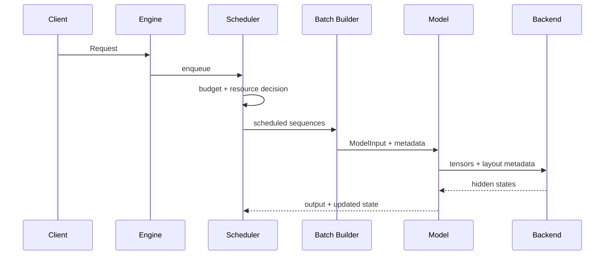

# xLLM Code Wiki 高质量写作基准

> 适用范围：`code_wiki/` 下所有原理、源码、模型、服务、调度与推理加速专题。
>
> 目标：让不同时间、不同作者写出的文章保持同一套研究深度、证据标准和表达方式，最终形成一套可以帮助读者真正读懂 xLLM 的源码知识库。

---

## 1. 这份标准解决什么问题

xLLM 的知识不能靠罗列类名、翻译注释或摘抄配置项来建立。一个功能通常跨越：

```text
用户接口
  -> 配置解析
  -> 引擎初始化
  -> Scheduler 决策
  -> Batch / ModelInput 构造
  -> 模型 forward
  -> Attention / MoE / 通信后端
  -> KV、显存和设备状态更新
  -> 输出回传
```

如果文章只讲其中一层，读者会“认识代码”，但仍然不知道功能为何成立、何时生效、代价是什么、当前仓库是否真的支持。

因此，`code_wiki` 的文章必须同时回答四类问题：

1. **原理是什么**：功能试图解决哪个瓶颈，数学或系统机制是什么。
2. **源码怎么走**：从入口到后端的完整调用链、状态流和数据流是什么。
3. **模型怎么配合**：模型 forward、Attention、KV 布局、并行方式和特殊架构如何承接该功能。
4. **工程上值不值得**：通信、overlap、内存、精度、SLO、限制和组合关系是什么。

文章的最终产物不是“源码导览”，而是一套可以用于以下工作的心智模型：

- 阅读和修改 xLLM 源码；
- 判断一个配置是否真正生效；
- 为新模型接入某项能力；
- 分析性能瓶颈和容量上限；
- 设计测试，区分“能跑”与“正确且更快”；
- 对当前仓库能力作出可复核的结论。

---

## 2. 总体写作原则

### 2.1 先解释机制，再让源码证明机制

不要从文件列表开始。先用浅显但专业的语言回答：

- 没有这个功能时，系统会遇到什么问题？
- 这个功能改变了哪个资源的分配方式或哪段执行顺序？
- 它减少的是计算、访存、通信、等待还是碎片？
- 它没有解决什么问题？

随后再进入源码，说明每一个原理结论由哪个配置、数据结构、分支和算子实现。

正确顺序通常是：

```text
问题 -> 直觉 -> 形式化描述 -> 系统约束 -> 源码实现 -> 运行时例子 -> 代价与边界
```

### 2.1.1 不默认读者掌握相邻领域

xLLM 文章会跨越网络、操作系统、分布式通信、模型结构、设备 runtime 和编译/Graph。读者可能熟悉其中一层，却完全不了解另一层。文章不得因为主题是“推理框架”就默认读者已经理解 HTTP、RPC、collective、stream/event、页表、因果 mask 或量化 scale。

对一个相邻领域的概念第一次出现时，应依次给出：

1. 一句不依赖该领域背景的白话定义；
2. 它解决的问题；
3. 它与相邻概念的区别；
4. 一个最小数字例子或时序；
5. 映射回 xLLM 的真实类、字段或调用点。

例如第一次解释 SSE 时，不应只写“使用 ProgressiveAttachment 返回 SSE”，而应先说明它是在同一个 HTTP 响应中按 `data: ...\n\n` 连续发送事件，再指出 xLLM 的 `StreamCall` 怎样设置 `text/event-stream` 和写入 `[DONE]`。

类比只能降低理解门槛，不能替代定义。每个类比后必须明确写出真实对象映射，并说明类比在哪些地方不成立。

缩写第一次出现必须展开并解释其职责，例如：

```text
RPC = Remote Procedure Call：把跨进程/跨机器通信包装成远程方法调用
SSE = Server-Sent Events：服务端在一个 HTTP 响应中持续发送文本事件
TTFT = Time To First Token：从请求到达到首 token 返回的时间
```

“读者能根据上下文猜出来”不算解释完成。

### 2.2 必须讲完整链路，不能只讲核心类

“完整链路”至少包含：

```text
外部配置如何进入系统
  -> 初始化时创建了什么对象
  -> 请求到达后在哪一层第一次发生作用
  -> 调度器如何决策
  -> 输入元数据如何表达该决策
  -> 模型和算子如何消费这些元数据
  -> 结果如何改变下一轮调度状态
  -> 请求如何完成、释放或迁移资源
```

若某一环在当前实现中不存在，也要明确写“链路在这里中断”，而不是用推测补齐。

### 2.3 以当前源码为第一证据

证据优先级固定为：

```text
当前源码和构建条件
  > 当前测试及可复现实验
  > 当前仓库文档
  > 代码注释
  > 设计文档或历史提交
  > 通用理论和外部框架经验
```

文档、注释和接口名可能描述的是设计目标，不等于当前实现。出现冲突时必须以可执行源码为准，并解释冲突。

### 2.4 区分事实、推论和待验证项

建议使用以下措辞：

| 类型 | 推荐表达 | 不应表达成 |
|---|---|---|
| 源码事实 | “当前代码在……分支调用……” | “系统一定……” |
| 静态推论 | “由该条件可推得……” | “已经验证……” |
| 实验事实 | “在……配置下实测……” | “所有平台均……” |
| 尚未验证 | “当前未完成数值/性能验证” | 省略验证状态 |
| 设计意图 | “接口设计允许……” | “当前已完整支持……” |

文章必须让读者能分辨：什么是代码直接证明的，什么是作者根据代码作出的推论，什么还需要实验。

### 2.5 通用框架能力与具体模型支持分开写

以下两句话不能混为一谈：

- “xLLM 框架具备某项机制”；
- “Kimi K3 或另一个目标模型已经接通并验证该机制”。

模型支持至少要检查：

- 配置类是否声明所需参数；
- 模型构造是否选择正确 backend；
- forward 是否接收并传递所需 metadata；
- Attention / MoE / KV 路径是否匹配数据布局；
- 平台分支和编译宏是否覆盖目标设备；
- 单卡、TP、EP、PD 等拓扑是否分别成立；
- 是否有实际测试，而不只是可达的代码分支。

### 2.6 不把“启动成功”当成功能完成

服务进程启动、HTTP 200、首 token 返回，只能证明很低层级的可用性。涉及模型正确性或加速收益时，还必须继续回答：

- 输出是否与可靠基线一致；
- 长短序列、并发和边界条件是否正确；
- 目标算子或目标分支是否真的被执行；
- 显存、吞吐、TTFT、TPOT 是否按预期变化；
- 高并发和长时间运行是否稳定。

### 2.7 先治理知识树，再决定是否新建文章

`code_wiki` 不是“一个 flag 一个文件”的配置百科。新主题应先判断它在知识树中的层级：

| 文档类型 | 作用 | 何时使用 |
|---|---|---|
| 总索引/卷首 | 建立领域地图和阅读顺序 | 一个领域包含三个以上核心主题 |
| 核心篇 | 贯穿配置、调度、模型和 backend 的完整机制 | 能独立形成心智模型和验收闭环 |
| 聚焦篇 | 核心篇中的窄机制，但拥有独立状态机或正确性边界 | 合并后会显著破坏主线 |

满足下列任一条件时，优先合并到已有核心篇：

- 主题只是已有机制的一个调度策略、backend 快路径或配置开关；
- 文章无法独立讲出从配置到模型/设备再到状态回写的完整链路；
- 通信、内存、精度和测试方法与已有文章高度重复；
- 去掉通用背景后，剩余源码只集中在少数相邻函数；
- 两篇文章必须相互跳转才能解释同一个不变量。

满足下列条件时应保持独立：

- 有独立资源所有权或分布式协议，例如 PD 的跨实例 KV 交接；
- 会改变模型数学或 checkpoint 语义，例如量化、MLA、DiT Cache；
- 有独立且复杂的支持矩阵、故障语义或验收方法；
- 合并后单篇同时出现两条互不依赖的端到端主链。

本知识库合并文章后不保留迁移页。必须先审计并更新 `code_wiki`、`research` 和 skill 中的全部内部引用，再删除旧文件并压缩编号；总索引是合并关系和当前权威路径的唯一记录。

---

## 3. 写作前的强制调研流程

### 3.1 先读取项目状态

每次工作前完整读取 `research/PROJECT.md`，确认：

- 当前研究目标；
- 已确认结论；
- 正在处理的模型和硬件；
- 已知失败及其边界；
- 下一步行动；
- 哪些结论禁止被过时信息覆盖。

如果修改 xLLM 源码，还必须读取 `xllm/AGENTS.md` 和目标路径下适用的指令。

### 3.2 定义文章边界

动笔前写出一份内部研究问题清单：

```text
主题解决什么问题？
它和哪些相邻概念容易混淆？
配置入口在哪里？
核心状态由谁持有？
谁生产 metadata，谁消费 metadata？
调度、模型、backend 分别承担什么？
目标模型走哪条分支？
通信、overlap、内存、精度有什么变化？
哪些组合被支持，哪些被禁止？
当前证据能证明到哪一级？
```

同时明确“不在本文展开”的内容，并链接到对应专题，避免文章间大段重复。

### 3.3 建立源码地图

搜索顺序建议如下：

1. 配置字段、命令行 flag 和环境变量；
2. 核心类、枚举和数据结构；
3. 构造点、调用点和条件分支；
4. ModelInput / Batch / metadata 的定义与转换；
5. 模型 forward 和 backend / kernel；
6. 资源分配、释放、迁移和错误路径；
7. 单元测试、集成测试和 benchmark；
8. `CHECK`、`FATAL`、`TODO`、被注释代码和编译宏。

仅搜索“功能名称”通常不够。还要搜索数据字段，因为跨层链路往往靠一个布尔值、slot 映射、block table、sequence length 或 rank 信息串起来。

### 3.4 建立“符号账本”

阅读时记录关键对象及其所有权：

| 对象 | 创建者 | 修改者 | 消费者 | 生命周期 | 设备位置 |
|---|---|---|---|---|---|
| 配置项 | CLI / config | 通常不可变 | engine / scheduler / model | 进程级 | Host |
| 请求状态 | engine / scheduler | scheduler | batch builder | 请求级 | Host |
| metadata | batch builder | 一般不可变 | model / backend | step 级 | Host/Device |
| KV block | allocator | attention backend | attention backend | sequence 级 | HBM/Host |

文章中不必原样展示整张表，但必须回答这些关系。状态归属不清，是源码解读最常见的断点。

### 3.5 先找限制，再写能力

主动搜索以下内容：

```text
CHECK / DCHECK / FATAL / throw / unsupported / TODO
#if / #ifdef / platform switch
feature combination guard
disabled / fallback / legacy
```

一个 `CHECK(!enable_x)` 往往比十个接口声明更能说明当前能力边界。

---

## 4. 标准文章结构

复杂核心专题建议使用以下结构。章节可以合并或重命名，但问题不能遗漏。

### 4.1 导读与结论预览

开头用一页以内回答：

- 本文主题是什么；
- 它在整个 xLLM 链路中的位置；
- 读者读完能回答什么；
- 当前实现最重要的一个结论或限制。

不要写成营销式摘要，也不要在尚未解释时堆叠大量类名。

### 4.2 一句话心智模型

给出可以贯穿全文的核心比喻或抽象，但比喻后必须马上映射回真实对象。

例如：

```text
Paged KV 的直觉是“逻辑连续、物理分页”。

逻辑连续：一个 sequence 仍然看到按 token 顺序增长的 KV。
物理分页：KV 实际存储在离散 block 中，由 block table 完成映射。
```

比喻用于降低理解门槛，不能替代技术定义。

### 4.3 问题、目标与非目标

至少说明：

- 基线方案如何工作；
- 瓶颈发生在哪里；
- 本特性优化什么指标；
- 它可能让哪些指标变差；
- 它不负责解决哪些相邻问题。

### 4.4 易混概念辨析

对名字相近但层次不同的概念给出对照表。例如：

| 概念 A | 概念 B | 核心区别 |
|---|---|---|
| Chunked Prefill | Prefix Cache | 前者切分本次计算，后者复用历史计算 |
| Paged KV | Paged Attention | 前者是存储/寻址机制，后者是消费分页 KV 的计算方式 |
| 异步提交 | 真实 overlap | 前者只是不阻塞调用线程，后者要求时间线上确有重叠 |

### 4.5 原理与必要数学

公式只写对理解系统有用的部分，并逐个解释符号。

必须回答：

- 计算复杂度怎样变化；
- 内存复杂度怎样变化；
- 通信量如何估算；
- 哪些量随 batch、sequence length、TP/EP world size 变化；
- 优化收益的上界受什么限制。

公式后给一个具体数字例子，防止抽象符号悬空。

### 4.6 源码全景图

先列层次化源码地图，再进入细节：

```text
配置层
  -> Engine / Executor
调度层
  -> Scheduler / BlockManager
批处理层
  -> Batch / ModelInput / metadata
模型层
  -> model.forward / attention layer / MoE layer
后端层
  -> CUDA / ATB / Torch / custom op
验证层
  -> unit test / integration test / benchmark
```

每个节点附准确源码链接，并说明它在链路中的职责，而不是只列文件名。

### 4.7 配置与初始化

配置部分至少说明：

- 用户可见入口；
- 默认值；
- 配置传递路径；
- 初始化时创建或选择了什么；
- 平台、模型和编译条件；
- 冲突配置与失败行为；
- 配置存在但未被消费的情况。

### 4.8 核心数据结构与不变量

逐字段解释真正影响机制的成员：

```text
字段表达什么
谁写入
谁读取
单位是什么
Host 还是 Device
每轮是否更新
必须满足什么不变量
```

需要明确区分：容量与用量、逻辑索引与物理索引、token 数与 block 数、本地 rank 与全局 rank。

### 4.9 完整运行时链路

按真实调用顺序解释：

1. 请求进入；
2. 状态创建；
3. admission / schedule；
4. 资源预留；
5. batch 合并；
6. metadata 构造；
7. model forward；
8. backend / kernel；
9. sample / output；
10. 状态回写；
11. 下一 step 或完成释放。

每一步都说明输入、输出和关键副作用。

### 4.10 调度器侧实现

只要主题会影响 token 预算、batch 组成、优先级、抢占、KV 分配或跨节点路由，就必须单列调度器章节。

重点解释：

- 决策发生在 admission、schedule 还是 post-step；
- 使用哪些预算和约束；
- 对 prefill/decode 的处理是否不同；
- 如何处理无法满足资源条件的请求；
- 是否会产生饥饿、公平性或 head-of-line blocking；
- 决策如何被编码进 ModelInput。

### 4.11 模型侧实现

这是强制章节，不能只写“模型正常调用 Attention”。至少追踪：

```text
model.forward
  -> decoder layer
  -> attention / MoE module
  -> backend selector
  -> operator parameters
  -> output reshape / reduce / gather
```

同时回答：

- 模型是否感知该特性；
- 感知发生在 Python/C++ 模型代码还是 backend；
- prefill 和 decode 是否走不同路径；
- MHA、GQA、MLA 等架构如何变化；
- RoPE、position id、mask、slot mapping 是否需要特殊处理；
- TP、EP、PP、DP 下 shape 和 collective 是否变化；
- 量化权重、KV dtype、graph capture 是否兼容。

### 4.12 后端与算子实现

对 ATB、Torch、CUDA/NPU custom op 等实现分别说明：

- 选择条件；
- 输入输出 shape、dtype 和 layout；
- workspace 和临时 buffer；
- stream / event 语义；
- 是否组图、何时编译或 capture；
- 动态 shape 怎样处理；
- fallback 是否功能等价；
- 平台分支是否存在行为差异。

不要把 backend API 名称当作解释。必须继续追踪其参数是怎样由上层状态构造出来的。

### 4.13 通信分析

每篇推理加速文章都必须显式回答通信问题，即使答案是“无新增跨 rank 通信”。

至少分析：

- collective 类型：AllReduce、AllGather、ReduceScatter、AllToAll、P2P；
- 发生在哪个层和哪个 step；
- 消息大小近似公式；
- 通信频次；
- TP/EP/PP/DP/PD 拓扑中的参与者；
- Host 控制面与 Device 数据面；
- 是否引入跨节点 KV、激活或权重传输；
- 通信 buffer 占用和生命周期；
- 小消息延迟还是大消息带宽占主导。

若通信量不变，也要分析该特性是否改变通信的批次、时机或可隐藏程度。

### 4.14 Overlap 分析

不能因为 API 是异步的，就声称实现了 overlap。必须画出或描述真实依赖时间线：

```text
Stream 0: [compute A] [wait event] [compute B]
Stream 1:             [communication]
CPU:      [schedule next] [submit next graph]
```

需要证明：

- 哪两个阶段可以并行；
- 它们是否使用不同资源；
- 依赖由什么 event / future / queue 表达；
- 下一消费者何时等待；
- 关键路径缩短了多少，理论上限是什么；
- 动态 batch 或同步点会不会破坏重叠。

结论应使用“代码具备异步提交条件”“静态依赖允许重叠”或“trace 已观察到重叠”等精确措辞。

### 4.15 内存分析

至少建立以下内存账本：

| 类别 | 典型内容 | 生命周期 | 主要影响因素 |
|---|---|---|---|
| 权重 | dense / expert / quantized weight | 进程级 | 模型、dtype、并行切分 |
| KV cache | K/V pages、scale | sequence 级 | token、layer、head、dtype |
| 激活 | hidden state、QKV、logits | layer/step 级 | token budget、hidden size |
| Workspace | backend 临时空间 | op/graph 级 | kernel、shape 上界 |
| 通信 buffer | collective / P2P staging | collective 级 | message size、并发数 |
| Graph buffer | capture 地址和固定输入 | graph 级 | bucket 数、并发图 |
| Host/Pinned | metadata、swap、staging | 不同 | 调度与迁移策略 |

必须说明：

- 峰值和常驻量；
- 分配单位与碎片；
- 是否预分配；
- 是否出现重复持有；
- OOM 时谁负责回收、抢占或降级；
- 优化是否以额外内存换时间。

### 4.16 精度与正确性分析

“理论等价”不等于“位级一致”。按以下层次分析：

1. **布局变换**：只改变存储位置和索引，理论结果不变；
2. **运算顺序变化**：数学等价，但浮点舍入可能不同；
3. **低精度表示**：权重、激活、KV、通信量化引入误差；
4. **近似算法**：裁剪、稀疏、投机接受等可能改变输出分布；
5. **状态错误**：position、mask、KV slot 或跨 rank 同步错误会造成逻辑错误。

对每层给出验证方式：

- 张量 shape/layout 断言；
- 小输入逐层对齐；
- logits / hidden states 数值误差；
- greedy token 完全一致；
- sampling 分布统计；
- 长上下文和边界 block；
- 多 rank 一致性；
- 真实模型回归。

### 4.17 特性组合矩阵

复杂功能必须列出和其他能力的组合关系：

| 本特性 + 另一特性 | 当前状态 | 原因 / 证据 | 需要验证什么 |
|---|---|---|---|
| Chunked Prefill | 支持/条件支持/禁止/未知 | 配置或源码链接 | correctness + perf |
| Prefix Cache | … | … | … |
| Speculative Decoding | … | … | … |
| Graph | … | … | … |
| TP/EP/PD | … | … | … |
| Quantization | … | … | … |

状态词必须使用统一语义：

- **已支持**：链路接通且至少有相应正确性证据；
- **条件支持**：只在明确模型、backend、拓扑或配置下成立；
- **代码可达、未验证**：静态链路存在，但证据不足；
- **已禁用**：配置检查或运行时明确拒绝；
- **残留/陈旧路径**：存在接口或代码，但当前主链路不使用；
- **未确认**：调研尚不足，不作肯定结论。

### 4.18 完整时序图

当主题跨越三个以上组件时，使用 Mermaid 时序图或流程图。图中只画真实控制流和数据流，并在正文逐段解释。

示例骨架：



### 4.19 具体运行例子

至少给一个从输入数字开始的完整例子，例如：

```text
prompt = 1000 tokens
chunk size = 256
block size = 16
TP = 4
```

逐 step 展示：

- 本轮调度多少 token；
- 需要多少 block；
- metadata 中关键字段是什么；
- 模型看到的 shape；
- KV 写到哪里；
- 通信量和内存如何变化；
- 下一轮状态是什么。

例子应覆盖至少一个边界条件，如非整 block、混合 prefill/decode、资源不足或跨 rank。

### 4.20 当前仓库和 Kimi K3 专节

凡是与当前 Kimi K3 研究可能相关，都要单列：

- Kimi K3 使用的模型结构和目标 backend；
- 静态链路当前走到哪里；
- 已完成哪些环境、算子、单卡或分布式验证；
- 当前第一个失败点；
- 该失败能证明什么、不能证明什么；
- 下一步最小验证动作。

Kimi K3 的未完成工作不能阻止通用知识库成文，但必须准确标注证据边界，不能把目标状态写成当前状态。

### 4.21 性能指标与调优

至少覆盖：

- TTFT；
- TPOT / ITL；
- request throughput；
- token throughput；
- P50/P95/P99 latency；
- HBM 峰值和 KV 容量；
- 设备利用率；
- 通信带宽和等待时间；
- prefix/chunk/block 命中或利用率等专题指标。

调优建议必须说明方向和代价，不能只说“参数越大越快”。

### 4.22 测试阶梯

按从便宜到昂贵的顺序设计验证：

| 等级 | 证明内容 | 典型手段 |
|---|---|---|
| E0 接口存在 | 配置/类/算子存在 | 静态搜索、构建 |
| E1 链路可达 | 目标分支确实执行 | 日志、断点、trace |
| E2 局部正确 | 数据结构或算子正确 | unit/operator test |
| E3 请求可用 | 完整请求返回 | offline/online smoke |
| E4 数值正确 | 与可靠基线一致 | logits/token 对齐 |
| E5 稳定与性能 | 压力下收益成立 | benchmark、长稳测试 |

文章结论不得超过当前证据等级。例如只有 E1 时，不能写“功能已完整支持且有性能收益”。

### 4.23 常见误区、源码阅读顺序和自测题

结尾固定提供：

- 5～10 个容易误判的问题；
- 一条由浅入深的源码阅读顺序；
- 5～10 个读完后应能回答的问题；
- 一段压缩全文的最终总结。

自测题不应只是名词解释，而应要求读者沿链路推导。例如：

> 为什么增大 chunk size 可能降低总吞吐，也可能提高吞吐？请从调度、Attention 计算、KV 内存和 batch 混合四层解释。

---

## 5. 源码引用规范

### 5.1 链接必须可点击并落到精确行

本地源码使用绝对路径和单行行号：

```markdown
[scheduler.cpp](/absolute/path/xllm/runtime/scheduler.cpp:123)
```

禁止：

- 只写文件名但不提供链接；
- 链到不存在的历史路径；
- 使用行号范围；
- 用一个链接支撑多个相距很远的结论；
- 引用生成目录代替源文件；
- 在未重新读取文件时沿用过时行号。

### 5.2 引用粒度以函数和关键分支为单位

每个重要结论应靠近对应链接。正文应该说明该位置证明了什么：

```text
不好：核心逻辑在 scheduler.cpp。

好：Scheduler 在预算检查通过后才调用 BlockManager 预留物理块；
失败分支保留请求状态并结束本轮 admission。见……
```

### 5.3 代码片段必须注明性质

只允许三类片段：

- **源码摘录**：保持语义一致，并链接到原文件；
- **等价伪代码**：明确写“等价伪代码”；
- **简化示意**：明确省略了哪些细节。

不能为增强叙事而编造一个看似真实的函数。

### 5.4 引用密度基准

引用数量不是质量本身，但可以暴露“只有原理、没有源码”的问题。当前核心文章的合理参考区间是：

| 类型 | 建议主章节数 | 建议源码链接数 | 常见篇幅 |
|---|---:|---:|---:|
| 跨层核心专题 | 25～40 | 40～80+ | 1200～2000+ 行 |
| 单一加速机制 | 18～30 | 25～60+ | 800～1600+ 行 |
| 聚焦状态/限制说明 | 12～22 | 15～40+ | 500～1000+ 行 |

这些数字是**覆盖度报警线，不是灌水目标**。如果主题确实窄，可以更短；如果横跨调度、模型和多 backend，达到行数仍可能不够。

---

## 6. 深度分析的统一问题集

每篇文章在交付前都要能回答下面的问题。

### 6.1 原理

- 基线瓶颈是什么？
- 优化改变了什么？
- 理论收益和复杂度是什么？
- 收益受什么上界限制？
- 哪些 workload 不适合？

### 6.2 配置与生命周期

- 用户如何启用？默认是否启用？
- 配置经过哪些对象？
- 初始化、请求、step、layer 各阶段发生什么？
- 资源何时分配和释放？
- 异常、中断、抢占时如何清理？

### 6.3 调度与批处理

- 调度器知道哪些信息？
- token、sequence、block、expert 或 rank 预算怎么计算？
- prefill 和 decode 能否混合？
- metadata 怎样表达决策？
- 动态 batch 是否改变 shape 或 graph 命中？

### 6.4 模型与算子

- 模型 forward 走哪条路径？
- 关键 tensor 的 shape、dtype、layout 是什么？
- 特殊模型架构如何处理？
- backend 如何选择？
- custom op 与 fallback 是否等价？

### 6.5 通信

- 新增、删除或重排了什么通信？
- 传什么张量，传多少字节，多久一次？
- 哪些 rank 参与？
- 跨节点和单机有什么不同？
- 控制面和数据面分别在哪里？

### 6.6 Overlap

- 哪两段工作真实并行？
- 谁生产 event，谁等待？
- 是否竞争同一计算/通信资源？
- 动态 shape、同步和小 batch 是否使 overlap 失效？
- 有 trace 证据还是只有静态可能性？

### 6.7 内存

- 常驻、峰值和临时内存分别多少？
- 是否产生碎片和重复 buffer？
- Host、Pinned、HBM 分别占用什么？
- 并行度和序列长度怎样影响容量？
- OOM 的降级或回收策略是什么？

### 6.8 精度

- 理论上是否等价？
- 浮点运算顺序是否改变？
- 是否引入量化或近似？
- mask、position、KV 映射能否出错？
- 用什么基线和容差验证？

### 6.9 组合与限制

- 与 Chunked Prefill、Prefix Cache、Spec Decode、Graph 是否兼容？
- 与 TP、EP、PP、DP、PD 是否兼容？
- 各设备 backend 的状态是否一致？
- 哪些组合有明确 guard？
- 哪些只是尚无测试，不能误写成不支持？

### 6.10 可观测性与调优

- 从哪些日志、metric、trace 判断功能生效？
- 哪些参数是主要旋钮？
- 旋钮影响 TTFT、TPOT、吞吐、显存和尾延迟的方向是什么？
- 怎样设计 A/B 实验隔离变量？

---

## 7. 文章模板

下面的模板用于起稿。删除所有占位说明后再交付。

```markdown
# <编号>-<主题中文名>：从原理到 xLLM 完整源码链路

> 本文定位：……
>
> 关联文章：……
>
> 当前代码基线：……

---

## 1. 先给结论：一句话心智模型

## 2. 为什么需要它：基线瓶颈、目标与非目标

## 3. 与相邻概念的区别

## 4. 原理、公式与具体数字例子

## 5. xLLM 源码全景图

## 6. 配置入口、默认值与初始化

## 7. 核心数据结构、所有权与不变量

## 8. 请求进入后的完整运行时链路

## 9. Scheduler 如何作出决策

## 10. Batch / ModelInput / metadata 如何承载决策

## 11. 模型 forward 如何消费这些信息

## 12. Attention / MoE / 其他核心模块实现

## 13. Backend 与设备算子实现

## 14. Prefill、Decode 与混合 Batch 的差异

## 15. TP / EP / PP / DP / PD 下的行为

## 16. 通信类型、通信量与拓扑

## 17. Overlap：真实依赖和时间线

## 18. 内存账本：HBM、Host、Workspace 与碎片

## 19. 精度、数值等价与正确性风险

## 20. 与其他加速特性的组合矩阵

## 21. 当前模型与 Kimi K3 的实现状态

## 22. 完整时序图

## 23. 一个带数字的端到端例子

## 24. 关键不变量与失败模式

## 25. 性能指标、调优方法与收益边界

## 26. 测试阶梯与复现实验

## 27. 当前仓库已确认结论与未确认项

## 28. 常见误区

## 29. 推荐源码阅读顺序

## 30. 读完后应能回答的问题

## 31. 总结
```

模板是覆盖清单，不是僵硬目录。主题确实不涉及某项时，正文应简短解释“为什么不涉及”，而不是无声删除关键维度。

---

## 8. 质量门禁

### Gate A：范围门禁

- 标题和开头清楚界定主题；
- 说明与已有文章的关系；
- 没有把未展开的邻近主题混成一篇；
- 没有复制其他文章的大段内容。

### Gate B：原理门禁

- 有基线、有瓶颈、有机制、有非目标；
- 公式均解释符号，并配数字例子；
- 没有用比喻替代技术定义；
- 能解释收益何时消失。

### Gate C：完整链路门禁

- 配置、初始化、调度、batch、模型、backend、状态回写均已追踪；
- 关键 metadata 的生产者与消费者明确；
- 资源分配和释放明确；
- 至少一个完整时序图或等价的逐步链路。

### Gate D：模型侧门禁

- 追到具体 model forward；
- 追到 Attention/MoE/目标模块；
- 解释关键 shape、dtype、layout；
- 区分通用能力和目标模型状态；
- 不用“模型侧无需关心”跳过真实链路。

### Gate E：AI Infra 门禁

- 通信已分析，包括“无新增通信”的情况；
- overlap 已按依赖和时间线分析；
- 内存已拆分常驻、峰值和临时量；
- 精度已区分布局、顺序、低精度、近似与逻辑错误；
- SLO、吞吐和容量的权衡明确。

### Gate F：真实性门禁

- 当前源码和旧设计没有混淆；
- `CHECK/FATAL/TODO` 和禁用分支已搜索；
- 支持、条件支持、未验证、禁用、残留路径用词准确；
- Kimi K3 状态与 `research/PROJECT.md` 一致；
- 没有把启动成功写成功能正确或性能达标。

### Gate G：证据门禁

- 核心事实有紧邻源码链接；
- 链接指向存在的文件和有效行号；
- 代码摘录、伪代码和示意代码已区分；
- 测试结论包含配置、环境和证据等级；
- 未完成验证项明确列出。

### Gate H：可读性门禁

- 开头先讲人话，再讲类名；
- 每节回答一个明确问题；
- 长链路有图或编号步骤；
- 表格用于对照，不堆成长段数据库；
- 缩写首次出现时解释；
- 前后术语、单位和符号一致。

### Gate I：机械完整性门禁

- Markdown 代码围栏成对；
- 只有一个一级标题；
- 没有 TODO 和占位符；
- 本地链接均有效；
- 文件名符合现有编号和 kebab-case 约定；
- 运行 skill 附带的检查脚本并处理所有错误。

任何一个门禁失败，都不能把文章标为完成。

---

## 9. 常见低质量模式

### 9.1 文件清单型文章

症状：列出几十个文件和类，但没有调用顺序、状态变化和因果关系。

修复：围绕一个请求或一个 step，追踪真实对象如何流动。

### 9.2 原理百科型文章

症状：通用理论很多，xLLM 源码只有几处链接。

修复：每个理论结论都回答“xLLM 在哪里、用什么数据结构实现”。

### 9.3 核心类孤岛型文章

症状：Scheduler 或 backend 写得很细，但没有解释上下游。

修复：补齐配置入口、metadata、模型消费者和状态回写。

### 9.4 接口即能力型文章

症状：看到 flag、类或算子注册，就宣称功能已支持。

修复：继续检查构造、调用、guard、目标模型和测试证据。

### 9.5 异步即重叠型文章

症状：看到 async、stream、future 就宣称通信计算重叠。

修复：画依赖时间线，找 event/wait，并用 trace 验证。

### 9.6 零精度影响型文章

症状：只要数学等价，就写“完全无精度影响”。

修复：分别分析浮点顺序、dtype、量化、近似和状态正确性。

### 9.7 只报成功路径

症状：忽略 OOM、资源不足、抢占、取消、跨 rank 失败和 fallback。

修复：把失败路径当成理解系统不变量的第一手材料。

### 9.8 用篇幅伪装深度

症状：重复定义、复制代码、堆表格，行数很多但链路仍有断点。

修复：用质量门禁和问题集衡量覆盖，不以行数单独验收。

---

## 10. 交付前 Definition of Done

交付文章前逐项确认：

- [ ] 已完整读取 `research/PROJECT.md`。
- [ ] 已定义主题边界和相邻文章关系。
- [ ] 已建立配置到 backend 的源码地图。
- [ ] 已搜索关键字段的生产者和消费者。
- [ ] 已搜索限制、编译条件、禁用和残留路径。
- [ ] 已讲清原理、复杂度和数字例子。
- [ ] 已讲清完整请求/step 链路。
- [ ] 已讲清 Scheduler 和 batch metadata。
- [ ] 已追到模型 forward 和具体算子。
- [ ] 已分析通信、overlap、内存和精度。
- [ ] 已分析关键特性组合。
- [ ] 已区分框架能力与目标模型状态。
- [ ] 已用证据等级约束结论措辞。
- [ ] 已给出测试阶梯和性能指标。
- [ ] 已提供准确、可点击、紧邻结论的源码链接。
- [ ] 已给出时序图、具体例子、误区和源码阅读顺序。
- [ ] 已删除 TODO、占位符和未经证实的断言。
- [ ] 已运行 `$xllm-code-wiki-authoring` 的检查脚本。
- [ ] 已把未来研究真正需要的新增结论写回 `research/PROJECT.md`。

---

## 11. 这套标准如何演进

该文档是 `code_wiki` 的权威写作基准。后续出现以下情况时应更新它：

- 新文章暴露出反复遗漏的分析维度；
- 新 backend 或模型架构需要新的固定检查项；
- 实测发现某种常用证据不足以支撑原有结论；
- 文章规模和源码引用基准明显不再适合；
- Kimi K3 研究形成可复用的新验证方法。

更新原则是增加可复用的方法，不记录一次性的对话或命令。具体项目进展仍写入 `research/PROJECT.md`。

最终标准只有一句话：

> 每篇文章都要让读者从“为什么需要这个机制”出发，沿着当前源码亲自走完一条真实链路，并有能力判断它在目标模型上是否正确、是否生效、代价是什么、下一步该怎样验证。
