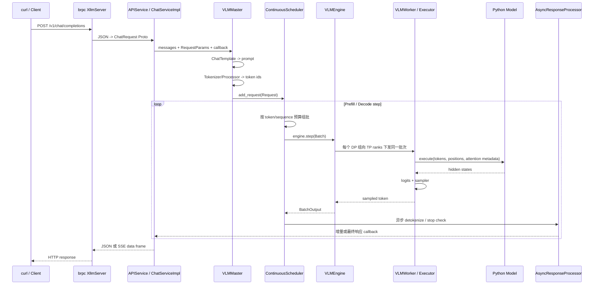

# xLLM 在线服务完整链路：从模型目录到一次 Chat Completion

> 本文是 `code_wiki` 的第一篇核心文章。它不要求读者预先了解网络编程：会先解释 IP、端口、TCP、HTTP、JSON、路由、RPC、callback 与 SSE，再沿着当前 xLLM 源码追踪一个模型怎样变成在线服务、一次 `curl` 怎样穿过调度器并执行模型，以及模型特性应在哪一层兼容。
>
> 源码基线：`xllm` 提交 `9768548dd359460d46e7fab32d3cd905407fff6d` 及 2026-08-13 当前工作区。文中“框架支持”来自源码，“本仓库已验证”来自 Kimi K3 实验，二者不会混写。

## 1. 先建立完整心智模型

xLLM 在线服务不是“HTTP Server 直接调用一次 `model.forward()`”。它由五层组成：

1. **服务接入层**：brpc HTTP Server、OpenAI 兼容协议、JSON/Proto 转换、流式 SSE。
2. **请求语义层**：Chat Template、Tokenizer、多模态 Processor、采样参数、停止条件。
3. **调度与缓存层**：Continuous Batching、Chunked Prefill、KV Cache、Prefix Cache、请求抢占与恢复。
4. **分布式执行层**：Master、Worker、DP/TP/EP/CP 通信、每轮 Prefill/Decode 的批次广播。
5. **模型实现层**：C++ Native Model 或 Python Model、权重装载、Attention/KDA、MoE、量化与图模式。

一次请求的主链路如下：



这里最重要的两个认识是：

- **启动完成不等于端口已经起来**。Master 构造阶段会先装载模型、估算并分配 KV cache；这些成功后才创建 HTTP Server。
- **一次生成不是一次模型调用**。Prefill 处理 prompt，之后每生成一个或一组 token 都会进入新的 Decode step；调度器会把不同请求连续重组为批次。

如果暂时不认识图里的英文名，可以先把整套服务想成一家有前台、后厨和仓库的餐厅：

```text
curl / SDK        = 顾客，用统一格式下单
HTTP Server       = 门店地址和前台，负责接收订单
路由               = 按订单类型分到“聊天窗口”“模型查询窗口”等柜台
APIService        = 柜台员工，检查订单字段并翻译成内部对象
Master/Scheduler  = 后厨调度，决定哪些订单这一轮一起做
Engine/Worker     = 厨房工位和设备执行者
KV Cache          = 每桌客人已经聊过内容的工作记忆
Model forward     = 真正的一轮模型计算
ResponseProcessor = 把 token 整理成文本并送回前台
SSE               = 菜做好一点就上一点，而不是等全部完成再一次端出
```

这个比喻只用于定位职责。真实系统中，“订单”是 `Request`，“每条候选生成轨迹”是 `Sequence`，“这一轮一起算的工作”是 `Batch`，“工作记忆”由分页 KV 和模型特有状态共同组成。

---

## 2. 网络零基础：`curl` 到底把请求发到了哪里

先看一个地址：

```text
http://11.87.191.102:13736/v1/chat/completions
```

它可以拆成四部分：

| 部分 | 例子 | 白话含义 |
|---|---|---|
| 协议 | `http` | 双方按 HTTP 规则组织请求和响应 |
| 主机/IP | `11.87.191.102` | 去哪台机器 |
| 端口 | `13736` | 去这台机器上的哪个服务进程 |
| 路径 | `/v1/chat/completions` | 想调用这个进程提供的哪项功能 |

### 2.1 IP 和端口分别解决什么

一台机器可以同时运行 SSH、数据库、监控和多个模型服务。IP 找到机器，端口找到机器上的具体监听入口。

```text
11.87.191.102:22     -> 可能是 SSH
11.87.191.102:13736  -> 当前 xLLM rank 0 的公共 HTTP 服务
11.87.191.102:30136  -> 当前启动脚本使用的内部 master rendezvous 地址
```

“端口已被占用”意味着另一个进程已经在同一 IP/端口监听。当前启动脚本会在覆盖日志和重复创建通信服务前检查既有 Kimi 进程与 `/health`，见 [run_kimi_k3.sh](/export/home/weinan5/penghengduo/CODE/xllm-KIMI-K3/run_kimi_k3.sh:31)。

### 2.2 TCP 在这里做什么

HTTP 通常运行在 TCP 连接上。可以把 TCP 理解成一条可靠的双向字节通道：

1. 客户端与服务端建立连接；
2. 字节按顺序传输；
3. 丢失的数据由协议重传；
4. 任一方最终关闭连接。

应用层不需要自己给每个 JSON 分片实现重传，但仍要处理超时、客户端断开和服务端失败。

HTTP 规定的是“这些字节怎样解释成方法、路径、Header、Body 与状态码”；TCP 负责把字节可靠送到对方。xLLM 源码主要工作在 HTTP/RPC 层，不是在手写 TCP 协议。

### 2.3 `curl` 是什么

`curl` 是一个命令行网络客户端。它替我们完成：

```text
解析 URL
  -> 连接 host:port
  -> 发送 HTTP 方法、Header 和 Body
  -> 接收状态码、Header 和响应 Body
  -> 把结果打印到终端
```

因此 `curl` 不是 xLLM 的特殊工具。Python SDK、浏览器、Java 服务或网关，只要发出兼容的 HTTP 请求，都能调用同一接口。

---

## 3. 一封 HTTP 请求里究竟装了什么

Chat Completion 常见请求可以抽象成：

```http
POST /v1/chat/completions HTTP/1.1
Host: 11.87.191.102:13736
Content-Type: application/json

{
  "model": "kimi",
  "messages": [{"role": "user", "content": "你好"}],
  "max_tokens": 8,
  "stream": false
}
```

这段报文有四类信息。

### 3.1 Method：想做什么动作

- `GET` 常用于读取资源，例如健康检查；
- `POST` 常用于提交一个需要处理的请求；
- xLLM Chat Completion 使用 `POST`，因为请求体中要携带 messages 和采样参数。

### 3.2 Path：交给哪个处理函数

`/v1/chat/completions` 是路由路径。服务端把它映射到 `ChatCompletionsHttp`，路由表见 [xllm_server.cpp](/export/home/weinan5/penghengduo/CODE/xllm-KIMI-K3/xllm/xllm/server/xllm_server.cpp:31)。

它不是磁盘目录，也不是 C++ 文件路径，而是网络接口的名字。

### 3.3 Header：怎样解释和管理这次通信

`Content-Type: application/json` 告诉服务端 Body 使用 JSON 编码。流式返回时，xLLM 会把响应类型改为 `text/event-stream`，并设置 `Connection: keep-alive` 与 `Cache-Control: no-cache`，源码见 [stream_call.h](/export/home/weinan5/penghengduo/CODE/xllm-KIMI-K3/xllm/xllm/api_service/stream_call.h:49)。

Header 是通信元信息，不是模型 prompt。

### 3.4 Body：真正的业务参数

JSON Body 承载：

- 对外模型名；
- 对话消息；
- 最大生成长度；
- temperature/top-p 等采样参数；
- 是否流式；
- stop、tools、logprobs 等扩展字段。

JSON 只是网络传输格式。模型不会直接读取 JSON；API 层必须先解析、校验，再构造框架内部的 Request。

---

## 4. 路由、JSON、Proto 和 C++ 对象是什么关系

这是第一篇最容易让初学者迷路的地方。

### 4.1 路由像前台分诊

同一个端口可以提供很多路径：

```text
/health                 -> 健康状态
/v1/models              -> 当前模型列表
/v1/chat/completions    -> 聊天生成
/v1/embeddings          -> 向量服务
```

brpc Server 先根据路径找到处理函数。`XllmServer::start()` 把 APIService 和路由表注册进 Server，再调用 `Start(port)` 开始监听，见 [xllm_server.cpp](/export/home/weinan5/penghengduo/CODE/xllm-KIMI-K3/xllm/xllm/server/xllm_server.cpp:129)。

### 4.2 JSON 是外部语言，Proto 是内部结构化类型

网络客户端发送 JSON。xLLM API 层把 JSON 字段解析到 Protocol Buffers 生成的 C++ 类型，例如 `ChatRequest`。

这里的 Proto 可以先理解成“字段定义严格、由工具生成代码的 C++ 数据结构”：

```text
JSON: 字段可能缺失、类型可能写错，需要解析和报错
Proto/C++ object: 字段访问方式固定，便于后续代码使用
```

`chat.proto` 定义了 messages、stream、tools、sampling 等字段，见 [chat.proto](/export/home/weinan5/penghengduo/CODE/xllm-KIMI-K3/xllm/xllm/proto/chat.proto:45)。

重要区别：外部 HTTP 请求使用 JSON，不等于客户端必须发送 protobuf 二进制；Proto 在这里主要是服务端内部的结构化承载对象。

### 4.3 解析成功也不代表请求一定合法

JSON 语法正确后仍要检查：

- `model` 是否匹配当前服务；
- messages 是否满足协议；
- prompt 是否超过上下文；
- sampling 参数范围是否合法；
- 服务并发是否超限；
- 当前 backend 是否实现该接口。

因此“HTTP 收到请求”“JSON 解析成功”“进入 Scheduler”“模型 forward 成功”是四个不同层级。

---

## 5. HTTP、RPC、brpc 和 HCCL 不要混为一种通信

xLLM 同时存在多种通信，它们服务于不同对象。

| 通信 | 参与者 | 携带什么 | 白话理解 |
|---|---|---|---|
| 公共 HTTP | 用户客户端 <-> rank 0 API | JSON 请求、JSON/SSE 响应 | 外部调用协议 |
| brpc RPC | xLLM 内部进程/服务 | 控制命令、结构化请求、metadata | 像调用远端函数 |
| rendezvous | 各 rank <-> master 地址 | rank、地址、通信组建立信息 | 开工前互相认识 |
| HCCL collective | NPU ranks | 激活、路由 token 等设备张量 | 多卡共同完成模型计算 |

### 5.1 RPC 是什么

RPC 是 Remote Procedure Call，直译为“远程过程调用”。调用方写起来像调用一个函数，但实际发生的是：

```text
参数序列化
  -> 通过网络发送
  -> 远端找到对应方法并执行
  -> 返回结果或错误
```

brpc 是 xLLM 使用的 RPC/HTTP 服务框架。它既能承载公共 HTTP 路由，也能承载 WorkerService 等内部 RPC。Worker 同步 master 节点时会初始化 brpc Channel，见 [worker_server.cpp](/export/home/weinan5/penghengduo/CODE/xllm-KIMI-K3/xllm/xllm/core/distributed_runtime/worker_server.cpp:479)。

### 5.2 HCCL 为什么不是 HTTP

TP/EP 计算中的 AllReduce、AllGather、AllToAll 传输的是设备 tensor，要求高带宽、低延迟和 rank 级同步，不会把激活先转成 JSON 再走公共 HTTP。

`--communication_backend=hccl` 选择的是 NPU collective backend，配置入口见 [parallel_config.cpp](/export/home/weinan5/penghengduo/CODE/xllm-KIMI-K3/xllm/xllm/core/framework/config/parallel_config.cpp:48)。

所以：

```text
curl 能否返回 -> 主要观察公共 HTTP 与整条服务链
多卡是否正确协作 -> 还要观察内部 RPC/rendezvous 和 HCCL
```

HTTP 200 不能单独证明 HCCL 分片数学正确；HCCL 建组成功也不能证明 API 路由可用。

---

## 6. 非流式与流式响应到底差在哪里

### 6.1 非流式：全部完成后一次返回

`stream=false` 时，连接仍然是一问一答：

```text
客户端发送完整请求
  -> 服务端进行 Prefill 和多轮 Decode
  -> 请求完成
  -> 一次性返回 application/json
  -> 连接可关闭或复用
```

用户在生成全部完成前看不到中间 token。

### 6.2 流式：同一个响应不断追加事件

`stream=true` 时，xLLM 使用 SSE（Server-Sent Events）。SSE 不是模型算法，而是一种 HTTP 文本流格式：

```text
data: {第一段 JSON}\n\n
data: {第二段 JSON}\n\n
data: [DONE]\n\n
```

服务端先返回 HTTP 200 和 `text/event-stream`，但不立即结束响应；每得到一段增量结果就调用 ProgressiveAttachment 写入，最后发送 `[DONE]`。实现见 [stream_call.h](/export/home/weinan5/penghengduo/CODE/xllm-KIMI-K3/xllm/xllm/api_service/stream_call.h:91)。

### 6.3 `curl -N` 为什么重要

`-N`/`--no-buffer` 让 curl 收到数据就打印，避免客户端自己攒一段后再显示。

但看到多次打印仍不能单独证明模型端“一 token 一次真实 Decode”。完整证明还要结合服务日志或 trace，确认 Prefill 后确实发生了持续 Decode，而不是服务端先生成完整文本再人为切片。

### 6.4 callback 是什么

模型生成需要多个 step，HTTP 处理线程不能一直用同步函数层层阻塞全部服务。

callback 可以理解成：“现在先把请求交出去，后面有增量结果或最终结果时，请调用这个函数通知我。”

```text
APIService 创建 callback
  -> Master/Scheduler 异步推进请求
  -> ResponseProcessor 产生结果
  -> callback 写 JSON 或 SSE
```

异步 callback 不等于设备计算一定与 CPU 重叠；它首先表示控制流不要求当前函数同步等到最终文本。

---

## 7. 用一条请求把网络层和推理层接起来

假设执行：

```bash
curl -N -sS \
  -H 'Content-Type: application/json' \
  -d '{"model":"kimi","messages":[{"role":"user","content":"你好"}],"max_tokens":2,"stream":true}' \
  http://11.87.191.102:13736/v1/chat/completions
```

完整过程是：

```text
1. curl 连接 11.87.191.102:13736
2. 发送 POST、路径、Header 和 JSON Body
3. brpc 根据路径调用 ChatCompletionsHttp
4. API 层把 JSON 解析成 ChatRequest，并校验 model/参数/限流
5. Chat Template 把 messages 编成模型训练格式的 prompt
6. Tokenizer 把 prompt 变成 token IDs
7. Master 创建 Request/Sequence，放入 Scheduler
8. Scheduler 选择 Prefill，Engine/Worker 执行模型
9. 使用最后一个 prompt hidden row 计算 logits，Sampler 选出首 token
10. 后续 step 进入 Decode，读取同一 Sequence 的 cache
11. ResponseProcessor 增量 detokenize
12. callback 把每段结果写成 SSE data event
13. 达到 max_tokens=2，写 finish_reason 与 [DONE]
14. Request 完成，释放或缓存相关资源
```

网络没有替代模型计算，模型也不会自己管理 HTTP。在线服务正是把这两端用 Request、Scheduler、callback 和响应序列化连接起来。

## 8. 源码导航地图

| 领域 | 关键入口 | 作用 |
|---|---|---|
| 进程入口 | [xllm.cpp](/export/home/weinan5/penghengduo/CODE/xllm-KIMI-K3/xllm/xllm/xllm.cpp:564) | 初始化配置、NPU/Python、Master 和 HTTP Server |
| 服务配置 | [service_config.cpp](/export/home/weinan5/penghengduo/CODE/xllm-KIMI-K3/xllm/xllm/core/framework/config/service_config.cpp:23) | host、port、HTTP/请求/响应线程数、并发限制 |
| 模型配置 | [model_config.cpp](/export/home/weinan5/penghengduo/CODE/xllm-KIMI-K3/xllm/xllm/core/framework/config/model_config.cpp:23) | 模型路径、对外 model id、backend、model_impl |
| HTTP 路由 | [xllm_server.cpp](/export/home/weinan5/penghengduo/CODE/xllm-KIMI-K3/xllm/xllm/server/xllm_server.cpp:39) | 注册 OpenAI/Anthropic/生成类路由并启动 brpc |
| API 适配 | [api_service.cpp](/export/home/weinan5/penghengduo/CODE/xllm-KIMI-K3/xllm/xllm/api_service/api_service.cpp:111) | JSON/Proto、参数校验、服务类型分发、响应序列化 |
| Chat 协议 | [chat.proto](/export/home/weinan5/penghengduo/CODE/xllm-KIMI-K3/xllm/xllm/proto/chat.proto:45) | messages、stream、tools、logprobs、停止参数等 |
| Master | [vlm_master.cpp](/export/home/weinan5/penghengduo/CODE/xllm-KIMI-K3/xllm/xllm/core/distributed_runtime/vlm_master.cpp:66) | 模型初始化、模板/分词、请求创建、调度循环 |
| 调度器 | [continuous_scheduler.cpp](/export/home/weinan5/penghengduo/CODE/xllm-KIMI-K3/xllm/xllm/core/scheduler/continuous_scheduler.cpp:216) | 接入请求、预算控制、组批、Prefill/Decode 推进 |
| 批输入 | [batch_input_builder.cpp](/export/home/weinan5/penghengduo/CODE/xllm-KIMI-K3/xllm/xllm/core/framework/batch/batch_input_builder.cpp:1189) | token、position、slot mapping、block table、采样位置 |
| 推理引擎 | [vlm_engine.cpp](/export/home/weinan5/penghengduo/CODE/xllm-KIMI-K3/xllm/xllm/core/distributed_runtime/vlm_engine.cpp:114) | 模型装载、cache 估算/分配、并行 Worker 执行 |
| Python 桥 | [py_executor_impl.cpp](/export/home/weinan5/penghengduo/CODE/xllm-KIMI-K3/xllm/xllm/core/runtime/py_executor_impl.cpp:218) | C++ BatchInput 转为 Python metadata，并调用模型 |
| Python 执行器 | [executor.py](/export/home/weinan5/penghengduo/CODE/xllm-KIMI-K3/xllm/xllm/python/model_executor/executor.py:77) | Attention backend、Eager/Graph runner、KV/KDA cache 绑定 |
| 模型注册 | [model_registry.cpp](/export/home/weinan5/penghengduo/CODE/xllm-KIMI-K3/xllm/xllm/models/model_registry.cpp:76) | 从 HF config 推导 backend、ModelArgs、TokenizerArgs |
| Python 注册 | [registry.py](/export/home/weinan5/penghengduo/CODE/xllm-KIMI-K3/xllm/xllm/python/registry.py:59) | `model_type` 到 Python 模型类的映射 |
| Kimi K3 文本模型 | [kimi_k3_text.py](/export/home/weinan5/penghengduo/CODE/xllm-KIMI-K3/xllm/xllm/python/models/kimi_k3_text.py:1388) | MLA/KDA/MoE 组装、forward、TP LM Head、权重加载 |
| 启动脚本 | [run_kimi_k3.sh](/export/home/weinan5/penghengduo/CODE/xllm-KIMI-K3/run_kimi_k3.sh:1) | 当前四卡 Kimi K3 服务的参数化可复现入口 |

后续章节沿着真实执行顺序阅读这些文件。

## 9. 启动前：一个“可服务模型”由什么组成

### 9.1 模型目录

对当前 Hugging Face loader，最小模型目录至少需要：

- `config.json`：决定 `model_type`、网络结构、层类型、量化配置等。
- 至少一个 `.safetensors`：当前 `HFModelLoader` 构造时会扫描 safetensors 并要求结果非空。虽然某些接口枚举中也出现 `.bin`，当前实际装载路径不能据此认为 PyTorch bin 已完整可用。
- Tokenizer 资产：Kimi K3 使用 `tiktoken.model`；其他模型通常使用 tokenizer config/vocab 文件。
- Chat Template 相关配置：通用模型可从 tokenizer/config 中读取 Jinja 模板；Kimi K3 走框架内的原生 XTML 模板。

权重入口在 [hf_model_loader.cpp](/export/home/weinan5/penghengduo/CODE/xllm-KIMI-K3/xllm/xllm/core/framework/hf_model_loader.cpp:474)。它会排序所有 safetensors 文件，用线程池并行读取为多个 `StateDict`。对于 Python 模型，这些 shard 随后整体传给 Python `load_weights()`；因此模型适配器必须正确处理“一个参数可能分布在多个文件视图中”的情况。

### 9.2 三个容易混淆的开关

#### `--model_backend`

它决定使用哪一套服务/引擎语义：

- `llm`：文本 LLM 服务族。
- `vlm`：多模态/统一 Causal VLM 引擎；也可以服务纯文本请求。
- `dit`：扩散生成类服务。

没有显式指定时，入口会根据模型注册表自动判断。Kimi K3 顶层 HF `model_type` 是 `kimi_k3`，当前注册为 `vlm`，所以即使本阶段只跑文本，也由 VLM Master/Engine 承载。

#### `--model_impl`

- `native`：使用 xLLM C++ 模型实现。
- `python` / `py`：使用嵌入式 Python 模型实现。

Kimi K3 当前使用 `--model_impl python`。C++ 仍负责服务、调度、cache 生命周期和分布式 Worker；只有模型构图/forward/权重适配主要在 Python。

#### `--model_id`

这是 API 对外暴露并校验的模型名，不是磁盘目录。若未指定，入口默认取模型路径最后一级目录名。请求中的 `"model"` 必须与其一致；当前服务显式使用 `kimi`。

### 9.3 配置优先级

xLLM 先注册默认值和命令行 flag，再读取 JSON 配置。当前实现中，**JSON 文件里的值覆盖命令行值**，这与很多 CLI 工具的习惯相反，排障时必须留意。

相关代码在 [config_utils.cpp](/export/home/weinan5/penghengduo/CODE/xllm-KIMI-K3/xllm/xllm/core/framework/config/config_utils.cpp:48)。可以启用 `--enable_dump_config_json=true` 并设置 `--dump_config_json_file=...`，把最终生效配置落盘，避免只凭启动命令猜测。

## 10. 启动入口逐段通读

### 10.1 `main()`：从 flag 到服务进程

[xllm.cpp](/export/home/weinan5/penghengduo/CODE/xllm-KIMI-K3/xllm/xllm/xllm.cpp:564) 的 `main()` 顺序是：

1. 处理 `--help`。
2. 解析 gflags。
3. 初始化日志与全部配置类别。
4. 校验 `--model` 非空。
5. NPU 构建下提前初始化 ACL、内嵌 Python、`torch_npu` 和当前 device。
6. 进入 `run()` 构建服务。

NPU 初始化必须早于首个 NPU tensor/cache 分配。设备选择综合 `node_rank`、`nnodes` 与可见设备数量：当前启动方式是每个 OS 进程设置一个不同的 `ASCEND_RT_VISIBLE_DEVICES`，同时给它不同的 `node_rank`。

### 10.2 `run()`：规范化配置并决定进程角色

[run()](/export/home/weinan5/penghengduo/CODE/xllm-KIMI-K3/xllm/xllm/xllm.cpp:412) 做了这些工作：

1. 校验模型路径存在。
2. 补全 `model_id` 和 host。
3. 根据注册表自动推导 model backend。
4. 读取模型类型，并为已知模型自动设置 tool parser / reasoning parser。
5. 检查 backend、图模式、推测解码等组合是否合法。
6. 把分散的配置对象复制进一个 `Options`，供后续所有组件共享。
7. 根据 rank 创建 Master 或 AssistantMaster。
8. `master->run()` 启动调度循环。
9. 只有提供公共 API 的进程才构造 `APIService` 和 `XllmServer`。

`create_options()` 位于 [xllm.cpp](/export/home/weinan5/penghengduo/CODE/xllm-KIMI-K3/xllm/xllm/xllm.cpp:95)，它不是简单搬运几个参数，而是在线服务配置的汇合点：

- Service：端口、线程、并发限制。
- Model：路径、model id、backend、model_impl、dtype、revision。
- Scheduler：batch token/sequence 预算、chunked prefill、调度策略。
- KV cache：block size、显存利用率、cache 大小、prefix cache。
- Parallel：DP/TP/EP/CP 与通信端口。
- Execution：eager/graph、graph backend、batch sizes。
- PD、推测解码、量化、设备和调试配置。

所以分析“某个 flag 最后有没有影响模型执行”，最稳妥的路径是：配置定义 -> `create_options()` -> 消费 `Options` 的具体组件。

### 10.3 为什么 HTTP 端口最后才出现

`run()` 创建 Master 时会触发引擎构造，而 [VLMEngine::init()](/export/home/weinan5/penghengduo/CODE/xllm-KIMI-K3/xllm/xllm/core/distributed_runtime/vlm_engine.cpp:114) 依次执行：

```text
init_model()
  -> 每个 worker 建模型并加载权重
estimate_kv_cache_capacity()
  -> 汇总各 worker 可用显存并取安全值
allocate_kv_cache()
  -> 建 block manager，并在每个 worker 分配 KV/KDA cache
```

这些都成功后，rank 0 才会在 [xllm.cpp](/export/home/weinan5/penghengduo/CODE/xllm-KIMI-K3/xllm/xllm/xllm.cpp:543) 创建 `APIService` 并启动 brpc。因此：

- 能看到权重加载日志但连不上端口，通常说明还在初始化或后续 cache 分配失败。
- `/health` 成功意味着 HTTP Server 已启动，不代表输出数值已经与参考实现对齐。
- `/v1/models` 成功只说明 API 层已持有当前模型描述。

## 11. 当前 Kimi K3 四卡启动脚本与进程拓扑

[run_kimi_k3.sh](/export/home/weinan5/penghengduo/CODE/xllm-KIMI-K3/run_kimi_k3.sh:1) 做了四类工作。

### 11.1 构建五层影子模型目录

脚本不修改原始 checkpoint，而是：

1. 创建 `/tmp/kimi-k3-5layers`。
2. 除 `config.json` 外，模型文件全部符号链接到原目录。
3. 用 `jq` 把 `text_config.num_hidden_layers` 改成 5。
4. 同步过滤 `kda_layers` 和 `full_attn_layers`，只保留前五层中的层号。

这让权重仍来自原 checkpoint，但模型只实例化前五层。它适合快速打通加载、cache、Prefill 和 Decode，**不适合判断模型语义或精度**。

### 11.2 设置 Ascend 自定义算子优先级

脚本把 vLLM Ascend 的 `custom_transformer` vendor 路径放在 `ASCEND_CUSTOM_OPP_PATH` 最前，再放 xLLM vendor 路径。当前环境中这个顺序是必要条件：错误的 CausalConv1d tiler 实现会触发 int64/int32 contract 不匹配。

这属于运行时 ABI/算子选择问题，不是 Kimi Python 层能兜底的问题。判断真实加载了哪个自定义算子，比只检查 Python import 是否成功更重要。

### 11.3 启动四个 OS 进程

脚本循环创建四个进程。当前默认是 `TP2 + DP2 + EP2`，Graph 默认关闭；专项验证 Decode ACL Graph 时显式设置 `ENABLE_GRAPH=true`。核心参数等价于：

```bash
ASCEND_RT_VISIBLE_DEVICES=<rank-device> \
  <xllm-binary> \
  --model=/tmp/kimi-k3-5layers \
  --model_id=kimi \
  --host=11.87.191.102 \
  --port=<13736+rank> \
  --master_node_addr=11.87.191.102:30136 \
  --nnodes=4 \
  --node_rank=<0..3> \
  --model_impl=python \
  --python_model_path=/export/home/weinan5/penghengduo/CODE/xllm-KIMI-K3/xllm \
  --dp_size=2 \
  --tp_size=2 \
  --ep_size=2 \
  --block_size=128 \
  --max_memory_utilization=0.7 \
  --max_cache_size=4294967296 \
  --max_tokens_per_batch=8192 \
  --max_seqs_per_batch=20 \
  --enable_graph=false \
  --communication_backend=hccl
```

先区分“OS 进程”和“模型副本”。四个 rank 是四个服务进程，但 `DP2 + TP2` 表示两个数据并行副本，每个副本内部由两个 TP rank 合作计算：

```text
rank 0 / visible device 0 / port 13736
  VLMMaster + VLMEngine + APIService + public HTTP routes
  DP replica 0 的 TP shard

rank 1 / visible device 1 / port 13737
  VLMAssistantMaster
  DP replica 0 的另一 TP shard

rank 2 / visible device 2 / port 13738
  VLMAssistantMaster
  DP replica 1 的 TP shard

rank 3 / visible device 3 / port 13739
  VLMAssistantMaster
  DP replica 1 的另一 TP shard
```

四个进程通过 `master_node_addr` 建立内部控制与 Worker 通信。用户请求只应发送到 rank 0 的 13736；非主 rank 不注册完整公共 API 路由。

`EP2` 还让 MoE token 在两个 expert rank 间路由；EP 是 expert 的放置与 token AllToAll 关系，不是第三份完整模型副本。详细并行语义见 [10-distributed-parallelism-and-communication.md](/export/home/weinan5/penghengduo/CODE/xllm-KIMI-K3/code_wiki/10-distributed-parallelism-and-communication.md:1)。

### 11.4 这些参数解决什么问题

- `max_seqs_per_batch=20`：允许并发 Decode 组批，同时限制单 step Sequence 数。
- `max_tokens_per_batch=8192`：限制单 step query token 预算，主要影响 Prefill/混批规模。
- `max_memory_utilization=0.7` 与 4 GiB `max_cache_size`：控制 KV cache 预留，避免初始化吞满设备。
- `block_size=128`：KV cache 以 128-token block 管理。
- `TP2 + DP2`：每个副本由两张卡共同计算，同时允许两个副本承接不同 Sequence。
- `EP2`：当前 Kimi MoE 的 expert 拓扑宽度为 2。
- `enable_graph=false`：脚本默认先使用 eager；设置 `ENABLE_GRAPH=true` 才启用已专项验证的 Decode ACL Graph。

这些是当前五层验证配置，不代表 93 层模型的吞吐最优点。调整并发、batch、KV、Graph 或并行拓扑后，都应重新检查显存、正确性和 SLO。

## 12. HTTP Server 与路由到底怎样工作

### 12.1 路由注册

[xllm_server.cpp](/export/home/weinan5/penghengduo/CODE/xllm-KIMI-K3/xllm/xllm/server/xllm_server.cpp:39) 列出了服务可注册的路由，包括：

- `/v1/chat/completions`
- `/v1/completions`
- `/v1/embeddings`
- `/v1/models`
- `/v1/messages`
- `/v1/rerank`
- image/audio/text/video generation
- sleep/wakeup、pause/resume、profile、repository 等管理接口

但“路由名存在”不等于“当前 backend 支持该业务”。[ServiceImplFactory](/export/home/weinan5/penghengduo/CODE/xllm-KIMI-K3/xllm/xllm/api_service/api_service.cpp:56) 按 Master 类型创建真正的实现：

| backend/Master | 主要服务实现 |
|---|---|
| LLM | Completion、Sample、Chat、Embedding、Rerank、Anthropic |
| VLM | MMChat、MMEmbedding |
| DiT | 图像/音频/文本/视频生成类 |
| REC | Completion、Chat |
| 所有模式 | Models |

因此当前 Kimi K3 VLM 服务应以 `/v1/chat/completions` 为主；不能因为路由表中写了 `/v1/completions` 就假定该接口在此 backend 上完整可用。

### 12.2 `/health` 不经过 APIService

`XllmServer::start()` 把一个 brpc `HealthReporter` 放进 ServerOptions，然后调用 `Start(port)`。所以 `/health` 是 brpc 健康报告，不需要模型请求的 Proto/JSON 逻辑。

这解释了健康探针的正确分层：

- `/health`：进程与 HTTP Server 活着。
- `/v1/models`：APIService 已正确暴露模型 id。
- 最小生成：调度器、Worker、模型和响应链真的走通。

### 12.3 请求如何从 JSON 进入 C++

Chat 路由被注册到 [APIService::chat_completions](/export/home/weinan5/penghengduo/CODE/xllm-KIMI-K3/xllm/xllm/api_service/api_service.cpp:422)。随后：

1. 从 brpc request attachment 读取 JSON body。
2. 转成 `ChatRequest` Proto。
3. `ChatServiceImpl` 或 `MMChatServiceImpl` 校验模型名与限流。
4. 把 Proto 转成内部 `RequestParams` 和 `Message`。
5. 构造异步 callback，将请求交给 Master。

`ChatRequest` 不只兼容最小 OpenAI 字段，还覆盖：

- `temperature`、`top_p`、`top_k`、`n`、`best_of`
- `max_tokens`、`stop`、`stop_token_ids`、`ignore_eos`
- presence/frequency/repetition penalty
- `stream` 与 `stream_options.include_usage`
- `logprobs`、`top_logprobs`
- `tools`、`tool_choice`
- request id、priority、beam 参数、chat template kwargs

实际默认值以 [request_params.cpp](/export/home/weinan5/penghengduo/CODE/xllm-KIMI-K3/xllm/xllm/core/framework/request/request_params.cpp:458) 为准。例如内部默认 `max_tokens` 是 5120；Proto 注释中的旧默认值不能当运行事实。

## 13. Chat 请求进入模型前发生了什么

### 13.1 消息结构保真

API 层会保留每条消息的：

- role 与 content
- reasoning content
- tool calls
- tool call id

多模态 Chat 还会通过 `mm_service_utils` 提取文本、图片等 payload，并交给 VLM 的 Processor。

### 13.2 Chat Template

[VLMMaster::generate_request(messages)](/export/home/weinan5/penghengduo/CODE/xllm-KIMI-K3/xllm/xllm/core/distributed_runtime/vlm_master.cpp:434) 先调用 Chat Template：

```text
messages + tools + chat_template_kwargs
  -> ChatTemplate::apply()
  -> 单个模型 prompt 字符串
```

[ChatTemplate::create()](/export/home/weinan5/penghengduo/CODE/xllm-KIMI-K3/xllm/xllm/core/framework/chat_template/chat_template.cpp:28) 按模型类型选择模板。Kimi K3 使用原生 XTML 模板，而非普通 Jinja 路径。Thinking 配置也在这一层影响最终 prompt：启用 thinking 时需要正确的 thinking effort，并生成相应的思考/回答控制标记。

这层错误的典型表现不是 kernel 崩溃，而是：prompt token 数异常、停止标记不匹配、工具调用格式错误或输出行为完全偏离模型训练格式。

### 13.3 Processor 与 Tokenizer

模板输出随后经过模型 Processor 和 Tokenizer：

- 纯文本：得到 prompt token ids。
- 多模态：还会下载/解码/预处理媒体，产生像素或编码输入，并在文本序列中定位媒体标记 token。

当前 Kimi K3 tokenizer 由 C++ 模型注册代码指定为 tiktoken，并读取 `tiktoken.model` 与特殊 token 定义。Tokenizer 是 Master 侧共享语义的一部分；response processor 会 clone tokenizer 做异步增量 detokenize，避免阻塞调度主循环。

### 13.4 构造内部 Request

[VLMMaster::build_request()](/export/home/weinan5/penghengduo/CODE/xllm-KIMI-K3/xllm/xllm/core/distributed_runtime/vlm_master.cpp:328) 负责：

1. 校验 prompt 不超过模型最大上下文。
2. 计算 `prompt_tokens + max_tokens + 1` 的容量需求。
3. 创建 SamplingParameters。
4. 把模型默认停止 token 与请求的 stop/stop token ids 合并。
5. 将 stop 字符串 tokenize。
6. 创建 `StoppingChecker`、`RequestState`、`Request`。

到这里，一个 HTTP 请求才变成调度器能管理的生成请求。

## 14. Continuous Scheduler：在线推理的核心

### 14.1 为什么需要连续批处理

传统静态 batching 要等一批请求全部结束再换批。LLM 请求输出长度不同，会造成大量设备空洞。Continuous Scheduler 在每个 step 都重新决定：

- 哪些新请求进入 Prefill。
- 哪些已有请求继续 Decode。
- 每个请求本轮处理多少 token。
- token budget、sequence budget 和 cache block 是否足够。

因此不同请求可以在 token 粒度进入和离开批次。

### 14.2 `add_request()` 到 `prepare_batch()`

Master 把请求交给 [ContinuousScheduler](/export/home/weinan5/penghengduo/CODE/xllm-KIMI-K3/xllm/xllm/core/scheduler/continuous_scheduler.cpp:216) 后：

1. 请求先进入并发安全队列。
2. 如启用存储/远端 cache，可提前发起 prefetch。
3. 每轮 `prepare_batch()` drain 新请求。
4. 回收上轮完成/取消的请求与 cache block。
5. 调度策略在 `max_tokens_per_batch`、`max_seqs_per_batch` 等预算下选序列。
6. `BatchFactory` 为选中序列创建本轮模型输入。

当前源代码默认值包括：

- `max_tokens_per_batch=10240`
- `max_seqs_per_batch=200`
- Chunked Prefill 开启
- Prefix Cache 开启
- Mix Batch 开启
- Schedule Overlap 关闭

启动脚本的显式值会覆盖这些默认值。文档或旧 CLI 注释若与当前配置源码冲突，应以当前分支源码和最终 dump 配置为准。

### 14.3 Prefill、Chunked Prefill 与 Decode

调度器根据每条 Sequence 的 `kv_cache_tokens` 判断本轮工作：

- `kv_cache_tokens < prompt_tokens`：还在 Prefill。
- prompt 很长且单轮预算不足：做 Chunked Prefill，只计算一段。
- prompt 已全部进入 cache：进入 Decode，本轮通常追加一个 token。

同一个 batch 可以在支持的条件下混合 Prefill 与 Decode。模型层不应该自己猜阶段，而应根据框架构建的 metadata（query lengths、sequence lengths、block tables 等）选择正确 kernel。

### 14.4 `BatchInputBuilder` 生产什么

对每个选中 sequence，[BatchInputBuilder](/export/home/weinan5/penghengduo/CODE/xllm-KIMI-K3/xllm/xllm/core/framework/batch/batch_input_builder.cpp:1189) 构造：

- 本轮需要执行的 token ids。
- position ids。
- `q_seq_lens` 与累计/实际 sequence lengths。
- KV cache block tables。
- 每个 token 写入 cache 的 slot mapping。
- linear attention/KDA state 对应的 row 与 metadata。
- 哪些 hidden states 需要进入 logits/sampling 的索引。

NPU 路径对 `q_seq_lens` 的约定是“每条序列的非累计长度”；Attention backend 必须按同一 contract 解释。

## 15. KV Cache 与容量估算

### 15.1 为什么模型加载后还要估算 cache

模型权重、运行时 workspace、图缓存和 KV cache 共享设备显存。`VLMEngine` 让所有 Worker 报告可用容量，并取能够在全部 rank 上成立的安全值，再结合：

- `max_memory_utilization`
- `max_cache_size`
- encoder cache 预留
- 模型 KV 形状与 dtype
- linear attention state 大小

计算 block 数量。TP 中任一 rank 容量更小，都可能成为全局上限。

### 15.2 Paged KV Cache

Paged cache 不为每个请求预先分配最大上下文，而把 cache 切成固定 token 数的 block。Sequence 持有逻辑 block table，slot mapping 把本轮 token 映射到物理 cache 位置。

收益包括：

- 请求可动态增长。
- 完成后 block 可立即复用。
- 抢占/恢复只需管理 block ownership。
- Prefix Cache 可以让相同前缀复用已有 block。

`block_size=128` 表示每个 block 承载 128 个 token 的状态，不表示每轮一定执行 128 token。

### 15.3 KDA 的 linear state 不是普通 KV

Kimi K3 同时存在两类层：

- MLA/Full Attention 层：使用 paged latent/positional KV cache。
- KDA 层：使用 convolution state 和 SSM/recurrent state。

Python executor 在初始化时只为 linear layer 绑定 KDA cache；普通 attention layer 绑定 `(key/value cache, layer index)`。每个 step 同时传入 attention metadata 与 KDA metadata，层实现按 layer type 消费正确状态。

因此接入混合注意力模型时，只声明一个统一 KV shape 是不够的，还必须把 layer ordering、linear state slot 数量、状态 dtype/shape 和回收语义接到调度层。

## 16. Engine、Worker 与并行执行

### 16.1 `VLMEngine::step()`

[VLMEngine::step()](/export/home/weinan5/penghengduo/CODE/xllm-KIMI-K3/xllm/xllm/core/distributed_runtime/vlm_engine.cpp:374) 将调度器批次转换为每个 DP rank 的输入：

1. 一个请求在生命周期内固定到同一 DP rank，保证 cache locality。
2. 同一 DP 组内的所有 TP rank 收到相同 token/metadata 形状。
3. 各 TP rank 只持有自己的参数 shard，并通过 HCCL collective 合作执行。
4. 只有 driver worker 的采样输出回到 Engine。
5. `Batch::process_sample_output()` 把新 token 写回 Sequence 状态。

当前 Kimi 配置是 DP2/TP2：Scheduler 把不同 Sequence 固定分给两个 DP 副本；每个副本内部的两个 TP rank 接收相同的本地 token/metadata，并合作完成模型分片计算。四个端口仍不是四个可独立调用的公共模型服务，用户请求只发给 rank 0。

### 16.2 Worker 到 Executor

VLM Worker 初始化模型并创建 `Executor`。当 `model_impl=python` 时，VLM executor 内部选择 Python executor，但多模态 encode、embedding 合并、logits 与 sampling 的整体生命周期仍由 C++ VLM Worker 组织。

执行大致是：

```text
VLMWorker
  -> （可选）encode multimodal input
  -> get_input_embeddings
  -> inner Executor::run
       -> Python ModelExecutor.execute
  -> model.logits(hidden_states, selected_indices)
  -> Sampler
  -> sampled token ids / logprobs
```

### 16.3 C++ 到 Python 只有一次主 forward 边界

[PyExecutorImpl](/export/home/weinan5/penghengduo/CODE/xllm-KIMI-K3/xllm/xllm/core/runtime/py_executor_impl.cpp:218) 在构造时 import `xllm.python.model_executor.executor.ModelExecutor`。每轮 step 它：

1. 将 KV/KDA cache tensor 与 Python layer 对象绑定。
2. 从 BatchInput 构造 `AttentionMetadataView`。
3. 构造 KDA 的 per-step metadata。
4. 调用一次 Python：

```python
execute(tokens, positions, attention_metadata, input_embedding, kda_metadata)
```

这条边界让调度和 cache 管理留在 C++，模型特性以 Python layer/runtime spec 的方式接入。不要在每层、每 token 上增加新的 C++/Python 往返，否则会放大调度开销。

## 17. Python ModelExecutor 与 Attention Backend

### 17.1 初始化阶段

[ModelExecutor](/export/home/weinan5/penghengduo/CODE/xllm-KIMI-K3/xllm/xllm/python/model_executor/executor.py:77) 扫描模型中的 `AttentionRuntimeLayer`：

1. KDA/linear 层主要用于记录 ordering 和状态类型。
2. 找到第一个非 linear attention spec，选择真正的 paged attention backend。
3. NPU 使用 `NpuPagedAttentionBackend`。
4. 创建 eager runner；按配置再创建 ACL Graph、CUDA Graph 或 compile runner。
5. 绑定各层 KV/KDA cache。

混合模型的所有普通 attention 层必须满足 backend 可共同处理的 contract；不能静默混用互不兼容的 cache layout。

### 17.2 每轮 execute

运行时优先级是：

1. 有多模态 embedding 等不适合图捕获的输入时走 eager。
2. 满足捕获条件且对应 graph 已就绪时走 graph。
3. 否则回退 eager。

Eager runner 先让 attention backend `prepare()` metadata，再进入 forward context，最后调用 Python model。Attention layer 从 context 中读取本轮 block table、slot mapping、query/sequence lengths，而不是让模型 forward 接收大量散乱参数。

### 17.3 NPU paged attention 的两个分支

NPU backend 同时处理：

- MHA/GQA：reshape 并写入 paged K/V cache，再按 Prefill/Decode 走对应算子。
- MLA：把 latent KV 与 positional 部分写入 cache，再走 dense 或 sparse 路径。

当前 Kimi Full Attention 的 `topk=None`，应走 dense MLA Prefill/Chunked Prefill/Decode；不能为了“看起来像稀疏模型”而错误开启 sparse top-k。

FIA 算子只支持若干 query head 数。Kimi K3 总 query heads 为 96，TP4 后本地是 24；实现会把 query 临时 pad 到 32 heads，算完再 slice 回 24。这是算子合法性适配，不改变模型逻辑 head 数。

## 18. Kimi K3 模型是怎样被框架识别的

### 18.1 C++ 注册层

[model_registry.cpp](/export/home/weinan5/penghengduo/CODE/xllm-KIMI-K3/xllm/xllm/models/model_registry.cpp:76) 承担“HF config 到框架语义”的转换：

- `kimi_k3` -> `vlm` backend。
- 从顶层/嵌套 `text_config` 读取 hidden size、层数、96 个 query heads、MLA q/kv 维度、kv lora rank 等。
- 根据一基层号列表生成逐层 `layer_types`，区分 KDA 与 Full Attention。
- 读取 KDA 的卷积/状态参数。
- 读取多模态与特殊 token 配置。
- 注册 tiktoken tokenizer 及 `tiktoken.model`。

这一层影响 C++ 的 cache 形状、并行切分、模板和 tokenizer。即使模型主体在 Python，这里的参数也必须与 Python config 完全一致。

### 18.2 Python 注册与实例化

[registry.py](/export/home/weinan5/penghengduo/CODE/xllm-KIMI-K3/xllm/xllm/python/registry.py:59) 把模型类型映射到 Python 类。`PyCausalVLM` 会：

1. 初始化 Python 侧 TP process group。
2. 合并原始 HF config、C++ ModelArgs、parallel/quant/dtype/device/graph 信息。
3. 从 registry 获取模型类并实例化到 NPU。
4. 切到 eval 模式。
5. 将 C++ loader 读出的全部 StateDict shards 交给 Python `load_weights()`。

Kimi 顶层 wrapper 可包含 vision tower 与 language model；当前验证请求是纯文本，不能据此宣称视觉链路已完成验证。

### 18.3 文本 Decoder 逐层执行

[kimi_k3_text.py](/export/home/weinan5/penghengduo/CODE/xllm-KIMI-K3/xllm/xllm/python/models/kimi_k3_text.py:1004) 中每个 DecoderLayer 根据 `layer_types` 选择：

- KDA layer：消费 recurrent/conv state。
- MLA layer：消费 paged MLA cache。

随后进入该层的 dense MLP 或 MoE。完整模型循环全部层，最终 RMSNorm；顶层 `KimiK3ForCausalLM` 再通过 TP-aware LM head 计算 logits。

### 18.4 权重加载为什么是模型适配的关键

Python `load_weights()` 不能只是 `state_dict.update()`：

- 同一逻辑层的 tensor 可能位于不同 safetensors shard。
- TP rank 只加载对应切片。
- fused 参数可能由 checkpoint 中多个参数拼成。
- 量化权重还有 scale、group、layout 等附属 tensor。
- reduced-layer shadow model 会有 checkpoint 中存在但模型未实例化的层，必须按明确规则忽略；同时不能掩盖已实例化层的缺失参数。

当前 Kimi loader 会合并 shard 视图、加载 TP shard，并对需要的缺失权重做校验。一次“进程没崩”的加载不足以证明加载正确，至少还要有 tensor 命中统计、关键参数抽查和参考输出对齐。

## 19. Logits、Sampling、停止与响应

### 19.1 Sampling

Worker 从模型 hidden states 中只选取需要采样的位置计算 logits，然后 Sampler 依次处理：

- frequency/presence/repetition penalty
- temperature
- top-k/top-p
- greedy 或随机采样
- 可选 logprobs/top logprobs

新 token 写回 Sequence。下一轮 Scheduler 会把它作为 Decode 输入，并继续复用同一请求的 cache。

### 19.2 停止条件

`StoppingChecker` 综合判断：

- EOS。
- 模型默认 stop token ids。
- 请求 stop token ids。
- stop 字符串对应的 token 序列。
- `max_tokens`。
- 模型最大上下文。

它设置 OpenAI 风格的 `stop` 或 `length` finish reason。`ignore_eos` 只影响 EOS 类停止，不能绕过上下文上限。

### 19.3 异步 detokenize

[AsyncResponseProcessor](/export/home/weinan5/penghengduo/CODE/xllm-KIMI-K3/xllm/xllm/core/scheduler/async_response_processor.cpp:86) 不在调度主线程内做完整响应编码：

- 非流式：请求完成后 `generate_output(tokenizer)`，一次调用 callback。
- 流式：每轮用 `generate_streaming_output(tokenizer)` 产生增量文本并 callback。
- 若客户端断开，callback 可触发请求取消，释放后续计算与 cache。

### 19.4 HTTP 与 SSE 输出

非流式响应的 Content-Type 是 `application/json`。流式响应由 [stream_call.h](/export/home/weinan5/penghengduo/CODE/xllm-KIMI-K3/xllm/xllm/api_service/stream_call.h:61) 发送：

```text
data: {chat.completion.chunk JSON}\n\n
data: {chat.completion.chunk JSON}\n\n
data: [DONE]\n\n
```

这就是 `curl -N` 必须关闭客户端缓冲的原因。

## 20. `curl` 调用手册

下面以当前 rank 0 地址为例：

```bash
export XLLM_BASE_URL=http://11.87.191.102:13736
```

### 20.1 健康检查

```bash
curl -sS "${XLLM_BASE_URL}/health"
```

当前实测响应：

```json
{"status":"healthy"}
```

### 20.2 查询模型

```bash
curl -sS "${XLLM_BASE_URL}/v1/models"
```

当前实测对外模型 id 为 `kimi`。这个值应原样放入后续请求的 `model` 字段。

### 20.3 最小非流式 Chat Completion

```bash
curl -sS \
  -H 'Content-Type: application/json' \
  -d '{
    "model": "kimi",
    "messages": [
      {"role": "user", "content": "你好"}
    ],
    "temperature": 0,
    "max_tokens": 1,
    "stream": false
  }' \
  "${XLLM_BASE_URL}/v1/chat/completions"
```

2026-08-07 当前服务实测返回 HTTP 200，`prompt_tokens=89`、`completion_tokens=1`、`finish_reason="length"`。由于服务使用五层影子模型，返回文本只证明完整执行链路，不代表 Kimi K3 的语义质量。

### 20.4 流式 Chat Completion

```bash
curl -N -sS \
  -H 'Content-Type: application/json' \
  -d '{
    "model": "kimi",
    "messages": [
      {"role": "user", "content": "用一句话说明连续批处理。"}
    ],
    "temperature": 0,
    "max_tokens": 32,
    "stream": true,
    "stream_options": {"include_usage": true}
  }' \
  "${XLLM_BASE_URL}/v1/chat/completions"
```

预期看到多行 `data: {...}`，最后一行是 `data: [DONE]`。要验证真实增量执行，应同时查看服务日志中至少一次 Prefill 和后续 Decode step；只看网络分块不能排除服务端先完整生成再分块的伪流式实现。

当前服务的两 token 流式实测也符合这一协议：先返回 assistant role 空 delta，随后返回两个 content delta，再返回 `finish_reason="length"` 的 usage chunk，最后发送 `[DONE]`。这证明 HTTP/SSE 回传链路已实际走通；返回文本仍受五层影子模型限制，不作为语义结论。

### 20.5 stop 与 logprobs

```bash
curl -sS \
  -H 'Content-Type: application/json' \
  -d '{
    "model": "kimi",
    "messages": [{"role": "user", "content": "列出三个数字"}],
    "max_tokens": 32,
    "stop": ["3"],
    "logprobs": true,
    "top_logprobs": 3
  }' \
  "${XLLM_BASE_URL}/v1/chat/completions"
```

是否能返回有意义的 logprobs 还取决于当前模型 logits/sampler 路径；协议接受字段不等于某个特定模型组合已经完成专项验证。

### 20.6 工具调用

```bash
curl -sS \
  -H 'Content-Type: application/json' \
  -d '{
    "model": "kimi",
    "messages": [{"role": "user", "content": "北京现在几点？"}],
    "tools": [{
      "type": "function",
      "function": {
        "name": "get_time",
        "description": "查询城市时间",
        "parameters": {
          "type": "object",
          "properties": {"city": {"type": "string"}},
          "required": ["city"]
        }
      }
    }],
    "tool_choice": "auto",
    "max_tokens": 64
  }' \
  "${XLLM_BASE_URL}/v1/chat/completions"
```

工具调用需要三部分同时正确：模型训练格式对应的 Chat Template、生成文本的 tool parser、流式增量 parser。当前框架具备协议与解析挂点，但 Kimi K3 五层链路验证不能替代完整模型的 tool calling 测试。

## 21. 一个新模型怎样接成在线服务

下面不是“加一个 registry 名字”这么简单，而是一条按依赖顺序执行的接入清单。

### 21.1 第一步：确定承载方式

先明确：

- backend 是 LLM、VLM 还是 DiT。
- 模型实现用 native C++ 还是 Python。
- checkpoint 的 `model_type`、顶层 wrapper 与文本子 config 在哪里。
- 需要的接口是 Chat、Completion、Embedding、Rerank 还是多模态生成。

这个选择决定 Master、Engine、ServiceImpl 和模型工厂，后面很难靠局部补丁弥补错误选择。

### 21.2 第二步：注册配置语义

在 C++ model registry 中至少提供：

- backend 映射。
- `ModelArgs`：层数、hidden、heads、head dim、vocab、max position、dtype。
- attention-specific args：GQA/MLA/linear state/cache layout。
- parallel 后本地 head/hidden 的合法性。
- TokenizerArgs、特殊 token、stop token。
- 多模态 ProcessorArgs（若需要）。

原则是：凡是影响调度器、cache shape 或 C++ sampling 的参数，都不能只藏在 Python config 中。

### 21.3 第三步：实现模型类与运行时 layer spec

Python 路径要在 registry 注册模型类，并实现框架期望的接口：

- 构造网络。
- `forward`。
- `compute_logits` 或等价 logits 接口。
- `load_weights`。
- VLM 的 `encode` / `get_input_embeddings`（若需要）。

Attention 层要暴露正确 runtime spec，让 Executor 知道：

- 它是普通 attention、MLA 还是 linear/KDA。
- 每层使用哪个 cache index。
- cache tensor shape/dtype。
- Prefill/Decode 接口与 metadata contract。

### 21.4 第四步：做权重映射

必须明确验证：

- checkpoint 参数名到模型参数名的映射。
- TP/EP shard 维度。
- QKV、gate/up 等 fused 参数拼接。
- MoE expert 与 shared expert。
- 量化权重、scale、zero point 和 layout。
- tied embedding / lm_head。
- 可接受的额外权重与不可接受的缺失权重。

建议加载结束输出“总 checkpoint tensor、命中、合法跳过、缺失”四类统计，并对 embedding、首/末层、LM head 做数值抽查。

### 21.5 第五步：模板、停止与高级协议

- 确认 Chat Template 与训练格式一致。
- 注册模型默认 EOS/stop token。
- 需要 tools 时实现 tool parser。
- 需要 reasoning 时实现 reasoning parser。
- 流式 parser 必须处理跨 chunk 的半个结构化标记。
- 多模态必须验证媒体 token 与 embedding 数量严格匹配。

### 21.6 第六步：按验证阶梯启动

推荐顺序：

1. 单 rank、eager、无量化或最简单量化，完成 config/权重加载。
2. cache 成功分配，`/health` 和 `/v1/models` 正常。
3. `max_tokens=1`，覆盖 Chat Template、Prefill、logits、sampler、HTTP 返回。
4. `max_tokens=2`，确保至少一次 Decode 和 cache 回读。
5. 长 Decode，检查 cache 增长与停止条件。
6. 并发请求，验证 continuous batching。
7. TP/DP/EP 扩展。
8. Prefix Cache、Chunked Prefill、graph、speculative 等特性逐项开启。
9. 与参考实现做 token/logits/输出对齐。

“先把所有优化一起打开再排错”会让错误同时跨越模板、权重、cache、通信和 kernel，定位成本极高。

## 22. 特性兼容应该落在哪一层

| 模型特性 | 主要兼容层 | 必须验证的 contract |
|---|---|---|
| 新 `model_type` | C++/Python registry | backend、模型类、嵌套 config 一致 |
| 新 Tokenizer | Tokenizer registry/factory | special tokens、encode/decode、增量 decode |
| 新 Chat 格式 | ChatTemplate | role、tools、thinking、generation prompt |
| GQA/MQA/MLA | ModelArgs + Attention backend | 本地 heads、cache layout、Prefill/Decode |
| Linear/KDA | Scheduler cache + runtime layer | recurrent state、conv state、slot 生命周期 |
| MoE | 模型层 + EP/TP 通信 | router、expert shard、shared expert、reduce |
| 量化 | QuantConfig + weight loader + kernel | weight/scale layout、dtype、算子支持 |
| 多模态 | Service + Processor + VLM model | 媒体解析、媒体标记 token、embedding merge |
| Tool calling | Template + parser + API | 非流式/流式结构化输出 |
| Reasoning | Template + parser + response schema | reasoning/content 分离与停止语义 |
| Prefix Cache | Scheduler + block manager | 哈希/匹配、block ownership、模型位置编码 |
| Chunked Prefill | Scheduler + Attention | 分块位置、历史 cache、最后 token 采样 |
| CUDA/ACL Graph | Executor/runner | 可捕获 shape、动态输入、eager fallback |
| Speculative Decode | Scheduler/Engine/模型 | draft/verify、接受率、cache 回滚 |
| PD 分离 | Master/传输/cache | prefill/decode 路由和 KV 传输 |

这张表也是排障边界：例如工具调用 JSON 错误优先看 Template/Parser；Decode 第二 token 崩溃优先看 cache 写回、block table 与 Attention Decode kernel；不能一律归因于模型 forward。

## 23. 当前 Kimi K3 已验证与未验证边界

### 23.1 已验证

- 五层影子模型从 config 解析、权重扫描/加载到 cache 分配完成。
- 四个进程组成 `DP2 + TP2 + EP2` HCCL 服务。
- KDA 层与 Full Attention/MLA 层按 `[KDA: 1,2,3,5; Full Attention: 4]` 建模。
- 已完成五层模型 `TP2 + DP2 + EP2` 在线请求 smoke；两个 DP 副本能处理独立请求，EP2 MoE 路径可完成连续 Decode。
- rank 0 `/health` 返回 200 与 `{"status":"healthy"}`。
- `/v1/models` 返回 `kimi`。
- Chat Completion `max_tokens=1` 返回 200。
- `max_tokens=2`、100-token Decode 与四并发 128-token Decode 请求均完成，覆盖持续 cache 回读和请求回收。
- 设置 `ENABLE_GRAPH=true` 时，四个 rank 已 capture Decode bucket，并在请求期间持续 replay；Prefill 明确保持 eager。
- 当前定向 Python executor、权重与 Paged Attention 回归分别为 `35/40/13` 项通过；C++ Graph warmup、DP/EP padding、ACL task-update 与 ACL executor 分别为 `15/4/4/21` 项通过。

### 23.2 尚未由这些结果证明

- 完整层数 Kimi K3 的显存可承载性和稳定运行。
- 生成语义质量与原始 Kimi K3 一致。
- 与 vLLM/Transformers 的 token-by-token logits 或输出对齐。
- 完整视觉输入链路。
- 工具调用、reasoning、多轮长上下文的模型级正确性。
- 长时间高并发 continuous batching 的吞吐、尾延迟与公平性。
- 固定输入的 eager/Graph logits 对齐。
- Prefix Cache、真正的多 chunk Prefill、推测解码和 PD 分离在 Kimi K3 上的专项兼容性。

五层模型返回的内容可能没有语义意义。正确结论应写成“在线服务完整控制/执行链路已打通”，而不是“模型适配完成”或“精度正确”。

## 24. 排障：从日志和现象定位层级

### 24.1 端口没有起来

按顺序检查：

1. 模型路径和 `config.json`。
2. safetensors 是否被扫描到。
3. Python model registry 是否命中。
4. 权重缺失/shape/dtype/TP shard。
5. 自定义算子与 `ASCEND_CUSTOM_OPP_PATH`。
6. cache 容量估算和分配。
7. rank 间 master/HCCL rendezvous。

HTTP Server 在这些步骤之后启动，所以此时反复 curl 没有诊断价值，应先读 rank 日志。

### 24.2 `/health` 正常但生成失败

继续分层：

- 400：JSON/Proto、model id、参数或 prompt 长度校验。
- 第一轮就失败：Template、Tokenizer、Prefill metadata、权重或 Prefill kernel。
- `max_tokens=1` 成功、`max_tokens>=2` 失败：Decode metadata、cache 写回/读回、position 或 Decode kernel。
- 只有 TP>1 失败：参数 shard、collective、local head 数、rank shape 不一致。
- 非流式成功、流式失败：增量 detokenize、parser、SSE callback 或客户端断连处理。
- 只在并发时失败：block 生命周期、batch 重组、DP affinity、预算和异步竞态。

### 24.3 输出能生成但不正确

优先验证：

1. Chat Template 的最终 prompt。
2. Token ids 与参考 tokenizer。
3. 权重加载命中和 TP shard。
4. 第一层输入、关键层输出、最终 hidden states。
5. logits top-k 与参考实现。
6. Sampling 参数和随机种子。

把 temperature 设为 0 并不自动保证可比；模板、量化、并行规约和算子数值差异仍会影响结果。

## 25. 在线服务验收清单

### 启动面

- [ ] 最终配置已 dump 并审阅。
- [ ] 每个 rank 绑定预期设备。
- [ ] 所有 rank 使用一致的 model/config/通信配置。
- [ ] 权重命中、缺失、跳过统计合理。
- [ ] cache shape、block 数与显存预算合理。
- [ ] rank 0 启动 public HTTP，assistant ranks 不对外承载请求。

### 协议面

- [ ] `/health`。
- [ ] `/v1/models` 与请求 model id 一致。
- [ ] 非流式 Chat Completion。
- [ ] 流式 SSE 逐块输出且以 `[DONE]` 结束。
- [ ] stop、EOS、length finish reason。
- [ ] 错误 model id 和非法参数返回明确错误。
- [ ] tools/reasoning/logprobs 仅在宣称支持时专项验证。

### 执行面

- [ ] `max_tokens=1` Prefill 路径。
- [ ] `max_tokens=2` Decode/cache 回读路径。
- [ ] 长 prompt 的 Chunked Prefill。
- [ ] 多轮 Decode 与 cache 增长。
- [ ] 并发组批和请求完成后的 block 回收。
- [ ] 客户端断连取消请求。
- [ ] TP/DP/EP 目标拓扑。

### 正确性面

- [ ] Tokenizer 与 Chat Template 对齐。
- [ ] 权重与参考实现一致。
- [ ] 单层/关键层 hidden states 对齐。
- [ ] logits 对齐。
- [ ] greedy token 序列对齐。
- [ ] 完整层模型通过，而非只靠裁层 shadow model。

## 26. 本篇结论

xLLM 把在线推理拆成了清晰但强耦合的 contract：API 层定义请求语义，Master 把消息变成模型 token，Scheduler 管理序列和 cache，Engine/Worker 承担分布式 step，Executor 将统一 metadata 交给 Native/Python 模型，最后异步 response processor 完成 detokenize 和 HTTP/SSE 返回。

要让一个新模型真正“可在线服务”，必须同时闭合四个环：

1. **模型语义闭环**：config、模板、tokenizer、停止条件。
2. **参数闭环**：权重映射、量化、TP/EP shard。
3. **运行时闭环**：Attention/KDA metadata、cache layout、Prefill/Decode kernel。
4. **服务闭环**：路由、调度、采样、流式与错误处理。

当前 Kimi K3 五层 `TP2 + DP2 + EP2` 实验已经证明这条闭环能够运行到真实并发 Chat Completion，并可在显式开启时持续复用 Decode ACL Graph；下一阶段的严格目标仍是固定输入 eager/Graph 数值对照、真正多 chunk Prefill、完整 93 层资源与参考实现精度验收，而不是继续用“HTTP 200”替代正确性结论。
