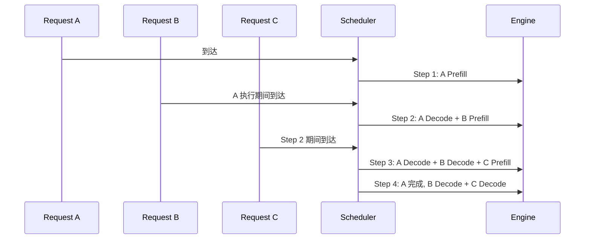
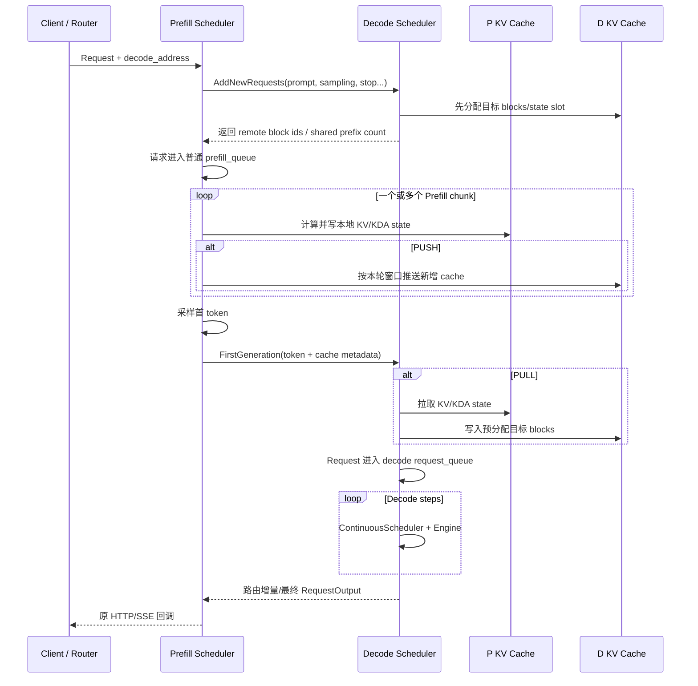

# xLLM Scheduler 全量解读：连续批处理、Chunked Prefill 与 PD 分离

> 本文是 `code_wiki` 的第二篇源码通读笔记，承接第一篇“在线服务完整链路”，专门拆解 xLLM 的调度系统。
>
> 阅读目标不是记住几个类名，而是能够回答：请求为什么在某一轮被选中，长 Prompt 为什么会被切块，Decode 为什么可能优先，显存不够时谁被抢占，Prefill/Decode 分离后 KV cache 和首 token 怎样跨实例交接。
>
> 源码基线：`xllm` 提交 `9768548dd359460d46e7fab32d3cd905407fff6d` 及 2026-08-13 当前工作区。文中会严格区分“当前源码具备的能力”和“本仓库 Kimi K3 已经实际验证的能力”。

## 1. Scheduler 到底是什么

最容易产生的误解是：Scheduler 只是一个请求队列。

实际上，队列只解决“谁先来”。xLLM Scheduler 每一轮还必须同时回答五个问题：

1. **谁可以运行**：新来的 Prefill、未完成的 Chunked Prefill，还是正在生成的 Decode？
2. **这一轮运行多少 token**：长 Prompt 是全部计算，还是只计算其中一个 chunk？
3. **这一轮最多放多少序列**：一个 Request 可能因为 `best_of` 或 beam search 展开成多条 Sequence。
4. **KV cache 是否够用**：选中请求前必须拿到物理 block，不能先执行再考虑状态放在哪里。
5. **怎样满足延迟目标**：既要降低首 token 延迟 TTFT，又要避免正在输出的请求出现明显卡顿。

可以把 Scheduler 理解为设备前面的“实时配载员”。它每一轮拿着三本账：

```text
token 账：这一轮最多计算多少个 query token
sequence 账：这一轮最多容纳多少条 sequence
cache 账：这些 sequence 的历史状态和新增状态放在哪里
```

在启用延迟感知调度时，还会增加第四本账：

```text
latency 账：预测这一轮执行时间是否会突破 TTFT/TPOT 预算
```

Scheduler 不计算 Transformer 数学，但它决定模型每一轮看到什么输入。因此，Scheduler 既影响吞吐与延迟，也直接定义 Attention、KV cache 和模型执行器必须遵守的运行时契约。

### 1.1 先用医院候诊室理解调度

可以先把 NPU 看成一组检查设备，把请求看成病人。

每个病人的情况不同：

- 有人刚来，需要先做一整套初检，对应 Prefill；
- 有人已经完成初检，只需每隔一小步继续复查，对应 Decode；
- 有人的初检项目太多，需要拆成几次，对应 Chunked Prefill；
- 每个病人还占用一份病历与检查状态，对应 KV cache；
- 设备每轮能处理的人数和检查项目数有限，对应 Sequence 与 token 预算。

如果调度器只按“先来后到”办事，一个超长 Prompt 可以长时间占住设备，已经开始流式输出的请求会突然卡住。反过来，如果永远优先 Decode，新来的长 Prompt 又可能迟迟拿不到首 token。

所以 Scheduler 做的不是简单排队，而是在每轮重新回答：

```text
这轮选谁？
每人做多少工作？
状态存储够不够？
谁需要等待或暂时让出资源？
怎样在吞吐、首 token 和连续输出之间折中？
```

映射回源码：病人是 `Request/Sequence`，本轮名单是 `Batch`，检查项目数是 query-token budget，病历空间是 KV block，执行一轮就是一个 step。

### 1.2 七个高频词的白话解释

| 术语 | 白话解释 | 不要误解为 |
|---|---|---|
| enqueue | 把请求放入候选队列 | 已经进入模型 |
| admission | 判断请求是否有资格获得资源并开始/恢复 | 只检查到达时间 |
| schedule | 为当前 step 真正选 Sequence 和 token 数 | 整个请求一次做完 |
| budget | 当前 step 可消费的资源上限 | 已经预占的固定 batch |
| preemption | 暂停某请求并回收/重建部分资源，让别人先跑 | 取消用户请求 |
| fairness | 避免某类请求长期得不到执行 | 所有请求延迟完全相同 |
| SLO | 服务希望满足的延迟目标 | 数学正确性条件 |

TTFT、TPOT 和 TTLT 也要先分清：

```text
TTFT = 从请求到达到首个输出 token 的时间
TPOT = 首 token 之后，平均每个输出 token 的间隔
TTLT = 从请求到达到整个请求结束的总时间
```

长 Prefill 往往主要影响自己和别人的 TTFT；Decode 被阻塞会直接表现为 TPOT 抖动；排队、生成长度和资源抢占共同决定 TTLT。

## 2. 四个基础对象：Request、Sequence、Batch、Step

理解后续源码前，先把四个对象分清。

### 2.1 Request：一次用户请求

Request 对应一次 API 调用，持有：

- request id、创建时间和连接状态；
- Prompt、采样参数、停止条件；
- stream callback；
- 优先级、TTFT/TPOT/TTLT SLO；
- 一组 Sequence。

关键定义在 [request.h](/export/home/weinan5/penghengduo/CODE/xllm-KIMI-K3/xllm/xllm/core/framework/request/request.h:38)。

### 2.2 Sequence：一条实际生成路径

一个普通 `n=1` 请求通常只有一条 Sequence。`best_of>1` 或 beam search 可能让一个 Request 管理多条候选 Sequence。

Sequence 才是真正携带 token 历史与 KV 状态的对象，包括：

- Prompt token 与已生成 token；
- KV cache 中已经存在多少 token；
- 物理 block table；
- 当前 DP rank；
- 是否已结束、取消或被抢占；
- 增量 detokenize 与 logprob 状态。

定义在 [sequence.h](/export/home/weinan5/penghengduo/CODE/xllm-KIMI-K3/xllm/xllm/core/framework/request/sequence.h:112)。

### 2.3 Batch：本轮真正送进模型的集合

Batch 不是长期存在的“固定一批请求”，而是 Scheduler 每个 step 临时拼出来的执行单元。下一轮可以加入新请求、移除已完成请求，也可以给同一条 Sequence 分配不同 token 数。

Batch 保存：

- 本轮选中的 Sequence 指针；
- 每条 Sequence 的 token budget；
- BatchForwardType；
- 构建模型输入所需的多模态数据与 cache transfer 信息；
- 模型输出应该写回哪些 Sequence。

定义在 [batch.h](/export/home/weinan5/penghengduo/CODE/xllm-KIMI-K3/xllm/xllm/core/framework/batch/batch.h:43)。

### 2.4 Step：一次“调度 + 模型执行 + 状态推进”

一次 step 的普通路径是：

```text
从队列取请求
  -> 选择 Sequence 并分配预算/cache
  -> 构造 Batch
  -> Engine 执行一次 forward
  -> 写回采样 token
  -> 流式输出或结束回收
```

一个请求通常跨越多个 step：一个或多个 Prefill step，加上多个 Decode step。

### 2.5 一个请求为什么会在多个队列间移动

以 300-token Prompt、chunk size 128、生成 3 token 为例：

```text
刚到达
  -> prefill_queue

step 0 计算 prompt [0,128)
  -> Prompt 还没结束
  -> chunk_queue

step 1 计算 prompt [128,256)
  -> 仍未结束
  -> chunk_queue

step 2 计算 prompt [256,300)，并采样首 token
  -> decode_queue

step 3/4 继续各生成一个 token
  -> 请求完成
  -> response + resource release
```

队列名称表示“下一次需要哪类工作”，不是用户请求的永久身份。同一个 Request 可以随着 Sequence 状态推进而换队列，但 request id、token 历史和 KV 所有权必须保持一致。

## 3. Sequence 阶段不是手工标签，而是由状态推导

[Sequence::stage()](/export/home/weinan5/penghengduo/CODE/xllm-KIMI-K3/xllm/xllm/core/framework/request/sequence.h:140) 根据“当前 token 总数”和“已有 KV token 数”实时推导阶段：

```text
kv_cache_tokens == 0 且 Prompt 未完成
  -> PREFILL

0 < kv_cache_tokens < Prompt token 数
  -> CHUNKED_PREFILL

kv_cache_tokens >= Prompt token 数
  -> DECODE
```

可以写成近似公式：

```text
stage =
  PREFILL          if cached == 0 and cached < prompt_end
  CHUNKED_PREFILL  if 0 < cached < prompt_end
  DECODE           if cached >= prompt_end
```

这个设计很重要：

- Scheduler 不需要维护另一份容易过期的 stage 字段。
- Prefix Cache 命中后，请求可以直接从非零 `cached` 开始。
- 一个 chunk 执行完成、KV token 数增加后，下一轮 stage 会自然变化。
- 最后一个 Prompt chunk 完成并采出首 token 后，Sequence 自然进入 Decode。

### 3.1 一个 300-token Prompt 的状态变化

假设 chunk size 为 128，且没有 Prefix Cache：

| Step 前 cached | 本轮计算 | Step 后状态 | 是否采样首 token |
|---:|---:|---|---|
| 0 | Prompt `[0,128)` | CHUNKED_PREFILL | 否 |
| 128 | Prompt `[128,256)` | CHUNKED_PREFILL | 否 |
| 256 | Prompt `[256,300)` | DECODE | 是，使用最后一个 Prompt token 的 logits |
| 300 | 第一个生成 token | DECODE | 采样下一个 token |

中间 chunk 只填 cache，不应该产生用户可见 token。[Batch::refresh_output_targets()](/export/home/weinan5/penghengduo/CODE/xllm-KIMI-K3/xllm/xllm/core/framework/batch/batch.cpp:375) 只有在本轮抵达当前 token 末尾时才登记采样位置。

## 4. Scheduler 源码地图

| 领域 | 关键文件 | 作用 |
|---|---|---|
| 调度器接口 | [scheduler.h](/export/home/weinan5/penghengduo/CODE/xllm-KIMI-K3/xllm/xllm/core/scheduler/scheduler.h:28) | `add_request`、`step`、`generate`、pause/resume 抽象 |
| 主调度器 | [continuous_scheduler.cpp](/export/home/weinan5/penghengduo/CODE/xllm-KIMI-K3/xllm/xllm/core/scheduler/continuous_scheduler.cpp:96) | 请求接入、每轮组批、执行、输出、暂停 |
| 调度状态/预算 | [scheduler_policy.h](/export/home/weinan5/penghengduo/CODE/xllm-KIMI-K3/xllm/xllm/core/scheduler/scheduler_policy.h:40) | `SchedulerState`、`ScheduleBudget`、策略接口 |
| 公共调度原语 | [scheduler_policy.cpp](/export/home/weinan5/penghengduo/CODE/xllm-KIMI-K3/xllm/xllm/core/scheduler/scheduler_policy.cpp:113) | drain、Prefill/Decode 分配、抢占、指标 |
| PrefillFirst | [prefill_first_policy.cpp](/export/home/weinan5/penghengduo/CODE/xllm-KIMI-K3/xllm/xllm/core/scheduler/prefill_first_policy.cpp:31) | Prefill 和 Decode 批次互斥，Prefill 优先 |
| DecodeFirst | [decode_first_policy.cpp](/export/home/weinan5/penghengduo/CODE/xllm-KIMI-K3/xllm/xllm/core/scheduler/decode_first_policy.cpp:30) | Decode 先填批次，剩余预算给 Prefill |
| Unified | [unified_policy.cpp](/export/home/weinan5/penghengduo/CODE/xllm-KIMI-K3/xllm/xllm/core/scheduler/unified_policy.cpp:35) | Prefill/Decode 统一排序，多 SLO 与优先级 |
| 队列实现 | [request_priority_queue.h](/export/home/weinan5/penghengduo/CODE/xllm-KIMI-K3/xllm/xllm/core/scheduler/request_priority_queue.h:60) | Deque、Heap、Set 三种队列 |
| 优先级比较 | [priority_comparator.cpp](/export/home/weinan5/penghengduo/CODE/xllm-KIMI-K3/xllm/xllm/core/framework/request/priority_comparator.cpp:22) | FCFS、priority、deadline、density、SLO |
| Batch 创建 | [batch_factory.cpp](/export/home/weinan5/penghengduo/CODE/xllm-KIMI-K3/xllm/xllm/core/framework/batch/batch_factory.cpp:32) | 按 DP rank 创建 Batch，统计 Prefill/Decode token |
| Batch 输入 | [batch_input_builder.cpp](/export/home/weinan5/penghengduo/CODE/xllm-KIMI-K3/xllm/xllm/core/framework/batch/batch_input_builder.cpp:671) | token、position、block table、slot mapping |
| 异步响应 | [async_response_processor.cpp](/export/home/weinan5/penghengduo/CODE/xllm-KIMI-K3/xllm/xllm/core/scheduler/async_response_processor.cpp:86) | detokenize、stream callback、取消 |
| Scheduler 工厂 | [scheduler_factory.cpp](/export/home/weinan5/penghengduo/CODE/xllm-KIMI-K3/xllm/xllm/core/scheduler/scheduler_factory.cpp:29) | Continuous、PD、PD-OOC、ZeroEviction 选择 |
| PD Scheduler | [disagg_pd_scheduler.cpp](/export/home/weinan5/penghengduo/CODE/xllm-KIMI-K3/xllm/xllm/core/scheduler/disagg_pd_scheduler.cpp:50) | P/D 请求与首 token 交接、KV transfer |
| PD-OOC | [pd_ooc_scheduler.cpp](/export/home/weinan5/penghengduo/CODE/xllm-KIMI-K3/xllm/xllm/core/scheduler/pd_ooc_scheduler.cpp:214) | PD 下 online/offline 共置调度 |
| 配置 | [scheduler_config.cpp](/export/home/weinan5/penghengduo/CODE/xllm-KIMI-K3/xllm/xllm/core/framework/config/scheduler_config.cpp:21) | batch、chunk、mix、overlap、priority 默认值 |

## 5. Scheduler 是怎样被创建的

LLM/VLM Master 会把全局 Options 转成 `ContinuousScheduler::Options`，再调用 Scheduler 工厂。Kimi K3 当前走 [VLMMaster](/export/home/weinan5/penghengduo/CODE/xllm-KIMI-K3/xllm/xllm/core/distributed_runtime/vlm_master.cpp:84)。

### 5.1 第一层选择：哪一种 Scheduler 类

[select_scheduler_kind()](/export/home/weinan5/penghengduo/CODE/xllm-KIMI-K3/xllm/xllm/core/scheduler/scheduler_factory.cpp:29) 的顺序是：

```text
enable_disagg_pd && enable_pd_ooc -> PDOOCScheduler
enable_disagg_pd                  -> DisaggPDScheduler
use_zero_evict                    -> ZeroEvictionScheduler
否则                              -> ContinuousScheduler
```

DiT 和推荐/REC 不走这条完全相同的路径：DiT 使用 `DiTDynamicBatchScheduler`，REC 使用 `FixedStepsScheduler`。本文主线聚焦生成式 LLM/VLM 的 ContinuousScheduler 体系。

### 5.2 第二层选择：ContinuousScheduler 内部采用什么 Policy

[resolve_batch_mode()](/export/home/weinan5/penghengduo/CODE/xllm-KIMI-K3/xllm/xllm/core/scheduler/continuous_scheduler.cpp:63) 先解析两个核心开关：

- `enable_chunked_prefill`
- `enable_mix_batch`

再结合 `priority_strategy` 选择策略：

| 条件 | Policy | 批次语义 |
|---|---|---|
| `enable_mix_batch=false` | PrefillFirst | Prefill 与 Decode 互斥 |
| mix 开启，普通优先级策略 | DecodeFirst | Decode 优先，可与 Prefill 混批 |
| mix 开启，`multi_slo_and_prio` | Unified | Prefill/Decode 放进统一队列排序 |

以下条件会强制关闭 Mix Batch：

- `cp_size > 1`
- 启用 MTP/推测解码
- 关闭 Chunked Prefill
- PD 的 PREFILL 实例

`multi_slo_and_prio` 会反过来强制开启 Chunked Prefill，因为统一调度必须能把长 Prefill 切成可控的小工作单元。

## 6. ContinuousScheduler 构造函数逐段解读

[ContinuousScheduler 构造函数](/export/home/weinan5/penghengduo/CODE/xllm-KIMI-K3/xllm/xllm/core/scheduler/continuous_scheduler.cpp:96) 完成的是运行时装配：

1. 从 Engine 获取 `KVCacheManager`。
2. 读取 Prefix Cache、Linear Attention 等能力。
3. 创建 ProfileManager，用于 TTFT/TPOT 与 step 时间预测。
4. 根据 BatchMode 创建 Policy。
5. 创建取消队列与 AsyncResponseProcessor。
6. 根据 priority strategy 创建 Prefill、Chunk、Decode 队列。
7. 若启用服务路由，连接 XService 控制面。
8. 初始化 schedule overlap 与 speculative token 所需状态。

### 6.1 为什么要有四个队列

普通策略维护：

```text
request_queue    HTTP/Master 写入的并发入口队列
prefill_queue    尚未开始或被抢占后要重算的请求
chunk_queue      已有部分 KV、Prompt 尚未完成的请求
decode_queue     Prompt 已完成、正在生成的请求
```

UnifiedPolicy 则额外使用 `unified_queue`，把 Prefill 与 Decode 请求放在同一个 list 中按 SLO 统一排序。

入口使用 `folly::MPMCQueue`，让请求处理线程和调度线程解耦；真正的优先级队列只由 Scheduler 线程维护。

### 6.2 不同优先级为什么使用不同容器

- `fcfs` 与 `multi_slo_and_prio` 使用 Deque，支持前后插入和稳定排序。
- `priority`、`deadline` 等使用 Heap/Set，快速取得最高和最低优先级请求。
- Chunk/Decode 需要从尾部找到低优先级请求做抢占，因此某些路径使用 Set。

容器不是实现细节：它决定能否稳定保持 FCFS、能否高效找到抢占对象，以及 Unified 调度能否重排整个队列。

## 7. 请求从 API 到 Scheduler

Master 完成 Chat Template、Tokenizer 和 Request 构造后调用：

```cpp
scheduler_->add_request(request);
```

[ContinuousScheduler::add_request()](/export/home/weinan5/penghengduo/CODE/xllm-KIMI-K3/xllm/xllm/core/scheduler/continuous_scheduler.cpp:176) 做两件事：

1. 若配置了外部 KV storage，先发起 Prefix/KV prefetch。
2. 把 Request 写入有界 `request_queue_`。

这里没有立刻申请设备 block，也没有立即调用模型。真正的准入发生在 Scheduler 线程的 `prepare_batch()`。

如果队列已满，`add_request()` 返回 false，Master/API 层必须把它转成服务过载，而不是让请求无限堆积。

## 8. `step()`：调度主循环的完整骨架

[ContinuousScheduler::step()](/export/home/weinan5/penghengduo/CODE/xllm-KIMI-K3/xllm/xllm/core/scheduler/continuous_scheduler.cpp:326) 是核心入口。

不开 schedule overlap 时，它非常直观：

```text
处理 pause 状态
  -> schedule_request(timeout)
       -> 应用取消请求
       -> prepare_batch()
       -> 没有任务时最多等待 timeout
  -> engine.step(batch)
  -> process_batch_output(false)
```

### 8.1 空闲时为什么不是死循环

`schedule_request()` 如果没有 batch：

- 队列仍非空时立即重试，因为可能只是暂时受策略/transfer 状态影响。
- 所有队列都空时，每次最多 sleep 1 ms，直到 timeout。

Master 通常传入一个有限 timeout，因此既能低延迟接收新请求，也不会在空闲时占满 CPU。

### 8.2 取消为什么在调度边界生效

客户端断开由 response callback 写入 `CancelRequestQueue`。Scheduler 在下一轮 `schedule_request()` 开头统一设置 `request->set_cancel()`。

这样避免网络线程直接修改 Scheduler 队列和 KV ownership。代价是取消不是即时中断当前 kernel，而是在安全的 step 边界清理。

## 9. `prepare_batch()` 的五个阶段

[ContinuousScheduler::prepare_batch()](/export/home/weinan5/penghengduo/CODE/xllm-KIMI-K3/xllm/xllm/core/scheduler/continuous_scheduler.cpp:216) 可以拆成五段。

### 9.1 Drain：把新请求放进策略队列

[drain_request_queue()](/export/home/weinan5/penghengduo/CODE/xllm-KIMI-K3/xllm/xllm/core/scheduler/scheduler_policy.cpp:113) 读取入口 MPMC 队列：

- `kv_cache_tokens == 0` 的普通新请求进入 `prefill_queue`。
- PD Decode 侧收到的请求已经有 KV allocation，会进入 running 集合。
- Prefix Cache 关闭时，可以提前把 `best_of` 展开为多条 Sequence。

### 9.2 Collect：回收完成和取消请求

[collect_finished()](/export/home/weinan5/penghengduo/CODE/xllm-KIMI-K3/xllm/xllm/core/scheduler/scheduler_policy.cpp:137) 会：

1. 更新客户端连接状态。
2. 对 finished/cancelled 请求释放 KV cache。
3. 从 running 集合移除。
4. 交给 AsyncResponseProcessor 生成最终响应。

资源回收必须在下一轮准入前完成，否则已经结束的请求仍会占着 block，造成虚假的显存不足。

### 9.3 Budget：创建本轮预算

Scheduler 初始化：

```text
remaining_token_budget = max_tokens_per_batch
remaining_seq_budget   = max(max_seqs_per_batch, 1)
latency_budget         = max_global_tpot_ms
estimate_latency       = 固定运行时开销
```

启用 profile token budget 后，token budget 可以由 ProfileManager 动态给出，不再固定等于 CLI 配置。

### 9.4 Policy：选择本轮请求

Policy 按自己的顺序从 Prefill/Chunk/Decode/Unified 队列取请求，并且对每条 Sequence：

- 计算本轮 token 数；
- 检查 token/sequence/latency budget；
- 匹配 Prefix Cache；
- 申请 KV block；
- 必要时抢占低优先级请求；
- 写入 `running_sequences` 与对应 budget。

### 9.5 Finalize：创建 DP Batch 并触发 cache transfer

[BatchFactory::create_batches()](/export/home/weinan5/penghengduo/CODE/xllm-KIMI-K3/xllm/xllm/core/framework/batch/batch_factory.cpp:32) 按 `sequence->dp_rank()` 放入不同 DP Batch。同一 Sequence 生命周期内固定在同一 DP rank，以保持 cache locality。

随后 `KVCacheManager::transfer_blocks()` 处理：

- host/device swap block；
- PD PUSH 等远端 KV transfer；
- 本轮无需模型 batch 时仍可能需要推进的 transfer。

## 10. 三类预算怎样共同工作

### 10.1 Token budget

Token budget 统计的是本轮模型实际要处理的 query token，不是“请求最大输出 token”。

例如：

```text
Decode A：1 token
Decode B：1 token
Prefill C：100 token
本轮 token 消耗 = 102
```

对推测解码，单条 Decode 的预算是：

```text
1 + min_speculative_tokens_required
```

开启 schedule overlap 时，代码会把所需 speculative token 预留翻倍，因为同时存在一个在途 step。

### 10.2 Sequence budget

每条参与本轮执行的 Sequence 消耗一个 sequence budget。一个 Request 若有多条活跃 Sequence，会消耗多个名额。

所以：

- `max_seqs_per_batch` 不是最大 HTTP 请求数。
- Beam search 的一组候选必须整体满足严格预算，避免只调度半个 beam group。
- UnifiedPolicy 当前明确限制一个 Request 只有一条 Sequence。

### 10.3 Latency budget

启用 latency-aware 后，ProfileManager 根据：

- 当前 KV 长度；
- 本轮新增 token；
- batch sequence 数；
- 固定运行时开销；

预测 step 时间。若再加入一个请求会超过本轮 TTFT 或 TPOT budget，就停止扩批。

它解决的是“token 数相同但成本不同”的问题。一个上下文 16K 的 Decode 和一个上下文 128 的 Decode 都只输入一个 token，但 Attention 读取历史的成本并不相同。

### 10.4 一个具体预算例子

假设：

```text
max_tokens_per_batch = 256
max_seqs_per_batch   = 4
chunk_size           = 128
```

队列里有：

```text
A：Decode
B：Decode
C：剩余 Prompt 400 token
D：新 Prompt 80 token
```

DecodeFirst 可能得到：

| 请求 | 本轮 token | 累计 token | 累计 sequence |
|---|---:|---:|---:|
| A Decode | 1 | 1 | 1 |
| B Decode | 1 | 2 | 2 |
| C Chunk | 128 | 130 | 3 |
| D Prefill | 80 | 210 | 4 |

此时仍剩 46 token，但 sequence budget 已耗尽，所以不能再加入请求。Policy 可能把剩余 token 重新分配给已入选的 Prefill Sequence，但仍受 chunk、cache 和 latency 条件约束。

## 11. PrefillFirstPolicy：批次互斥

[PrefillFirstPolicy::schedule()](/export/home/weinan5/penghengduo/CODE/xllm-KIMI-K3/xllm/xllm/core/scheduler/prefill_first_policy.cpp:31) 的顺序是：

1. 把上轮 running 请求重新放回 Chunk 或 Decode 队列。
2. 先调度 `chunk_queue`，保证已经开始的长 Prompt 继续推进。
3. 再调度新的 `prefill_queue`。
4. 本轮只要选中了任何 Prefill，就不调度 Decode。
5. 只有 Prefill 完全选不到时，才调度 `decode_queue`。

它的特点是逻辑清晰、Batch shape 单纯：

```text
本轮要么 Prefill/Chunked Prefill
本轮要么 Decode
绝不混合
```

适用场景包括：

- CP 或 MTP 不支持混批时；
- PD 的 PREFILL 实例；
- 模型/Attention backend 尚未实现 Mixed Batch；
- bring-up 阶段希望降低运行时变量。

代价是一个 Prefill batch 可能让已有 Decode 等一整轮，TPOT 抖动通常更明显。

## 12. DecodeFirstPolicy：当前默认的混批思路

默认配置开启 Chunked Prefill 和 Mix Batch，普通 FCFS 会进入 [DecodeFirstPolicy](/export/home/weinan5/penghengduo/CODE/xllm-KIMI-K3/xllm/xllm/core/scheduler/decode_first_policy.cpp:30)。

调度顺序是：

1. 上轮未完成请求按阶段重新入 Chunk/Decode 队列。
2. 先尽量放入 Decode 请求。
3. 用剩余 token/sequence/latency budget 放 Chunk continuation。
4. 再放新的 Prefill。
5. 把剩余 token budget 尝试重新分配给已经入选的 Prefill Sequence。

这类策略也常被称为 decode-maximal batching：先保护正在输出请求的 token 间延迟，再用设备剩余容量消化 Prompt。

### 12.1 为什么 Chunk continuation 比新 Prompt 优先

Chunk continuation 已经占有部分 KV block。如果长期不让它继续：

- 用户一直等不到首 token；
- 已占 block 长时间不能释放；
- 内存碎片和抢占概率增加。

因此无论 PrefillFirst 还是 DecodeFirst，都先处理 `chunk_queue`，再接纳全新的 Prompt。

### 12.2 为什么要预留“完整 KV footprint”

Chunked Prefill 的危险是：本轮只需要 128 token 的 block，看起来能放下；但整个 20K Prompt 最终根本不可能放入 cache。若盲目接纳，它会计算到一半后永远无法完成。

[schedule_prefill_from_queue()](/export/home/weinan5/penghengduo/CODE/xllm-KIMI-K3/xllm/xllm/core/scheduler/scheduler_policy.cpp:171) 对新请求做 full-footprint admission：

```text
full_footprint = ceil(sequence_total_tokens / block_size)
```

本轮不会一次分配全部 footprint，但会确认系统总容量能够承载它。DecodeFirst 还把当前已使用 block 乘以 1.1 作为保护余量，降低新 Prefill 挤压 Decode 的概率。

## 13. UnifiedPolicy：Prefill 和 Decode 统一竞争

[UnifiedPolicy](/export/home/weinan5/penghengduo/CODE/xllm-KIMI-K3/xllm/xllm/core/scheduler/unified_policy.cpp:35) 不再维护“Prefill 一组、Decode 一组”的固定先后关系，而是把所有请求放进统一 list：

```text
Prefill A
Decode B
Chunk C
Decode D
  -> 更新 deadline / urgency / estimated latency
  -> 统一排序
  -> 从队首按预算调度
```

它主要服务 `multi_slo_and_prio`：

- Prefill 关注 TTFT deadline。
- Decode 关注 TPOT deadline。
- 高优先级请求有更高权重。
- 即将违约的请求被标记为 URGENT。
- 等待过久的请求进入 anti-starvation 逻辑。

### 13.1 Density 的含义

代码中的 density 近似为：

```text
density = priority_weight / estimated_latency
```

它倾向选择“单位执行时间能完成更多优先级价值”的请求。URGENT 与 NORMAL 请求还会分别采用 density 或 deadline 排序。

### 13.2 UnifiedPolicy 还管理 H2D copy budget

当 KV cache 有 host blocks 时，UnifiedPolicy 会预测：

- 本轮模型计算时间；
- 从 host 拷回 device 的时间；
- 最多允许拷多少 block 才不会让 transfer 成为关键路径。

这说明调度资源不只包括算力和设备 cache，也可能包括传输带宽。

### 13.3 使用边界

当前实现对 Unified/Mix 路径有明确约束：一个 Request 只支持一条 Sequence。开启 `best_of>1`、复杂 beam 或特殊模型前，应先检查对应策略测试，而不是假定所有采样模式天然兼容。

## 14. Continuous Batching 到底“连续”在哪里

传统静态 batch：

```text
凑齐 A、B、C
  -> 一直运行到 A、B、C 全部结束
  -> 才接纳下一批
```

Continuous Batching：

```text
Step 1：A Prefill，B Prefill
Step 2：A Decode，B Decode，新加入 C Prefill chunk
Step 3：A 完成，B Decode，C 下一 chunk，新加入 D Prefill
Step 4：B Decode，C Decode，D Decode
```

连续的不是“一个 kernel 永不停止”，而是**每个 step 都重新组批**。

### 14.1 三个请求的完整时间线

假设 A、B、C 到达时间不同：



请求在设备执行期间仍可进入 MPMC queue；它会在下一个安全调度边界参与竞争。

### 14.2 BatchForwardType

[Batch::update_forward_type()](/export/home/weinan5/penghengduo/CODE/xllm-KIMI-K3/xllm/xllm/core/framework/batch/batch.cpp:90) 根据其中 Sequence 阶段归纳：

- `PREFILL`
- `CHUNKED_PREFILL`
- `DECODE`
- `MIXED`

Attention backend 不能把 MIXED 当成 Decode，也不能只看 batch 中第一条 Sequence。每条 Sequence 的 query length、KV length 和 slot mapping 才是实际依据。

## 15. Chunked Prefill 详细源码解读

### 15.1 Chunk 大小怎样计算

[compute_prefill_tokens()](/export/home/weinan5/penghengduo/CODE/xllm-KIMI-K3/xllm/xllm/core/scheduler/scheduler_policy.cpp:333) 的核心是：

```text
本轮 chunk = min(
  剩余 Prompt token,
  max_tokens_per_chunk_for_prefill,
  本轮剩余 token budget
)
```

若未显式设置 `max_tokens_per_chunk_for_prefill`，入口会把 `-1` 规范化为 `max_tokens_per_batch`，见 [xllm.cpp](/export/home/weinan5/penghengduo/CODE/xllm-KIMI-K3/xllm/xllm/xllm.cpp:454)。

### 15.2 CP 下为什么要对齐 chunk

启用 Context Parallel 后，中间 chunk 会向下对齐到：

```text
kv_split_size * block_size
```

最后一个 chunk 可以不对齐，否则永远无法处理尾部。这个限制来自当前 KV split/block 映射，而不是语言模型数学本身。

### 15.3 Linear Attention 为什么需要更严格的边界

普通 Attention 的 Prefix Cache 可以在完整 KV block 处恢复。KDA/GDN 等 Linear Attention 还需要 recurrent/conv state checkpoint。

当模型含 Linear Attention 且 Prefix Cache 开启时，中间 chunk 必须对齐到配置的 chunk stride，保证：

- KV prefix 与 recurrent state 是同一逻辑位置；
- 恢复时不会拿“token 256 的 KV”搭配“token 128 的 recurrent state”。

最终 chunk仍允许非对齐完成。相关逻辑在 [allocate_for_prefill()](/export/home/weinan5/penghengduo/CODE/xllm-KIMI-K3/xllm/xllm/core/scheduler/scheduler_policy.cpp:363)。

### 15.4 中间 chunk 为什么不采样

中间 chunk 没有完整 Prompt 的最后 hidden state，因此不能产生模型的首个回答 token。Batch 输出处理会识别 Chunked Prefill，并只推进 KV 状态，不 append 用户 token。

Schedule overlap 下还维护一个小型 pre-scheduled stage queue，保证“调度时看到的阶段”和“一轮后真实输出对应的阶段”不会错位，见 [Batch::update_sequence_state()](/export/home/weinan5/penghengduo/CODE/xllm-KIMI-K3/xllm/xllm/core/framework/batch/batch.cpp:671)。

### 15.5 Chunked Prefill 的收益与代价

收益：

- 长 Prompt 不再独占一个超大 step。
- Decode 可以在 chunk 之间插入，TPOT 更稳定。
- 动态 shape 和峰值 activation 更容易控制。

代价：

- 多次调度与 kernel launch。
- cache/position/metadata contract 更复杂。
- Prefix Cache、PD transfer、Linear Attention 都要理解 chunk 边界。
- chunk 太小会明显降低 Prefill 吞吐。

所以 chunk size 不是越小越好，而是 TTFT、TPOT、Prefill 吞吐和内存峰值之间的平衡。

## 16. KV Cache 如何参与调度决策

Scheduler 在选中 Sequence 前就要申请 cache，核心原因是模型 forward 必须拿到稳定的 block table 和写入 slot。

### 16.1 Prefill 分配

Prefill 的顺序是：

```text
尝试匹配 Prefix Cache
  -> 计算本轮结束位置
  -> 为未命中后缀申请新 block
  -> 记录实际能处理的 token 数
```

Prefix Cache 命中会减少实际计算 token，但 Sequence 的逻辑位置保持不变。

### 16.2 Decode 分配

Decode 每轮通常只新增一个 token，但若当前最后一个 block 已满，就需要再申请一个 block。推测解码还要为多个候选 token 预留空间。

[schedule_decode_from_queue()](/export/home/weinan5/penghengduo/CODE/xllm-KIMI-K3/xllm/xllm/core/scheduler/scheduler_policy.cpp:462) 会在把请求加入 Batch 前完成这些申请。

### 16.3 Prefill memory threshold

当普通模式 KV 利用率达到 `prefill_scheduling_memory_usage_threshold`，Scheduler 停止接纳新 Prefill。默认阈值为 0.95。

目的不是宣告“还有 5% 永远不用”，而是给正在 Decode 的请求增长、运行时波动和 block 边界留安全空间。

### 16.4 显存不够时的抢占顺序

Decode 申请 block 失败时，公共策略依次尝试：

1. 抢占 `chunk_queue` 尾部的低优先级请求。
2. 再抢占 `decode_queue` 尾部的低优先级请求。
3. 释放被抢占请求持有的 KV。
4. 标记 `preempted`。
5. 推回 `prefill_queue`，以后重新 Prefill。

这是一种“释放状态，稍后重算”的抢占。请求的 HTTP 生命周期没有结束，但已计算的私有 KV 可能丢失；恢复时可以重新匹配仍然有效的 Prefix Cache，不能假定原状态完整保留。

### 16.5 为什么不抢占当前最高优先级候选

如果为了给队首请求分配 cache，反过来抢占它自己，系统不会前进。代码从队尾寻找其他持有 cache 的请求；只剩一个仍无法容纳的请求时，返回 `RESOURCE_EXHAUSTED`，避免无限循环。

## 17. Prefix Cache 与 Scheduler 的关系

Prefix Cache 不是 Attention backend 自己偷偷复用 tensor，而是 Scheduler/KVCacheManager 的正式准入步骤。

### 17.1 跨请求 Prefix Cache

相同完整 block 前缀通过链式 hash 匹配。命中后：

- Sequence 挂载 shared blocks。
- `kv_cache_tokens` 从命中长度开始。
- Scheduler 只为后缀分配 budget 与新 block。
- usage 中可记录 cached token 数。

### 17.2 In-batch Prefix Cache

开启 `enable_in_batch_prefix_cache` 后，本轮先接纳的 Prefill 可以把已经覆盖的完整 block 发布到 Prefix Cache，让同一轮后接纳的请求直接共享。

[cache_in_batch_prefix()](/export/home/weinan5/penghengduo/CODE/xllm-KIMI-K3/xllm/xllm/core/scheduler/scheduler_policy.cpp:820) 按“当前 cached + 本轮 budget”的边界缓存，不会发布尚未计算的位置。

### 17.3 Chunk continuation 多久重新匹配一次

普通模型不必每个很小 chunk 都做完整 Prefix 匹配。`chunked_match_frequency` 控制重新匹配频率，默认 2。

Linear Attention + Prefix Cache 是例外：它需要在每个 chunk checkpoint 检查可恢复 state，不能只看普通 KV block。

### 17.4 Prefix Cache 不是无限内存

共享 block 仍占实际容量，并受引用计数/LRU 等生命周期控制。命中率高可以减少计算，却不代表可以越过物理 cache 总容量。

## 18. Schedule Overlap：把“调下一轮”和“收上一轮”重叠

默认 `enable_schedule_overlap=false`。开启后，[step_with_schedule_overlap()](/export/home/weinan5/penghengduo/CODE/xllm-KIMI-K3/xllm/xllm/core/scheduler/continuous_scheduler.cpp:377) 形成一个深度为 1 的流水：

```text
Step N:
  调度并提交 Batch N
  获取 Batch N-1 的真实输出
  修正 N-1 的 provisional token/state
  处理 N-1 流式响应
```

### 18.1 为什么需要 fake token

Scheduler 想在上一轮真实采样结果完全取回前先构造下一轮输入，就必须暂时为 Sequence 占一个位置。Engine/Batch 会先 append placeholder，再在 `update_last_step_result()` 中用真实 token 覆盖。

这不是伪造模型输出，而是一种 pipeline bookkeeping。任何一个环节错位都会产生严重问题：

- token position 偏一；
- KV token 数多加或少加；
- Chunked Prefill 被误当 Decode；
- finish reason 提前一轮；
- stream 重复或漏 token。

### 18.2 Overlap 与普通异步不是一回事

HTTP、响应 detokenize 本来就是异步的。Schedule overlap 特指**模型 step 之间**的调度/结果流水，它会改变 Sequence 状态推进方式，因此风险远高于把 callback 放进线程池。

### 18.3 当前限制

部分平台或组合会在配置规范化时关闭 overlap。例如当前代码会对某些 MLU/DCU PD 组合强制关闭。开启前应以最终 dump 配置为准。

## 19. 输出、流式与资源回收

[process_batch_output()](/export/home/weinan5/penghengduo/CODE/xllm-KIMI-K3/xllm/xllm/core/scheduler/continuous_scheduler.cpp:478) 本身不做重型 detokenize，而是：

1. 选择当前或上一轮 Sequence 集合。
2. 更新 TTFT/ITL 指标。
3. 更新 cache/activation 指标。
4. 找出需要流式回调的请求。
5. 交给 AsyncResponseProcessor。

下一轮 `collect_finished()` 才完成最终 cache deallocate 与完成响应处理。

这种拆分让 Scheduler 主循环尽量只做短事务；Tokenizer 和网络 callback 不应长时间阻塞设备下一轮组批。

## 20. DP、TP、CP 与 Scheduler

### 20.1 DP：决定 Batch 分片

每条 Sequence 一旦分配到某个 DP rank，整个生命周期保持该 rank。BatchFactory 按 DP rank 创建多个 Batch，避免 KV cache 在 DP 副本间迁移。

DP 的目标是让不同请求并行；Scheduler 要在 rank 间平衡负载，同时保持 locality。

### 20.2 TP：同一个 Batch 的多 rank 协作

同一 DP 组内的 TP ranks 必须收到一致的 token/sequence shape。Scheduler 只形成一次逻辑 Batch，Engine 把同一输入发给所有 TP worker；每个 rank 计算权重 shard。

某个 TP rank 看到不同 Sequence 会让 collective 卡死，因此不能在模型 rank 内部自行做第二套请求调度。

### 20.3 CP：影响 chunk 对齐与混批

CP 切分上下文维度，当前实现会：

- 强制关闭 Mix Batch；
- 对齐中间 chunk 到 `kv_split_size * block_size`；
- 要求各 CP rank 共享一致的逻辑位置和 block 映射。

### 20.4 MTP/推测解码：一个 Decode step 不再只占一个 token

MTP 会让 Scheduler 为候选 token 和 overlap 在途状态预留额外 budget/cache。当前 `resolve_batch_mode()` 也会关闭 Mix Batch，减少 speculative verify 与 Prefill 混合带来的复杂性。

## 21. PD 分离先讲原理

Prefill 和 Decode 的硬件行为差异很大：

| 阶段 | 输入形态 | 主要目标 |
|---|---|---|
| Prefill | 少量请求、每条很多 token | 高算力吞吐、低 TTFT |
| Decode | 大量请求、每条通常 1 token | 稳定 TPOT、低时延 |

共置服务让二者争用同一批设备。一个长 Prefill 可能让几十个 Decode 请求暂停一轮；为了保护 Decode，又可能把 Prefill chunk 切得过小。

PD 分离把它们放到不同实例：

```text
PREFILL instance：处理 Prompt，产生 KV cache 和首 token
DECODE instance ：接收 KV cache 与首 token，继续后续生成
```

关键难点不是把 HTTP 请求转发一下，而是**迁移模型状态**。Decode 不能只拿首 token；没有 Prompt 的每层 KV/KDA 状态，它无法继续生成。

## 22. xLLM PD Scheduler 的对象关系

启用 `enable_disagg_pd` 后，Scheduler 工厂创建 [DisaggPDScheduler](/export/home/weinan5/penghengduo/CODE/xllm-KIMI-K3/xllm/xllm/core/scheduler/disagg_pd_scheduler.h:37)。它继承 ContinuousScheduler，所以 P/D 两侧仍使用同一套：

- Request/Sequence；
- budget 与 Policy；
- BatchFactory；
- Engine 与 AsyncResponseProcessor。

它额外增加：

- P 侧请求 dispatch 线程；
- P/D 内部 brpc server；
- 远端 instance registry/channel；
- 请求到远端 Decode channel 的映射；
- P 侧首 token 发送线程池；
- D 侧等待首 token 的 Request map；
- KV PUSH/PULL 元数据。

PD 的内部 RPC 端口默认 7777，与面向用户的 OpenAI HTTP 端口不是同一个服务。

## 23. PD 完整请求时序

这是理解 PD 最重要的一张图：



Decode 侧负责后续 token 生成，但通常不直接持有最初的客户端连接。[AsyncResponseProcessor](/export/home/weinan5/penghengduo/CODE/xllm-KIMI-K3/xllm/xllm/core/scheduler/async_response_processor.h:44) 会依据 `source_xservice_addr` 和 Request 中保存的 callback，把 D 侧增量/最终输出路由回原 XService/P 侧，再完成 HTTP/SSE 响应；它也支持把多个响应组成一次内部 RPC，降低回程开销。

### 23.1 第一步：P 侧接收请求

[DisaggPDScheduler::add_request()](/export/home/weinan5/penghengduo/CODE/xllm-KIMI-K3/xllm/xllm/core/scheduler/disagg_pd_scheduler.cpp:299) 没有直接写普通 request queue，而是写 P 侧 dispatch queue：

- online 请求优先；
- online 等待 100 ms 超时后，尝试取一个 offline 请求；
- 请求必须携带已选择的 `decode_address`。

也就是说，P/D 实例选择通常由上游 XService/路由层完成，DisaggPDScheduler 消费选择结果。

### 23.2 第二步：先让 D 分配目标 cache

[dispatch_requests()](/export/home/weinan5/penghengduo/CODE/xllm-KIMI-K3/xllm/xllm/core/scheduler/disagg_pd_scheduler.cpp:317) 先检查 P/D topology 是否兼容，再通过 `AddNewRequests` 把这些信息发给 D：

- Prompt 与 token ids；
- sequence capacity；
- sampling 与 stop 参数；
- stream/logprob 信息；
- P 侧 cache cluster 信息。

D 侧先创建 Request 并分配目标 block，返回：

- D 侧 block ids；
- 已命中的 shared prefix block 数；
- DP rank；
- linear state slot；
- XTensor offset（若启用）。

为什么必须先分配 D？因为 PUSH 模式下 P 在 Prefill 过程中就要知道每个新 KV block 的远端目的地址。

当前 base dispatch 路径仍按一次一个请求处理；配置中出现批量字段不代表这段路径已经对任意 batch dispatch 完整生效。

### 23.3 第三步：P 侧进入普通 ContinuousScheduler

D 接受并返回目标 allocation 后，P 才把 Request 写入普通 `request_queue_`。从这里开始，P 侧仍按 PrefillFirst/Chunked Prefill、budget、Prefix Cache 和 Engine step 执行。

PD PREFILL 角色会强制关闭 Mix Batch，因为它没有本地长期 Decode 请求，使用互斥 Prefill 策略更清晰。

### 23.4 第四步：P 产生首 token

Prefill 完成后，P 不只是生成 KV，还会基于最后一个 Prompt token 的 logits 采样**第一个输出 token**。

[prefill_send_first_generation()](/export/home/weinan5/penghengduo/CODE/xllm-KIMI-K3/xllm/xllm/core/scheduler/disagg_pd_scheduler.cpp:642) 只处理 `num_generated_tokens()==1` 的请求，并发送：

- first token id；
- logprob/top logprobs；
- P 侧 TTFT；
- Prefix Cache 命中 token 数；
- transfer mode；
- PULL 所需 source block/cluster 信息；
- linear state id；
- MTP bootstrap embedding（若需要）。

### 23.5 第五步：D 恢复状态并开始 Decode

D 在收到 AddNewRequests 时只把 Request 放在 `received_request_map` 等待，还不会抢跑。收到 [FirstGeneration](/export/home/weinan5/penghengduo/CODE/xllm-KIMI-K3/xllm/xllm/core/scheduler/disagg_pd_scheduler.cpp:848) 后才：

1. 找回对应 Request。
2. 校验 first token、cached token 和 MTP bootstrap。
3. 把 first token append 到 Sequence；overlap 模式先放 placeholder。
4. PULL 模式执行真实 KV restore。
5. 把 Request 写入 D 的普通 `request_queue_`。
6. 后续由 ContinuousScheduler 当作 Decode 请求推进。

这个顺序保证 D 开始第一次 Decode 时，token 状态和 KV 状态来自同一个 Prefill 逻辑位置。

## 24. PUSH 与 PULL 的区别

### 24.1 PUSH

```text
D 先告诉 P：目标 block 是哪些
P 每完成一段 Prefill，就把新增 cache 推到 D
首 token 到达时，D 的目标 cache 已经就绪
```

优点：cache transfer 可以和分块 Prefill 流水推进。代价：P 必须提前掌握 D allocation，网络写入路径更复杂。

### 24.2 PULL

```text
P 完成 Prefill并保留 source cache 信息
首 token 通知 D
D 主动从 P 的 source blocks 拉取到本地目标 blocks
完成后才把请求放进 Decode 队列
```

优点：控制权集中在 D，D 可以在确定要执行时拉取。代价：首 token 交接处可能集中承担传输延迟。

### 24.3 Prefix Cache 命中时少传什么

D 在 allocation response 中返回 `remote_shared_num`。P 会把 transfer cursor 前移，跳过 D 已经拥有的 shared prefix，只传后缀。

这需要区分：

- P 本地命中了多少；
- D 本地命中了多少；
- 从哪个逻辑 block 开始传；
- 每类 composite cache group 各自的 shared 数量。

任意一个 cursor 用错，都可能出现“传输成功但 Decode 输出错误”。

### 24.4 Linear/KDA state 也必须交接

混合 Attention 模型不能只传普通 KV。代码还携带 recurrent/linear state slot id，并在 PULL 时把 source/destination state id 交给 Engine。

对 Kimi K3 这类 KDA + MLA 模型，PD 验收必须同时证明：

- MLA latent/positional cache 正确传输；
- KDA recurrent/conv state 正确传输或可重建；
- 两者对应同一 token 边界。

当前五层 Kimi 服务没有启用 PD，不能据普通 `TP2 + DP2 + EP2` Chat Completion 推断这部分已经正确。

## 25. PD 的 topology guard 与异构并行

P/D 可能使用不同 DP/TP 拓扑。xLLM 在 dispatch 前调用 topology guard，而不是等 transfer kernel 失败。

当前代码区分：

- homogeneous topology；
- 明确允许的 heterogeneous topology；
- 不兼容或远端信息无效。

非 MLA 的异构 PD 还有更严格限制，并要求特定 speculative/merge 路径。不要把“网络互通”当成“任意 P-TP 到任意 D-TP 都可转换”。

相关测试入口是 [pd_topology_guard_test.cpp](/export/home/weinan5/penghengduo/CODE/xllm-KIMI-K3/xllm/tests/core/framework/kv_cache_transfer/pd_topology_guard_test.cpp:85)。

## 26. PD 中 TTFT 和 TPOT 怎样计时

P 侧产生首 token，所以 TTFT 包含：

- P 排队；
- Prefill 计算；
- P/D allocation 与必要 transfer；
- first generation RPC。

D 收到首 token 后会把 TBT/ITL 时钟重新基准到当前时间。代码明确把 P->D 交接成本归入 TTFT，而不是后续 ITL；跨机器未假定时钟严格同步。

因此 PD 优化不能只盯 P 侧 kernel 时间。allocation RPC、KV transfer 和 first-token handoff 都会影响用户看到的首 token。

## 27. PD-OOC、ZeroEviction 与其他 Scheduler 变体

### 27.1 PDOOCScheduler

PD-OOC 在 PD 基础上增加 online/offline 共置：在线请求追求 SLO，离线请求利用空闲吞吐；资源紧张时允许在线任务抢占离线任务。

它维护更多队列、抢占计数和 transfer 状态，源码位于 [pd_ooc_scheduler.cpp](/export/home/weinan5/penghengduo/CODE/xllm-KIMI-K3/xllm/xllm/core/scheduler/pd_ooc_scheduler.cpp:214)。它不是普通 PD 的必经路径，只有同时启用 `enable_disagg_pd` 与 `enable_pd_ooc` 才会创建。

### 27.2 ZeroEvictionScheduler

ZeroEviction 的目标是在接纳 Prefill 前模拟未来 block 需求，尽量保证已接纳请求不被驱逐。它用 `BlockCapacityGuard` 评估 running/decode/candidate 的 block 收支。

适合重算代价高、希望延迟更可预测的场景；代价是准入更保守，可能降低瞬时利用率。

### 27.3 FixedStepsScheduler

主要服务 REC/OneRec 等固定轮数或特殊 batch pipeline，不是普通自回归 LLM 的默认选择。

### 27.4 DiTDynamicBatchScheduler

扩散模型没有相同的 token-by-token Decode 与 KV cache 生命周期，因此使用独立 Scheduler。不能把 LLM 的 Prefill/Decode 策略直接套到 DiT。

## 28. Pause/Resume：在线更新权重时怎样处理请求

ContinuousScheduler 支持三种 PauseMode，定义在 [continuous_scheduler.h](/export/home/weinan5/penghengduo/CODE/xllm-KIMI-K3/xllm/xllm/core/scheduler/continuous_scheduler.h:241)：

| 模式 | 处理方式 | Resume 后 |
|---|---|---|
| KEEP | 抢占 running/chunk/decode，请求回 Prefill，释放 KV | 使用新权重重新 Prefill |
| ABORT | 取消请求并通知客户端，释放 KV | 客户端重试 |
| WAIT | 停止接纳，等待在途请求自然完成，保留 KV | 没有待恢复请求 |

### 28.1 为什么 KEEP 必须重做 Prefill

权重更新后，旧权重生成的 KV cache 与新权重不再一致。即使 token 没变，也不能直接用旧 KV 继续 Decode。

因此 KEEP 会释放 KV、标记 preempted 并推回 Prefill queue。Resume 日志明确说明这些请求需要用新权重重新 Prefill。

### 28.2 Overlap 开启时为什么先排空流水

Pause 不能在一个 forward 仍读写 cache 时直接 deallocate。代码先取回唯一在途 step 的真实结果，重置 overlap bookkeeping，再执行 KEEP/ABORT。

这再次说明 schedule overlap 会改变资源生命周期，不是一个纯性能 flag。

## 29. 调度配置与当前默认值

以 [scheduler_config.cpp](/export/home/weinan5/penghengduo/CODE/xllm-KIMI-K3/xllm/xllm/core/framework/config/scheduler_config.cpp:21) 为准：

| 参数 | 当前默认值 | 作用 |
|---|---:|---|
| `max_tokens_per_batch` | 10240 | 单 step query token 上限 |
| `max_seqs_per_batch` | 200 | 单 step Sequence 上限 |
| `enable_schedule_overlap` | false | 是否把本轮调度与上轮结果处理流水化 |
| `enable_chunked_prefill` | true | 长 Prompt 是否允许分块 |
| `max_tokens_per_chunk_for_prefill` | -1 | 入口中规范化为 token batch 上限 |
| `enable_mix_batch` | true | 是否允许 Prefill + Decode 混批 |
| `prefill_scheduling_memory_usage_threshold` | 0.95 | 停止接纳新 Prefill 的 KV 利用率 |
| `chunked_match_frequency` | 2 | Chunk continuation 的 Prefix 重匹配频率 |
| `priority_strategy` | `fcfs` | 请求排序策略 |
| `enable_starve_prevent` | true | Unified/SLO 调度的防饥饿 |
| `use_zero_evict` | false | 是否使用 ZeroEvictionScheduler |

KV 侧重要默认值：

| 参数 | 当前默认值 | 作用 |
|---|---:|---|
| `block_size` | 128 | 每个物理 KV block 的 token slots |
| `enable_prefix_cache` | true | 跨请求 Prefix Cache |
| `enable_in_batch_prefix_cache` | false | 同一 batch 内发布/复用 Prefix |
| `max_memory_utilization` | 0.8 | 权重与 cache 等总体显存目标 |

PD 侧重要默认值：

| 参数 | 当前默认值 | 作用 |
|---|---:|---|
| `enable_disagg_pd` | false | 是否启用 PD 分离 |
| `enable_pd_ooc` | false | 是否启用 PD online/offline 共置 |
| `instance_role` | `DEFAULT` | DEFAULT/PREFILL/DECODE/MIX |
| `disagg_pd_port` | 7777 | P/D 内部 brpc 端口 |
| `kv_cache_transfer_type` | `LlmDataDist` | transfer backend |
| `kv_cache_transfer_mode` | `PUSH` | PUSH 或 PULL |

仍需记住：JSON 配置覆盖命令行配置，必须查看最终 dump 后再判断实际 Policy。

## 30. 当前 Kimi K3 服务实际使用什么调度模式

当前 `run_kimi_k3.sh` 显式设置：

```text
max_tokens_per_batch = 8192
max_seqs_per_batch   = 20
block_size           = 128
dp_size              = 2
tp_size              = 2
ep_size              = 2
```

其余相关默认值是：

```text
enable_chunked_prefill = true
enable_mix_batch       = true
enable_schedule_overlap = false
enable_disagg_pd       = false
priority_strategy      = fcfs
```

因此在未启用 CP/投机解码/PD Prefill 角色时，有效 Policy 是 **DecodeFirstPolicy**；默认 `max_tokens_per_chunk_for_prefill=-1` 会规范化为 `max_tokens_per_batch=8192`。

但是要注意验证边界：

- 当前短 Prompt 仍远小于 8192，没有真正发生多 chunk Prefill。
- 已完成双并发短请求和四并发 128-token Decode，请求可在两个 DP 副本上执行，证明基础 Continuous Batching/DP 分发链路可运行；但这不等于所有 Mixed Batch、公平性与极限并发已经验收。
- `max_tokens=2`、100-token 与四并发 128-token 请求覆盖了持续 Decode 和 cache 回读。
- Schedule overlap 未开启。
- PD 未开启。
- Prefix Cache 命中没有做专项请求级验证。

所以当前正确结论是“普通 Scheduler 的短 Prefill、并发 Decode、DP 分发链路已走通”，不能写成“真正多 chunk Prefill、任意 Prefill/Decode 混批、Prefix 命中与 PD 已验证”。

## 31. 怎样设计 Scheduler 验证实验

### 31.1 L0：策略选择

- dump 最终配置。
- 从日志确认 Scheduler class 与 Policy。
- 分别覆盖 PrefillFirst、DecodeFirst、Unified 的选择条件。

### 31.2 L1：单请求阶段推进

- Prompt 小于 chunk size，`max_tokens=1`。
- `max_tokens=2`，覆盖一次 Decode。
- 检查 Sequence stage、cached token 和 finish reason。

### 31.3 L2：真实 Chunked Prefill

- 构造 Prompt token 数大于 chunk size 两倍。
- 确认至少两个中间 chunk 不产生输出。
- 最终 chunk 只产生一个首 token。
- 对比不开分块时的 greedy token/logits。

### 31.4 L3：Continuous/Mixed Batch

- `max_seqs_per_batch>=3`。
- 先启动一个长 Decode 请求。
- 在 Decode 中途注入长 Prompt 和短 Prompt。
- 从 batch metadata 确认同一步同时存在 Decode 与 Prefill。
- 检查已有 Decode 的 ITL 是否在目标范围。

### 31.5 L4：内存压力与抢占

- 控制 cache block 数量。
- 让 Decode 增长到需要新 block。
- 同时保留一个 Chunk continuation。
- 观察 Chunk/低优先级 Decode 是否按预期被抢占并重新 Prefill。
- 确认没有 block 泄漏和重复 stream token。

### 31.6 L5：Prefix Cache

- 两个请求共享多个完整 block 前缀。
- 验证 cached token、实际 Prefill token 和 block 引用。
- 开启 in-batch cache，再验证同一步后入请求能否命中。
- Linear Attention 模型同时检查 state checkpoint 边界。

### 31.7 L6：Schedule Overlap

- 比较开关前后的 greedy 输出。
- 覆盖 Chunked Prefill -> 首 token -> Decode。
- 覆盖 EOS、length、client cancel 和 pause。
- 检查无重复/缺失 token 与 cache token 偏移。

### 31.8 L7：PD

- 分别测试 PUSH 与 PULL。
- 至少跨两个 Prefill chunk。
- 检查 D 预分配、transfer block 数和首 token handoff。
- 对比共置模式的 greedy 输出。
- Prefix 命中时确认只传后缀。
- KDA/MLA 混合模型检查两类状态。
- 网络/RPC 失败时确认请求与远端 block 正确清理。

## 32. 调优时应该看什么指标

### 延迟

- TTFT：排队 + Prefill + 首 token；PD 下还包括交接。
- ITL/TBT：相邻输出 token 的时间。
- TPOT：平均每个输出 token 的时间。
- Scheduler latency：组批与 cache 管理耗时。
- Engine latency：模型 step 耗时。

### 吞吐

- 每秒 Prompt token。
- 每秒 Generated token。
- 平均 running sequences。
- 每 step token 数与 batch size。

### 内存

- KV cache utilization。
- free/used blocks。
- prefix cache blocks。
- preempted requests。
- active KV 与 activation bytes。

### PD

- D allocation RPC。
- KV push/pull 时间与 block 数。
- first generation RPC。
- P/D 队列长度。
- transfer 失败与重试。

单独提高吞吐而让 P99 TTFT/ITL 失控，不算在线调度优化成功。

## 33. 常见现象怎样定位

### 33.1 长 Prompt 直接 RESOURCE_EXHAUSTED

检查：

- Chunked Prefill 是否实际开启。
- Prompt 是否超过模型上下文。
- full footprint 是否超过 cache 总 block。
- `max_tokens_per_batch` 与 chunk size 是否太小或不合法。
- Linear Attention chunk 对齐后是否出现 0-token chunk。

### 33.2 `max_tokens=1` 成功，`max_tokens=2` 失败

优先看：

- Decode 新 block allocation。
- slot mapping 与 position。
- Attention Decode kernel。
- sampled token append 后的 KV token 数。

这通常不是 Chunked Prefill 问题。

### 33.3 长 Prompt 首 token很慢，Decode 很稳

可能是 chunk 太大或 Prefill 长时间排队；可减小 chunk，代价是 Prefill 总吞吐下降。

### 33.4 Decode 经常卡顿

检查：

- 是否使用 PrefillFirst exclusive batch。
- Mix Batch 是否因 CP/MTP 被强制关闭。
- chunk 是否过大。
- latency-aware/TPOT budget 是否启用。
- cache 压力是否导致反复抢占。

### 33.5 抢占后输出重复或错位

检查：

- deallocate 是否重置 KV ownership/token count。
- 请求是否回到 Prefill 而非直接 Decode。
- Prefix Cache 挂载位置。
- overlap placeholder 是否已排空。
- stream offset 是否随真实 token推进。

### 33.6 PD 首 token成功，第二个 token错误

这是典型的状态交接问题，优先看：

- D block id 与 P transfer cursor。
- PUSH 是否漏传最后一个 chunk。
- PULL source/destination block 顺序。
- Prefix shared count。
- linear/KDA state slot。
- first token append 与 KV token 数是否对齐。

### 33.7 PD 请求永远不进入 Decode

检查两个握手：

1. `AddNewRequests` 是否成功并保存到 D 的 received map。
2. `FirstGeneration` 是否到达并完成 cache restore/enqueue。

只完成第一个 RPC，D 仍会等待首 token，不会自行开始 Decode。

## 34. 阅读测试比猜代码更快

Scheduler 相关测试入口：

| 测试 | 重点 |
|---|---|
| [scheduler_policy_test.cpp](/export/home/weinan5/penghengduo/CODE/xllm-KIMI-K3/xllm/tests/core/scheduler/scheduler_policy_test.cpp:206) | 正常调度、资源不足、抢占、优先级、full footprint |
| [continuous_scheduler_test.cpp](/export/home/weinan5/penghengduo/CODE/xllm-KIMI-K3/xllm/tests/core/scheduler/continuous_scheduler_test.cpp:307) | 工厂选择、beam、取消、pause、in-batch prefix |
| [disagg_pd_scheduler_test.cpp](/export/home/weinan5/penghengduo/CODE/xllm-KIMI-K3/xllm/tests/core/scheduler/disagg_pd_scheduler_test.cpp:237) | 首 token、MTP bootstrap、cached token、指标 |
| [batch_test.cpp](/export/home/weinan5/penghengduo/CODE/xllm-KIMI-K3/xllm/tests/core/framework/batch/batch_test.cpp:784) | Chunked PD transfer window、Prefix cursor、linear checkpoint |
| [prefix_cache_test.cpp](/export/home/weinan5/penghengduo/CODE/xllm-KIMI-K3/xllm/tests/core/framework/prefix_cache/prefix_cache_test.cpp:98) | Prefix 插入、匹配、淘汰、hash |
| [linear_state_prefix_cache_test.cpp](/export/home/weinan5/penghengduo/CODE/xllm-KIMI-K3/xllm/tests/core/framework/prefix_cache/linear_state_prefix_cache_test.cpp:59) | Linear state slot/checkpoint 生命周期 |

测试帮助确认边界，但单元测试通过不等于模型 kernel 已支持对应 Mixed/Chunked/PD metadata。最终仍要做真实模型请求级验证。

## 35. 推荐的源码阅读顺序

第一次完整阅读 Scheduler，建议按下面顺序，而不是直接从 900 行 cpp 第一行读到最后：

1. [Sequence stage](/export/home/weinan5/penghengduo/CODE/xllm-KIMI-K3/xllm/xllm/core/framework/request/sequence.h:134)：先理解阶段由什么决定。
2. [BatchMode](/export/home/weinan5/penghengduo/CODE/xllm-KIMI-K3/xllm/xllm/core/scheduler/continuous_scheduler.h:64)：看配置怎样映射策略。
3. [prepare_batch()](/export/home/weinan5/penghengduo/CODE/xllm-KIMI-K3/xllm/xllm/core/scheduler/continuous_scheduler.cpp:216)：建立每轮骨架。
4. [DecodeFirstPolicy](/export/home/weinan5/penghengduo/CODE/xllm-KIMI-K3/xllm/xllm/core/scheduler/decode_first_policy.cpp:30)：理解默认混批顺序。
5. [Prefill 公共原语](/export/home/weinan5/penghengduo/CODE/xllm-KIMI-K3/xllm/xllm/core/scheduler/scheduler_policy.cpp:171)：理解 chunk 与 admission。
6. [Decode 公共原语](/export/home/weinan5/penghengduo/CODE/xllm-KIMI-K3/xllm/xllm/core/scheduler/scheduler_policy.cpp:462)：理解 cache 增长与抢占。
7. [BatchFactory](/export/home/weinan5/penghengduo/CODE/xllm-KIMI-K3/xllm/xllm/core/framework/batch/batch_factory.cpp:32)：看策略输出怎样变成 DP Batch。
8. [BatchInputBuilder](/export/home/weinan5/penghengduo/CODE/xllm-KIMI-K3/xllm/xllm/core/framework/batch/batch_input_builder.cpp:671)：看模型真正收到什么。
9. [Batch 输出写回](/export/home/weinan5/penghengduo/CODE/xllm-KIMI-K3/xllm/xllm/core/framework/batch/batch.cpp:609)：理解首 token、chunk 与 overlap。
10. [PD dispatch](/export/home/weinan5/penghengduo/CODE/xllm-KIMI-K3/xllm/xllm/core/scheduler/disagg_pd_scheduler.cpp:317) 与 [first generation](/export/home/weinan5/penghengduo/CODE/xllm-KIMI-K3/xllm/xllm/core/scheduler/disagg_pd_scheduler.cpp:642)：最后加入跨实例状态交接。

## 36. 最终心智模型

读完 Scheduler 后，应当把一次生成理解成下面这个循环：

```text
请求进入
  -> 根据已有 KV 判断 Prefill / Chunk / Decode
  -> 策略决定本轮先照顾谁
  -> token、sequence、latency、cache 四类预算共同做准入
  -> Prefix Cache 减少需要计算的前缀
  -> KV manager 为新增状态分配物理位置
  -> BatchFactory 按 DP rank 组批
  -> BatchInputBuilder 生成模型与 Attention metadata
  -> Engine/Worker 执行
  -> 采样 token 写回 Sequence
  -> 完成则响应和释放，否则回队列参加下一轮
```

Continuous Batching 是“每轮重新组批”；Chunked Prefill 是“把长 Prompt 变成多个可调度工作单元”；Mix Batch 是“让 Prefill 单元与 Decode 单元共享同一轮”；Prefix Cache 是“让一部分逻辑 token 无需重算”；抢占是“用重算换回当前 cache 容量”；Schedule Overlap 是“让下一轮调度先于上一轮真实结果完成”；PD 分离则是“把 Prefill 与 Decode 放到不同实例，并显式迁移它们之间的模型状态”。

这些特性不是互相独立的开关。它们最终都汇合在同一个不变量上：

> 每次模型 forward 前，Sequence 的 token 位置、KV/KDA 状态、物理 block、Batch metadata 和本轮预算必须描述同一个逻辑时间点。

只要这个不变量成立，Scheduler 可以安全地切块、混批、抢占、流水和跨实例迁移；一旦它被破坏，表现往往不是简单的性能下降，而是第二个 token 开始错误、流式输出重复、cache 越界或分布式 rank 卡死。
