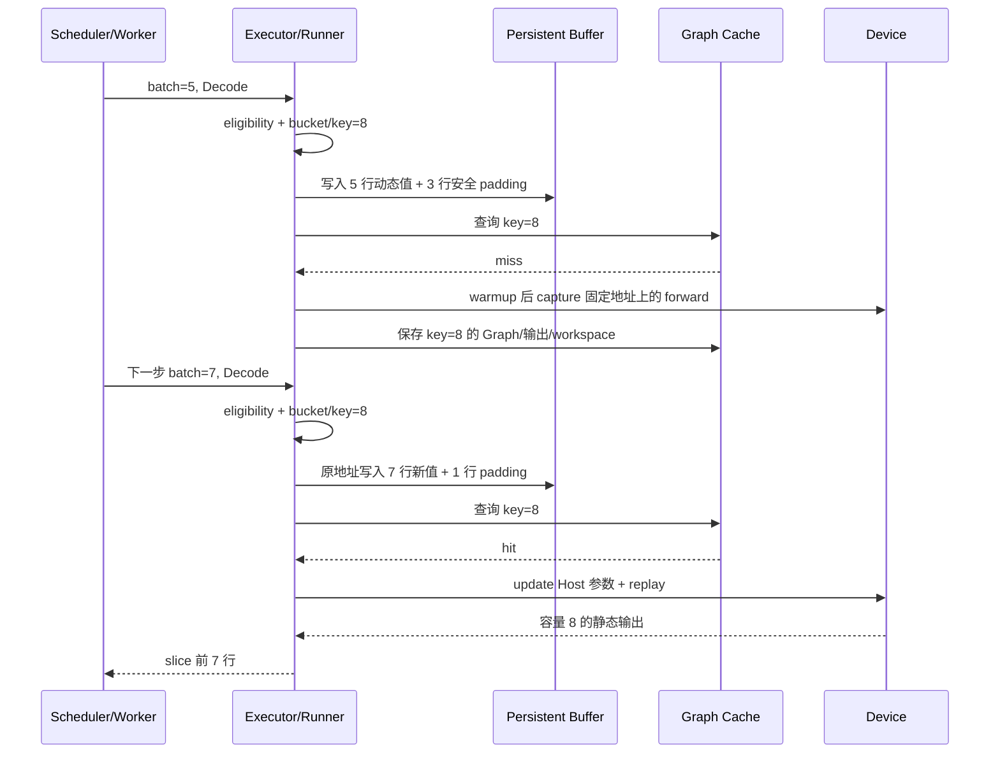
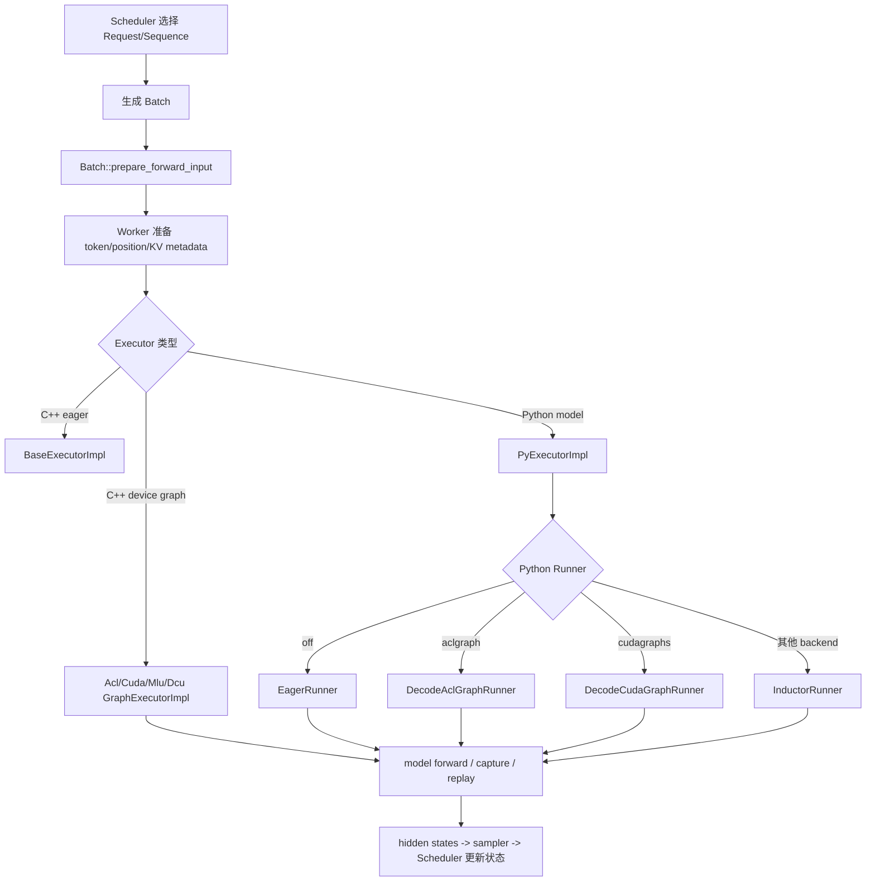
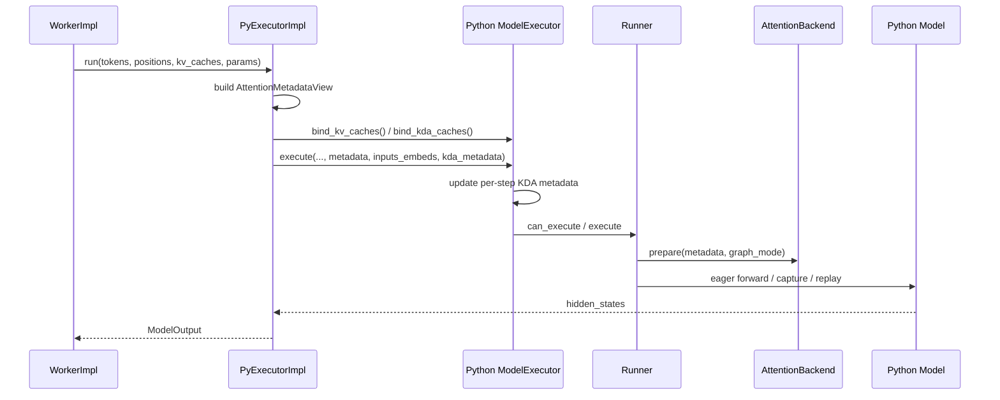

# xLLM Graph 模式完整链路：从 capture/replay 到 ATB、Torch 与设备 Graph

> 本文是 `code_wiki` 的第三篇核心文章。
>
> [第一篇](/export/home/weinan5/penghengduo/CODE/xllm-KIMI-K3/code_wiki/01-online-service-complete-chain.md:1)回答“一个在线请求如何跑完整个服务”，[第二篇](/export/home/weinan5/penghengduo/CODE/xllm-KIMI-K3/code_wiki/02-scheduler-complete-chain.md:1)回答“Scheduler 如何决定下一步跑谁”，本文继续回答：**Worker 拿到一个 batch 之后，为什么有时逐算子执行，有时捕获一张 Graph，有时重放已有 Graph；ATB、Torch、ACL Graph、CUDA Graph 和 `torch.compile` 又分别处在哪一层。**

本文严格按 `xllm` 提交 `9768548dd359460d46e7fab32d3cd905407fff6d` 及 2026-08-13 当前工作区源码撰写。涉及 Kimi K3 的内容用于解释 Python 模型、MLA、KDA 状态与 Graph 契约的关系；当前五层模型已经完成请求级 Decode ACL Graph capture/replay smoke，但固定输入 eager/Graph logits 对齐仍是独立的数值验证问题。

---

## 1. 先把 Graph 想明白：它究竟省掉了什么

Graph 难懂，通常不是因为 API 多，而是因为“图”这个词把几种完全不同的东西混在了一起。先不看 xLLM 类名，只看一次普通 Decode。

### 1.1 eager 每一步都在重新组织设备工作

在 eager 模式下，Host 每生成一步都要再次执行模型代码：

```text
读取本步 batch
  -> 调用 embedding
  -> 调用第 1 层 attention / MLP
  -> 调用第 2 层 attention / MLP
  -> ...
  -> 调用 LM head
  -> 逐个向设备提交 Kernel、memcpy、event 等任务
```

这里并不是每一步都重新“计算模型结构”，但 Python/C++ 控制流、框架 dispatcher、算子 launch 和 stream 编排仍会重复走一遍。Prefill 一次计算很多 token，这些 Host 开销通常容易被大算子掩盖；Decode 每个序列通常只增加一个 token，小算子多、单步短，Host 来不及持续喂满设备时，launch 开销就会变得显眼。

设备 Graph 做的事情可以先粗略理解成：

> 把一次可复用的设备任务提交轨迹录下来，后续只更新输入内容，再一次性重放这段轨迹。

因此 Graph 主要减少的是**重复组织和提交设备工作的开销**，不是减少 Transformer 必须完成的矩阵乘、Attention 或通信计算。一次 replay 仍然要真正执行所有被捕获的设备任务。

### 1.2 一次设备任务为什么值得“录下来”

把一次 Decode 想成一张很长的操作清单：读取 token、更新 KV 页表、跑 Attention、跑 MLP、做规约、写输出。模型权重通常没有变化，但每一步的 token、position、活跃序列和 KV slot 会变。

没有 Graph 时，Host 每一轮都重新遍历这张清单并提交很多小任务；有 Graph 时，第一次合法执行把“哪些任务、什么顺序、依赖什么 event、使用哪些固定地址”记录下来，后续只把新内容写入固定 buffer，再 replay 同一清单。

这也是 Graph 的正确直觉：

```text
固定的是执行契约：地址、shape、拓扑、依赖
变化的是运行内容：token、position、KV page、有效行数
```

它不是把上一次输出缓存下来，也不是让模型停止计算。

### 1.3 三个动词先分清：eager、capture、replay

| 动词 | 白话解释 | 对应工程动作 |
|---|---|---|
| eager | 每次都重新提交本轮算子 | 重新走模型控制流、dispatcher 和 kernel launch |
| capture | 第一次把合法执行录成图 | 在专用 stream/buffer 上执行并记录任务 |
| replay | 使用已经录好的任务清单 | 更新固定 buffer 后重放设备轨迹 |

“warmup”通常是为了让地址、workspace、kernel 选择稳定而做的准备执行；它不自动等于真实请求已经正确完成。`capture` 成功也不自动等于 replay 输出和 eager 数值一致，仍需单独验证。

### 1.4 capture 记录轨迹，replay 使用轨迹

下面是理解全文最重要的一组术语：

| 术语 | 在本文中的准确含义 | 最容易产生的误解 |
|---|---|---|
| eager | 每一步重新经过模型控制流并提交设备任务 | “低性能旧实现” |
| capture | 在专用上下文/stream 中执行一次 forward，并记录设备任务及依赖 | “把模型权重复制进图” |
| replay | 使用捕获好的任务轨迹再次执行 | “直接复用上一次输出” |
| static/persistent buffer | 地址长期稳定、内容可逐步改写的输入或 metadata Tensor | “输入值也不能变化” |
| bucket | 把多个相近的真实 shape 归并成一个捕获容量 | “真实 batch size” |
| Graph key | 查找一张兼容 Graph 的缓存键 | “只可能是 batch size” |
| fallback | 当前 batch 不满足 Graph 契约时走 eager | “Graph 运行失败” |

Graph 从来不缓存本步的数学结果。token、position、KV 页表和序列长度都必须更新；被复用的是任务拓扑、固定地址关系以及相应的执行资源。

### 1.5 用 batch=5、7、9 跑一遍完整过程

假设 Decode bucket 规则把 `5~8` 归入容量 8，把 `9~16` 归入容量 16。

第一次遇到真实 batch 5 时，逻辑过程是：

```text
真实 batch size = 5
        ↓ bucket
Graph 容量       = 8
        ↓
把 5 行 token/position/KV metadata 写入容量 8 的固定缓冲区
把剩余 3 行写成不会访问真实 KV/状态的安全 padding
        ↓
若 key=8 尚无 Graph：warmup + capture 容量 8 的 forward
        ↓
缓存 Graph entry(key=8)，执行或 replay，并只返回前 5 行输出
```

下一步真实 batch 变成 7 时，不需要捕获新图：

```text
真实 batch size = 7 -> bucket/key 仍为 8
更新同一批固定地址缓冲区的内容
第 8 行改成安全 padding
replay key=8
只取前 7 行输出
```

再下一步 batch 变成 9，容量 8 已经装不下，于是映射到 key=16。若 key=16 尚不存在，就为 16 这个执行契约准备另一组静态输入并捕获另一张 Graph。

这个例子解释了五个关键事实：

1. **真实 batch 可以变化。** 只要仍落在同一 bucket，并满足同一执行契约，就可以复用 Graph。
2. **Tensor 内容可以变化。** 真正要求稳定的是 Graph 看到的地址、shape 和可捕获控制流。
3. **padding 不只是补 token。** 页表、状态索引、Host 长度、mask 都必须对 padding 行安全。
4. **Graph 是有容量和类型的。** key=8 的 Decode 图不能自动执行 batch 9，也不能自动执行 Prefill。
5. **输出必须切回真实范围。** bucket 8 做了 8 行计算，不代表 3 个 padding 行属于真实请求。

### 1.6 一张图的生命周期

不同实现选择“何时 capture”不同：C++ ACL Graph 通常在运行时首次遇到某个 key 时惰性捕获；Python ACL/CUDA Runner 则在 warmup 阶段枚举 bucket 并提前建立 entry。二者的抽象生命周期相同：



把它压缩成一个公式就是：

```text
Graph 可复用
  = 执行阶段兼容
  + Graph key 完整
  + shape/控制流兼容
  + Tensor 地址稳定
  + 动态内容已正确更新
  + stream/event 依赖正确
  + 参与算子支持 capture/replay
```

少一个条件，都不能仅凭 `enable_graph=true` 宣称请求正在正确 replay。

### 1.7 哪些东西能变，哪些不能随意变

| 对象 | 每步能否变化 | Graph 路径怎样承接变化 |
|---|---|---|
| token ID、position | 能 | copy 到固定输入 Tensor |
| 真实 batch/token 数 | 能，但受 bucket 容量限制 | padding 到捕获 shape，输出再 slice |
| KV block/slot 映射 | 能 | 更新固定地址的 paged-KV metadata |
| 每序列 KV 长度 | 能 | 更新 Device Tensor和必要的 Host 参数 |
| 模型权重 | 通常不能在同一 Graph 下替换 | 权重地址已进入捕获轨迹 |
| Tensor 地址 | 通常不能 | 预分配 persistent/static buffer |
| 改变 Kernel 的分支 | 不能无条件变化 | 纳入 key、固定分支，或 fallback |
| workspace/output 地址 | 通常不能 | Graph entry 或内存池长期持有 |
| stream 依赖 | 不能缺失或乱序 | event/wait 建立 happens-before |

“地址稳定、内容动态”是设备 Graph 的第一心智模型；“同一个 key 必须代表同一种执行契约”是第二心智模型。

### 1.8 再回到 xLLM 的四层结构

xLLM 中没有一个叫做“组图”的单一开关，可以把所有模型和所有阶段都自动变成静态图。

“组图”至少涉及下面四层：

| 层次 | 回答的问题 | 代表实现 |
|---|---|---|
| 模型表达层 | 模型用什么语言和框架写出来 | Python PyTorch、C++ libtorch |
| Layer/Kernel 层 | 一个 Layer 内部调用什么算子 | ATB、Torch/torch_npu、ACLNN、自定义 Kernel |
| Executor/Runner 层 | 一次模型前向从哪条执行路径进入 | eager、C++ Graph Executor、Python Graph Runner、`torch.compile` |
| 设备轨迹层 | 是否捕获并重放设备上的 launch 序列 | ACL Graph、CUDA Graph、MLU Graph、HIP/DCU Graph |

最重要的结论有六条：

1. **ATB Graph 不是 ACL Graph。** ATB Operation Graph 通常描述 Layer 内的一组算子；ACL Graph 捕获的是更大范围的设备执行轨迹。
2. **Torch 不是 eager 的同义词。** Torch 算子既可以逐算子 eager 执行，也可能被 ACL/CUDA Graph 捕获，还可能进入 `torch.compile`。
3. **Python Graph 与 C++ Graph 是两套入口。** Python 模型优先进入 `PyExecutorImpl`，不会因为 `enable_graph=true` 就改走 C++ `AclGraphExecutorImpl`。
4. **Graph 的核心不是“输入不变”，而是“地址和执行拓扑可复用”。** 每步的 token、position、KV 页表内容可以变化，但必须写进捕获时约定好的稳定缓冲区。
5. **Graph 开关打开不等于当前请求发生了 replay。** Prefill、混合 batch、超容量 batch、特殊模型状态或者捕获失败，都可能回退 eager。
6. **Scheduler 决定 batch 的形态，Executor 决定这种形态是否适合 Graph。** 连续批处理、Chunked Prefill、Spec Verify、DP 不均衡都会改变 Graph 的准入条件和 key。

可以先用一句话记住整体结构：

> Scheduler 生产动态 batch，Worker 把 batch 变成 Tensor 和 metadata，Executor 选择 eager 或 Graph，persistent buffer 把动态内容装进稳定地址，设备 Graph 重放捕获过的模型执行轨迹。

---

## 2. 三种“图”不能混为一谈

初学时最容易把“用 Torch 写模型”“ATB 内部有 Operation Graph”“外层开启 ACL Graph”理解成三种互斥模式。实际上它们处在不同层，可以同时存在。

一个具体组合可能是：

```text
Python model.forward
  -> 调用 Torch / torch_npu / 自定义算子
  -> 某个 C++ Layer 内部使用 ATB Operation Graph
  -> 外层 Python ACL Graph Runner 捕获整段 Decode 设备轨迹
```

因此判断“现在走什么图”，必须先问是在说模型表达、Layer 算子组织、Python 编译，还是设备 launch 轨迹。

### 2.1 ATB Operation Graph：Layer 内的算子组织

ATB 是 Ascend 推理算子与图执行体系。xLLM 的部分 C++ NPU Layer 会把多个 Operation 组织起来，通过 ATB Context 执行 `Setup()` 和 `Execute()`。

这一层关心的是：

- 一个 Attention/MLP/Norm Layer 内使用哪些 Operation；
- Operation 之间如何连接；
- workspace 多大；
- Operation 在哪条 NPU stream 上执行；
- 是否采用 ATB、ACLNN 或其他实现。

它的典型捕获范围是“一个 Layer 或若干算子”，不是整个服务 step。

### 2.2 设备 Graph：一次前向的设备调用轨迹

ACL Graph、CUDA Graph、MLU Graph、HIP Graph 关心的是另一件事：

> 把一次 `model->forward()` 或其中稳定的一部分产生的设备任务记录下来，以后不再由 Host 逐个重新发射，而是直接 replay。

这类 Graph 的主要收益来自减少 Host launch、Python/C++ 调度和设备空闲间隙。Decode 每步计算量小、形状较稳定，因此最容易从设备 Graph 中获益。

### 2.3 `torch.compile`：Python 编译图

`torch.compile` 会通过 Dynamo、Inductor 或指定 backend 对 Python `nn.Module` 进行捕获、分图、编译和代码生成。它可能发生 graph break，也可能因为 shape 变化重新编译。

它和“记录一次设备调用轨迹再 replay”的设备 Graph 不是同一种机制。当前 Python Runner 只是把 backend 名传给：

```python
self.compiled_model = torch.compile(model, backend=backend)
```

源码见 [inductor.py](/export/home/weinan5/penghengduo/CODE/xllm-KIMI-K3/xllm/xllm/python/model_executor/runners/inductor.py:27)。

### 2.4 三者如何组合

理论上存在以下组合：

```text
C++ libtorch model
  + ATB Layer
  + eager Executor

C++ libtorch model
  + ATB Layer
  + ACL Graph Executor

C++ libtorch model
  + Torch/ACLNN Layer
  + ACL Graph Executor

Python PyTorch model
  + Torch/自定义算子
  + Python ACL/CUDA Graph Runner

Python PyTorch model
  + Torch/自定义算子
  + torch.compile backend
```

能否组合成功，取决于参与捕获的算子是否支持 capture、地址是否稳定、捕获期间是否动态分配、Host 参数是否可更新、stream 是否一致，而不是只看配置名是否同时打开。

可以用下面的层次表避免混淆：

| 你看到的词 | 它主要回答什么 | 是否直接决定真实请求 replay |
|---|---|---|
| Torch/Python model | 模型用什么 API 表达 | 否 |
| ATB Operation Graph | 一个 Layer 内如何组合算子 | 否 |
| `torch.compile` | Python 模型如何捕获和编译 | 不一定 |
| ACL/CUDA Graph Runner | 一次设备轨迹是否 capture/replay | 是主要入口 |
| Graph bucket/key | 哪一张静态执行契约可复用 | 是 |

---

## 3. 从 Scheduler 到 Graph 的完整位置

设备 Graph 不参与“选请求”。它发生在 Scheduler 已经完成选请求、Worker 已经准备执行输入之后。



Scheduler 和 Graph 通过 `BatchForwardType` 连接。xLLM 明确定义了五类前向：[batch_forward_type.h](/export/home/weinan5/penghengduo/CODE/xllm-KIMI-K3/xllm/xllm/core/framework/batch/batch_forward_type.h:21)。

| 类型 | 含义 | 通常的 Graph 处理 |
|---|---|---|
| `PREFILL` | 第一次处理 Prompt，不依赖已有 KV | 多数实现 eager；CUDA/DCU C++ 可选 piecewise |
| `CHUNKED_PREFILL` | Prompt 后续 chunk，依赖已有 KV | 通常 eager；ACL 仅把受限 Spec Verify 作为特殊路径 |
| `DECODE` | 每个序列生成新 token | 设备 Graph 的主要目标 |
| `MIXED` | Decode 与 Chunked Prefill 同批 | 多数 Graph 路径拒绝或回退 |
| `EMPTY` | 当前 rank 无真实序列 | 由 DP/EP 空 shard 逻辑处理 |

这里必须区分两个问题：

- `BatchForwardType` 描述“这一步是什么计算”；
- Graph Executor 的条件判断描述“这种计算能不能复用已有执行轨迹”。

因此，Chunked Prefill 本身不会自动进入所谓“Chunked Prefill Graph”。是否支持要看当前平台、当前 Executor 和当前模型契约。

---

## 4. Graph 配置从哪里来

### 4.1 ExecutionConfig 中的全部核心开关

Graph 配置集中在 [execution_config.cpp](/export/home/weinan5/penghengduo/CODE/xllm-KIMI-K3/xllm/xllm/core/framework/config/execution_config.cpp:21) 和 [execution_config.h](/export/home/weinan5/penghengduo/CODE/xllm-KIMI-K3/xllm/xllm/core/framework/config/execution_config.h:60)。

| 配置 | 默认值 | 实际作用 |
|---|---:|---|
| `enable_graph` | `false` | 通用 Graph 总开关；影响 C++ Executor，并可使 NPU Python 模型默认选择 `aclgraph` |
| `enable_graph_double_buffer` | `true` | NPU C++ ACL Graph 使用两个 persistent slot，允许准备下一步输入 |
| `enable_graph_mode_decode_no_padding` | `false` | Decode 按实际 token 数建图，不再向 bucket padding |
| `enable_prefill_piecewise_graph` | `false` | 支持的平台把 Prefill 稳定区域捕获，动态 Attention 保持 eager |
| `enable_graph_vmm_pool` | `true` | CUDA 多 shape Graph 通过 VMM pool 尝试复用物理显存 |
| `max_tokens_for_graph_mode` | `2048` | 部分平台的 Graph token 上限；超出后 eager |
| `acl_graph_decode_batch_size_limit` | `16` | NPU C++ ACL Decode Graph 的安全 batch 上限 |
| `python_graph_backend` | `off` | Python 模型选择 eager、ACL Graph、CUDA Graph 或 `torch.compile` backend |

### 4.2 flags 与 JSON 的优先级

`ExecutionConfig::initialize()` 先从 flags 读取，再从 JSON 读取。对应代码从 [execution_config.cpp](/export/home/weinan5/penghengduo/CODE/xllm-KIMI-K3/xllm/xllm/core/framework/config/execution_config.cpp:95) 开始。

这意味着如果同一个字段同时出现在命令行和配置 JSON 中，必须检查当前配置初始化逻辑，不要只根据启动命令推断最终有效值。

排查 Graph 时首先应该在日志或最终导出的配置中确认：

```text
enable_graph
enable_graph_double_buffer
python_graph_backend
enable_prefill_piecewise_graph
enable_graph_mode_decode_no_padding
max_tokens_for_graph_mode
acl_graph_decode_batch_size_limit
```

### 4.3 `npu_kernel_backend` 不属于 Execution Graph 开关

NPU Kernel 配置位于 [kernel_config.cpp](/export/home/weinan5/penghengduo/CODE/xllm-KIMI-K3/xllm/xllm/core/framework/config/kernel_config.cpp:24)：

```text
AUTO
ATB
TORCH
```

它决定模型注册和 Layer/Kernel 路径，不等价于 `enable_graph`。

模型注册会把 `AUTO` 解析成实际 backend，并拒绝模型不支持的组合。当前 `kimi_k3` 位于 Torch-only 集合中：[model_registry.cpp](/export/home/weinan5/penghengduo/CODE/xllm-KIMI-K3/xllm/xllm/models/model_registry.cpp:216)。

因此下面两个维度必须分别回答：

```text
Layer 使用什么实现？        npu_kernel_backend
整个前向是否 capture/replay？ enable_graph / python_graph_backend
```

---

## 5. Executor 分派：C++ Graph 与 Python Graph 在这里分流

### 5.1 总入口 `Executor::Executor`

Worker 创建的外层 `Executor` 不直接执行模型，而是先决定 backend。核心代码见 [executor.cpp](/export/home/weinan5/penghengduo/CODE/xllm-KIMI-K3/xllm/xllm/core/runtime/executor.cpp:26)：

```cpp
if (options.backend() == "vlm") {
  backend = "vlm";
} else if (ModelConfig::is_python_model_impl(model_config.model_impl())) {
  backend = "python";
} else if (options.enable_graph()) {
  backend = Platform::type_str();
} else {
  backend = options.backend();
}
```

优先级不能交换：

1. VLM 先进入 `VlmExecutorImpl`；
2. 普通 Python 模型进入 `PyExecutorImpl`；
3. 非 Python C++ 模型开启 Graph 后，backend 变成平台名；
4. 其他情况使用普通 `llm`、`rec` 等 backend。

### 5.2 backend 如何变成具体类

`REGISTER_EXECUTOR` 把字符串注册成构造函数，宏定义见 [executor_impl_factory.h](/export/home/weinan5/penghengduo/CODE/xllm-KIMI-K3/xllm/xllm/core/runtime/executor_impl_factory.h:56)。

| backend | 实现 |
|---|---|
| `llm` | `BaseExecutorImpl` |
| `rec` | `RecExecutorImpl` |
| `python` | `PyExecutorImpl` |
| `vlm` | `VlmExecutorImpl` |
| `npu` | `AclGraphExecutorImpl` |
| `cuda` | `CudaGraphExecutorImpl` |
| `mlu` | `MluGraphExecutorImpl` |
| `dcu` | `DcuGraphExecutorImpl` |

工厂找不到 backend 时直接抛出 `No valid backend found`，而不是静默改成 eager：[executor_impl_factory.cpp](/export/home/weinan5/penghengduo/CODE/xllm-KIMI-K3/xllm/xllm/core/runtime/executor_impl_factory.cpp:45)。

### 5.3 为什么 Python 模型不会走 C++ ACL Graph

在分派顺序中，Python 判断发生在 `enable_graph` 判断之前。所以 Python 模型即使设置：

```text
enable_graph=true
```

外层仍然选择 `backend="python"`。

随后 `enable_graph` 会被写入 Python 模型的 config dict：[py_causal_lm.cpp](/export/home/weinan5/penghengduo/CODE/xllm-KIMI-K3/xllm/xllm/models/llm/py_causal_lm.cpp:68)，由 Python `ModelExecutor` 决定是否创建 `DecodeAclGraphRunner`。

所以正确理解是：

```text
enable_graph=true
  对 C++ 模型：选择平台 C++ GraphExecutorImpl
  对 NPU Python 模型：仍选 PyExecutorImpl，Python 内部默认解析成 aclgraph
```

### 5.4 VLM 为什么还有第二次分派

VLM 需要先做 encode、embedding 拼接和缓存管理，因此外层优先进入 `VlmExecutorImpl`。构造函数内部再判断 Text 模型是不是 Python 实现：[vlm_executor_impl.cpp](/export/home/weinan5/penghengduo/CODE/xllm-KIMI-K3/xllm/xllm/core/runtime/vlm_executor_impl.cpp:30)。

```cpp
if (python_model || enable_graph) {
  backend = python_model ? "python" : Platform::type_str();
  llm_executor_ = factory.create(..., backend);
}
```

运行时先得到多模态 embedding，再调用内部 LLM Executor：[vlm_executor_impl.cpp](/export/home/weinan5/penghengduo/CODE/xllm-KIMI-K3/xllm/xllm/core/runtime/vlm_executor_impl.cpp:61)。

因此“外层是 VLM”与“Text forward 由 Python Graph Runner 执行”可以同时成立。

---

## 6. eager：Graph 的语义基线和最终回退

`BaseExecutorImpl::run()` 只有一个核心动作：[base_executor_impl.cpp](/export/home/weinan5/penghengduo/CODE/xllm-KIMI-K3/xllm/xllm/core/runtime/base_executor_impl.cpp:35)。

```cpp
return model_->forward(tokens, positions, kv_caches, params);
```

eager 的价值不是“性能差的旧路径”，而是：

- 模型接入时最容易暴露真实动态行为；
- Prefill、混合 batch、长序列和特殊功能的通用兜底；
- Graph 精度对比的参考基线；
- capture 失败后维持服务可用性的正式执行路径。

Graph 验收必须在同一个模型、同一个 Kernel backend、同一种 dtype 下比较 eager 与 Graph。若同时切换 ATB/TORCH、量化方式和 Graph，就无法判断差异来自哪一层。

---

## 7. 设备 Graph 为什么需要 persistent buffer

### 7.1 动态服务与静态地址的矛盾

连续批处理下，每一步都会变化：

- `tokens`
- `positions`
- 实际 batch/token 数
- `slot_mapping`
- `block_table`
- `q_seq_lens`、`kv_seq_lens`
- paged-KV indptr、indices、last-page-len
- Spec Verify 接受 token 数
- DP/EP padding metadata
- mRoPE position
- 线性注意力状态槽

如果直接把这些每步新建的 Tensor 传给 Graph，地址可能不同，Graph 就可能读取捕获时的旧地址。

### 7.2 xLLM 的解决方式

xLLM 预先创建容量足够大的 Tensor：

```text
persistent_tokens
persistent_positions
persistent_new_cache_slots
persistent_block_tables
q_seq_lens / kv_seq_lens
persistent_linear_state_indices
persistent_num_accepted_tokens
persistent_mask
hidden_states
```

C++ NPU 的成员定义见 [acl_graph_persistent_param.h](/export/home/weinan5/penghengduo/CODE/xllm-KIMI-K3/xllm/xllm/core/runtime/acl_graph_persistent_param.h:209)，初始化见 [acl_graph_persistent_param.cpp](/export/home/weinan5/penghengduo/CODE/xllm-KIMI-K3/xllm/xllm/core/runtime/acl_graph_persistent_param.cpp:137)。

之后每一步只做：

```text
动态 Tensor/Host metadata
        ↓ copy / update kernel / host args update
固定地址 persistent buffer
        ↓
Graph replay
```

### 7.3 persistent buffer 不是 KV Cache

KV Cache 本身也是长期存在的设备内存，但二者角色不同：

- KV Cache 保存历史 token 的 Key/Value 或 latent state；
- persistent buffer 保存“这一步要访问哪些 KV 页、当前位置、当前 token 和执行控制信息”。

Graph 能稳定访问 KV Cache，不代表 KV metadata 会自动正确更新。页表、slot mapping 和长度仍必须在每次 replay 前刷新。

### 7.4 捕获容量与实际有效范围

persistent Tensor 通常按最大容量分配，捕获时使用 bucket 大小，输出时再切回真实 token 数。

```text
真实 token = 5
bucket      = 8

输入 persistent buffer: [5 个真实值 + 3 个 padding]
Graph 执行 shape:         8
返回 hidden_states:       slice(0, 5)
```

因此 padding 的 metadata 必须安全。不能只把 token 补零，却让 padding 行指向真实 KV block 或真实状态槽。

---

## 8. Bucket 与 Graph Key：决定一张图能否复用

### 8.1 为什么不为每个实际 shape 建一张图

若 batch 依次为 `3、5、6、7、9、10...`，每个数都捕获一张图，会带来：

- 大量首次 capture 延迟；
- 多个 Graph 对象；
- 多份 persistent buffer/workspace；
- Graph pool 显存增长；
- cache 命中率下降。

所以 xLLM 把相近 shape 映射到 bucket。

### 8.2 ACL/Python Decode bucket

当前规则是：

```text
1 -> 1
2 -> 2
3~4 -> 4
5~8 -> 8
9~16 -> 16
17~32 -> 32
33~48 -> 48
...
```

C++ ACL 实现在 [acl_graph_executor_impl.cpp](/export/home/weinan5/penghengduo/CODE/xllm-KIMI-K3/xllm/xllm/core/runtime/acl_graph_executor_impl.cpp:709)，Python CUDA/ACL Runner 共用的规则见 [decode_cuda_graph.py](/export/home/weinan5/penghengduo/CODE/xllm-KIMI-K3/xllm/xllm/python/model_executor/runners/decode_cuda_graph.py:30)。

### 8.3 no-padding 模式的真实含义

`enable_graph_mode_decode_no_padding=true` 会让 C++ ACL Decode 直接使用实际 token 数作为 bucket。

它减少无效 padding 计算，却可能把下面的流量变成多张图：

```text
batch 9  -> graph key 9
batch 10 -> graph key 10
batch 11 -> graph key 11
...
```

所以 no-padding 不是无条件优化，而是“用更多图和显存换更少 padding”。只有 batch shape 比较稳定时才可能划算。

### 8.4 Graph key 不一定只有 token 数

普通 C++ ACL Decode 的 key 是 bucket token 数。受限 Spec Verify 路径还把 `q_max_seq_len` 和高位标识编码进 key：[acl_graph_executor_impl.cpp](/export/home/weinan5/penghengduo/CODE/xllm-KIMI-K3/xllm/xllm/core/runtime/acl_graph_executor_impl.cpp:730)。

原因是：即使 token 总数相同，不同 query 长度也可能改变 mask、线性状态更新和执行计划。若 key 缺少这个维度，就可能错误复用不兼容的图。

判断一个 Graph key 是否完整，可以问：

> 哪些动态值会改变 Tensor shape、控制流、Kernel 选择、workspace 或 Host tiling？这些值是否都体现在 key 或被 padding 成同一契约？

---

## 9. C++ ACL Graph：从 `run()` 到 replay 的完整代码链

这一节是本文最重要的源码主线。

### 9.1 构造阶段：创建一个或两个 GraphSlot

`AclGraphExecutorImpl` 持有最多两个 `GraphSlot`：[acl_graph_executor_impl.h](/export/home/weinan5/penghengduo/CODE/xllm-KIMI-K3/xllm/xllm/core/runtime/acl_graph_executor_impl.h:161)。

每个 slot 包含：

```cpp
struct GraphSlot {
  std::unique_ptr<GraphPersistentParam> persistent_param;
  flat_hash_map<uint64_t, std::unique_ptr<AclGraph>> graphs;
  bool is_prepared;
};
```

构造函数根据 `enable_graph_double_buffer` 创建 1 或 2 份 persistent 参数：[acl_graph_executor_impl.cpp](/export/home/weinan5/penghengduo/CODE/xllm-KIMI-K3/xllm/xllm/core/runtime/acl_graph_executor_impl.cpp:384)。

注意：双缓冲不仅是两个 input Tensor，而是每个 slot 都有自己的 persistent 参数和按 key 缓存的 Graph。

### 9.2 第一道准入：当前阶段是否适合 ACL Graph

`run()` 从 [acl_graph_executor_impl.cpp](/export/home/weinan5/penghengduo/CODE/xllm-KIMI-K3/xllm/xllm/core/runtime/acl_graph_executor_impl.cpp:414) 开始。

它先识别：

```cpp
in_decoding_phase = batch_forward_type.is_decode();
in_spec_verify_phase = is_spec_verify && is_chunked_prefill();
```

随后这些情况直接 eager：

- 既不是纯 Decode，也不是受支持的 Spec Verify；
- 模型只有 1 层；
- Spec Verify 不是 hybrid linear-attention 模型；
- DP metadata 尺寸不一致；
- DP 中有 rank 不是 Decode；
- KV 最大长度超过模型最大长度。

对应分支集中在 [acl_graph_executor_impl.cpp](/export/home/weinan5/penghengduo/CODE/xllm-KIMI-K3/xllm/xllm/core/runtime/acl_graph_executor_impl.cpp:422)。

这说明普通 `PREFILL`、普通 `CHUNKED_PREFILL`、`MIXED` 都不会进入 C++ ACL Graph。

### 9.3 DP 下为什么使用全局最大 token 数

一个 DP rank 可能有 4 个 Decode token，另一个只有 2 个，甚至是空 shard。但所有 rank 仍可能参加同一组通信。

ACL Graph 使用：

```cpp
graph_num_tokens = max(dp_global_token_nums);
```

再基于全局数量计算 bucket：[acl_graph_executor_impl.cpp](/export/home/weinan5/penghengduo/CODE/xllm-KIMI-K3/xllm/xllm/core/runtime/acl_graph_executor_impl.cpp:478)。

这样所有 rank 对 Graph shape 和通信拓扑做出一致决定。若某些 rank 是 Prefill、某些是 Decode，代码选择整体回退 eager，避免各 rank 进入不同的执行拓扑。

### 9.4 Decode batch 上限为什么要单独判断

`acl_graph_decode_batch_size_limit` 默认 16。代码按全局 batch 判断，超过就回退：[acl_graph_executor_impl.cpp](/export/home/weinan5/penghengduo/CODE/xllm-KIMI-K3/xllm/xllm/core/runtime/acl_graph_executor_impl.cpp:491)。

这里用的是 batch size，不是 token bucket。普通 Decode 每序列一个 token，两者通常相等；Speculative Decode 下一个序列可能对应多个 token，二者不能再简单等价。

上限的工程目的不是语义限制，而是控制图数量、persistent 内存和捕获 OOM 风险。

### 9.5 命中已有图：进入 replay

代码计算 `graph_key` 后：

1. 在锁内选择本次使用的 slot；
2. 轮转 `next_replay_slot_`；
3. 从该 slot 的 `graphs` map 查 key；
4. 命中则调用 `AclGraph::replay()`。

见 [acl_graph_executor_impl.cpp](/export/home/weinan5/penghengduo/CODE/xllm-KIMI-K3/xllm/xllm/core/runtime/acl_graph_executor_impl.cpp:533)。

replay 的外部流程是：

```text
动态输入
  -> 更新 active slot 的 persistent 参数
  -> graph_.replay()
  -> 更新需要 Host 参数的 graph task
  -> 用 event 让当前 stream 等待 graph stream
  -> 按真实 token 数裁剪 hidden states
```

### 9.6 未命中：惰性 capture

Graph 不是服务启动时一次性全部捕获。C++ ACL 路径在首次遇到某个 key 时惰性创建：[acl_graph_executor_impl.cpp](/export/home/weinan5/penghengduo/CODE/xllm-KIMI-K3/xllm/xllm/core/runtime/acl_graph_executor_impl.cpp:571)。

```text
graph cache miss
  -> new AclGraph
  -> graph->capture(...)
  -> 成功：放入 active_slot.graphs[graph_key]
  -> 返回 capture 已经产生的输出
  -> 失败/抛异常：重新走 eager forward
```

因此首次命中某个 bucket 的请求会承担 capture 开销。压测时要把“首捕获延迟”和“稳态 replay 延迟”分开统计。

### 9.7 `AclGraph::capture()` 逐步解读

核心实现见 [acl_graph_executor_impl.cpp](/export/home/weinan5/penghengduo/CODE/xllm-KIMI-K3/xllm/xllm/core/runtime/acl_graph_executor_impl.cpp:64)。

#### 第一步：把真实输入写入 persistent 参数

```cpp
graph_params = persistent_param_.update(
    tokens, k_cache, v_cache, positions, params,
    bucket_num_tokens,
    return_capture_params=true);
```

这里返回的是适合捕获的 `ModelInputParams`，内部 Tensor 指向 persistent buffer，而不是本次请求临时 Tensor。

#### 第二步：准备模型特有的 Graph metadata

某些模型需要在捕获前生成额外 metadata。`requires_graph_forward_metadata()` 为真时，代码创建并复用 `ModelGraphMetadataState`：[acl_graph_executor_impl.cpp](/export/home/weinan5/penghengduo/CODE/xllm-KIMI-K3/xllm/xllm/core/runtime/acl_graph_executor_impl.cpp:281)。

这是框架留给模型的扩展点。通用 Graph Executor 不可能预先知道所有模型的稀疏索引、特殊 Attention plan 或状态布局。

#### 第三步：锁定设备 capture，切换非默认 stream

NPUGraph 要求在非默认 stream 捕获。`AclGraph` 构造时从高优先级 stream pool 获取 capture/update stream，并创建完成 event：[acl_graph_executor_impl.cpp](/export/home/weinan5/penghengduo/CODE/xllm-KIMI-K3/xllm/xllm/core/runtime/acl_graph_executor_impl.cpp:252)。

捕获前还获取设备级 `DeviceCaptureLock`，避免其他线程在同一设备执行与 capture 冲突的同步初始化。

#### 第四步：真正捕获 `model->forward()`

```cpp
graph_.capture_begin(...);
auto result = model->forward(
    persistent_tokens,
    persistent_positions,
    kv_cache,
    graph_params);
persistent_param_.set_hidden_states(result.hidden_states);
graph_.capture_end();
```

见 [acl_graph_executor_impl.cpp](/export/home/weinan5/penghengduo/CODE/xllm-KIMI-K3/xllm/xllm/core/runtime/acl_graph_executor_impl.cpp:147)。

Graph 捕获的是这次 forward 在设备上产生的任务和临时内存关系。`NPUGraph` 的 mempool 负责捕获期间临时 Tensor 的地址复用。

#### 第五步：测试 replay

capture 完成后立即同步并调用一次 `graph_.replay()`。这既验证捕获结果，也确保第一张图已经可以执行。

### 9.8 `AclGraph::replay()` 逐步解读

实现见 [acl_graph_executor_impl.cpp](/export/home/weinan5/penghengduo/CODE/xllm-KIMI-K3/xllm/xllm/core/runtime/acl_graph_executor_impl.cpp:299)。

#### 1. 校验实际 token 没超过捕获容量

```cpp
CHECK_LE(actual_num_tokens, num_tokens_);
```

#### 2. 更新 persistent 内容

如果 Worker 已经通过双缓冲提前准备了输入，且模型不需要重新生成 Graph metadata，只更新 token；否则完整调用 `persistent_param_.update()`。

#### 3. 更新模型 Graph metadata

需要模型扩展 metadata 时，再调用 `prepare_model_graph_metadata()`，但地址仍需保持捕获契约。

#### 4. 执行 `graph_.replay()`

Host 不再逐个调用模型算子，而是提交捕获好的设备轨迹。

#### 5. 更新特殊 Graph task

Hybrid linear-attention 的 causal conv 等算子存在 Host 参数，需要 `graph_task_update_begin/end` 刷新。相关代码从 [acl_graph_executor_impl.cpp](/export/home/weinan5/penghengduo/CODE/xllm-KIMI-K3/xllm/xllm/core/runtime/acl_graph_executor_impl.cpp:183) 开始。

#### 6. stream/event 同步

Graph 在 graph stream 上执行。完成 event 被记录后，当前计算 stream 等待该 event，保证消费者不会读取尚未完成的输出。

#### 7. 裁剪输出

`get_hidden_states(actual_num_tokens)` 只返回真实 token 范围。

---

## 10. ACL Graph 双缓冲与 schedule overlap

### 10.1 为什么需要两个 slot

单缓冲流程近似为：

```text
更新 step N 输入 -> replay N -> 更新 step N+1 输入 -> replay N+1
```

如果更新下一步输入时 Graph 仍在读取同一块 persistent buffer，就会发生覆盖风险。

双缓冲把过程变成：

```text
slot 0: replay step N
slot 1: prepare step N+1

slot 1: replay step N+1
slot 0: prepare step N+2
```

### 10.2 Worker 什么时候提前准备 Graph 输入

Worker 只有同时满足以下条件才走提前准备：[worker_impl.cpp](/export/home/weinan5/penghengduo/CODE/xllm-KIMI-K3/xllm/xllm/core/runtime/worker_impl.cpp:583)。

```text
非 speculative decode
enable_graph=true
enable_graph_double_buffer=true
schedule overlap 已启用
backend == llm
batch 含 Decode
```

随后 Worker 在 prepare stream 上完成 Tensor 搬运、KV block swap、线性状态准备、CP plan，再调用 `prepare_graph_input()`：[worker_impl.cpp](/export/home/weinan5/penghengduo/CODE/xllm-KIMI-K3/xllm/xllm/core/runtime/worker_impl.cpp:780)。

### 10.3 `prepare_graph_input()` 为什么不是 capture

它只寻找“下一 slot 已经存在同 key Graph”的情况，然后提前把输入写进该 slot：[acl_graph_executor_impl.cpp](/export/home/weinan5/penghengduo/CODE/xllm-KIMI-K3/xllm/xllm/core/runtime/acl_graph_executor_impl.cpp:622)。

以下情况不会提前准备：

- 当前阶段不支持；
- 单 slot；
- 目标 key 尚未 capture；
- 模型要求现场生成 Graph metadata；
- Spec Verify/DP 条件不满足；
- slot 已经准备过。

所以双缓冲优化的是稳态 replay 的 Host 准备重叠，不负责首次 capture。

---

## 11. ATB、Torch 和 ACL Graph 的真实关系

### 11.1 `npu_kernel_backend` 选择 Layer 实现

`AUTO/ATB/TORCH` 的选择发生在模型注册和模型构建阶段。它回答的是：

```text
这个模型的 Layer 由哪一套实现构造？
```

### 11.2 `enable_graph` 选择外层执行方式

它回答的是：

```text
已经构造好的 model forward 是逐算子执行，还是由设备 Graph capture/replay？
```

二者是正交维度，但不是所有组合都保证可用。

### 11.3 ATB 嵌入 ACL Graph 所需的 stream 条件

NPU `BaseLayer::execute_node()` 在 Graph 模式下，把 ATB Context 的执行 stream 设置为当前 libtorch NPU stream，然后执行 `Setup()` 和 `Execute()`：[npu_base_layer.cpp](/export/home/weinan5/penghengduo/CODE/xllm-KIMI-K3/xllm/xllm/core/layers/npu/npu_base_layer.cpp:61)。

这段代码的含义是：

- 外层 ACL Graph 在某条 capture stream 上运行；
- ATB Operation 也必须发射到同一条 stream；
- 否则外层 Graph 可能捕获不到 ATB 任务，或者产生错误依赖。

但源码旁边明确标注 stream 管理仍有待完善。因此正确结论是：

> xLLM 已提供让 ATB Operation 跟随当前 Graph stream 的机制，这是嵌入外层 ACL Graph 的必要条件；具体模型、Operation 和 workspace 是否可捕获，仍需通过 eager 对比、capture/replay 和连续请求验证。

### 11.4 Torch 算子为什么也可能进入 ACL Graph

Python/C++ Torch 最终会通过 dispatcher 调用 torch_npu、ACLNN 或自定义 NPU op。只要这些 op 在捕获上下文中发射可记录的设备任务，并遵守固定地址与 stream 约束，就可能被 NPUGraph 捕获。

所以“TORCH backend”不代表“不能组图”，就像“ATB backend”也不代表“一定能组图”。

---

## 12. Python 模型：C++ bridge 到 Runner 的完整链路

Python 模型并不是 HTTP 请求直接调用 Python `forward()`。中间仍有完整的 C++ Worker、KV Cache 和 metadata 链路。



### 12.1 `PyExecutorImpl` 做了什么

构造时，它导入 `xllm.python.model_executor.executor` 并创建 `ModelExecutor`：[py_executor_impl.cpp](/export/home/weinan5/penghengduo/CODE/xllm-KIMI-K3/xllm/xllm/core/runtime/py_executor_impl.cpp:218)。

每个 step 的 `run()`：

1. 复用已有 `AttentionMetadata`，或由 C++ Builder 构建；
2. 第一次调用时把所有 KV Cache Tensor 绑定到 Python backend；
3. 对线性注意力层额外绑定 conv/SSM cache；
4. 把 C++ metadata 包成只读 pybind view；
5. 一次 C++ 到 Python 调用执行整个 step。

关键代码见 [py_executor_impl.cpp](/export/home/weinan5/penghengduo/CODE/xllm-KIMI-K3/xllm/xllm/core/runtime/py_executor_impl.cpp:250)。

### 12.2 Python `ModelExecutor` 如何选择 Runner

Python 入口见 [executor.py](/export/home/weinan5/penghengduo/CODE/xllm-KIMI-K3/xllm/xllm/python/model_executor/executor.py:77)。

它先遍历模型中的 `AttentionRuntimeLayer`，按物理 `layer_id` 排序，并从第一个非 linear attention spec 构造 paged-attention backend。

Runner 选择表：

| `python_graph_backend` | Runner | 行为 |
|---|---|---|
| `off`、空、`none`、`0` | `EagerRunner` | Python eager |
| `aclgraph` | `DecodeAclGraphRunner` | Ascend Python Decode Graph |
| `cudagraphs` | `DecodeCudaGraphRunner` | CUDA Python Decode Graph |
| 其他字符串 | `InductorRunner` | 作为 `torch.compile(..., backend=...)` |

NPU 上如果 `python_graph_backend=off`，但 `enable_graph=true`，解析函数会返回 `aclgraph`：[executor.py](/export/home/weinan5/penghengduo/CODE/xllm-KIMI-K3/xllm/xllm/python/model_executor/executor.py:32)。

选择 `aclgraph` 后还会做模型能力检查，而不是不加区分地捕获所有 Python 模型。普通模型当前只放行 MHA；带 Kimi K3 KDA runtime 的模型允许 `mha/mla/linear` 三类 attention，未知类型仍会被拒绝。检查函数见 [executor.py](/export/home/weinan5/penghengduo/CODE/xllm-KIMI-K3/xllm/xllm/python/model_executor/executor.py:77)，Runner 创建前的调用见 [executor.py](/export/home/weinan5/penghengduo/CODE/xllm-KIMI-K3/xllm/xllm/python/model_executor/executor.py:168)。

这个检查回答的是“框架是否具有对应的静态状态契约”，不是模型精度认证。通过检查之后仍需要 capture、连续 replay 和请求级对齐。

### 12.3 每步 Runner 分派

`execute()` 的顺序非常重要：[executor.py](/export/home/weinan5/penghengduo/CODE/xllm-KIMI-K3/xllm/xllm/python/model_executor/executor.py:239)。

```text
检查 KV cache 已绑定
  -> 更新 KDA per-step metadata（若有）
  -> inputs_embeds 不为空：直接 eager
  -> 有 Decode Graph Runner：warmup，再 can_execute
  -> 可执行：Graph Runner
  -> 否则有 InductorRunner：torch.compile
  -> 最终 EagerRunner
```

多模态 Prefill 之所以 eager，不是因为 VLM 永远不能组图，而是当前 Python Graph Runner 的输入契约只接受 `input_ids + positions`，没有 `inputs_embeds`。

---

## 13. Python ACL Graph Runner 全量解读

Python NPU Runner 位于 [decode_acl_graph.py](/export/home/weinan5/penghengduo/CODE/xllm-KIMI-K3/xllm/xllm/python/model_executor/runners/decode_acl_graph.py:15)。

### 13.1 它只支持纯 Decode

`can_execute()` 的条件非常直接：[decode_acl_graph.py](/export/home/weinan5/penghengduo/CODE/xllm-KIMI-K3/xllm/xllm/python/model_executor/runners/decode_acl_graph.py:108)。

```python
not metadata.is_prefill
and not metadata.is_chunked_prefill
and bucket(batch_size) <= max_batch
```

因为 `MIXED` 会被 AttentionMetadata Builder 标成 `is_chunked_prefill=true`，所以也会被拒绝。

### 13.2 Python Runner 是预热所有 bucket，不是惰性只捕获当前 bucket

首次进入 `ModelExecutor.execute()` 时会调用 `warmup()`。Runner 枚举：

```text
1, 2, 4, 8, 16, 32, ... max_batch
```

并为每个 bucket 构造 dummy metadata、调用 `execute()`，从而触发 capture：[decode_acl_graph.py](/export/home/weinan5/penghengduo/CODE/xllm-KIMI-K3/xllm/xllm/python/model_executor/runners/decode_acl_graph.py:117)。

与 C++ ACL 的“请求首次遇到某个 key 再惰性 capture”不同，Python Runner 更倾向于第一次执行时集中预热。

### 13.3 `_DecodeGraphEntry` 保存什么

每个 batch bucket 对应一个 entry：

```text
graph
static_output
static_input_ids
static_positions
static_attention_metadata
static_kda_metadata（KDA 模型存在时）
host seq length buffers
graph_tasks
```

其中 `_StaticAttentionMetadata` 包含普通 paged attention 所需的：

- `slot_mapping`
- `paged_kv_indptr`
- `paged_kv_indices`
- `paged_kv_last_page_len`
- `kv_cu_seq_lens`
- Host 侧长度
- `block_table`

字段定义见 [decode_acl_graph.py](/export/home/weinan5/penghengduo/CODE/xllm-KIMI-K3/xllm/xllm/python/model_executor/runners/decode_acl_graph.py:53)。`_DecodeGraphEntry` 还显式持有 `static_kda_metadata`，说明当前 Runner 的静态契约已经不只覆盖普通 paged attention：[decode_acl_graph.py](/export/home/weinan5/penghengduo/CODE/xllm-KIMI-K3/xllm/xllm/python/model_executor/runners/decode_acl_graph.py:71)。

### 13.4 每步如何更新动态 metadata

`execute()` 找到 bucket 后，首先 `_fill_entry()`：[decode_acl_graph.py](/export/home/weinan5/penghengduo/CODE/xllm-KIMI-K3/xllm/xllm/python/model_executor/runners/decode_acl_graph.py:168)。

设备侧更新通过 `ops.update_decode_graph_metadata` 一次写入：

```text
input_ids
positions
slot_mapping
kv_cu_seq_lens
paged_kv_indptr
paged_kv_indices
paged_kv_last_page_len
```

源码见 [decode_acl_graph.py](/export/home/weinan5/penghengduo/CODE/xllm-KIMI-K3/xllm/xllm/python/model_executor/runners/decode_acl_graph.py:327)。

Host 侧 `_fill_host_metadata()` 根据每序列 KV 长度重新计算页数和最后一页长度，并为 padding 行填安全值。

### 13.5 为什么 AttentionBackend 还要 `prepare(graph_mode=True)`

静态 metadata 只是输入契约。NPU FIA 还需要 Graph workspace、固定 output buffer 和 Host 参数。

`NpuPagedAttentionBackend.prepare()` 在 graph mode 下按 graph batch size 创建并复用 workspace/output：[npu_paged_attention.py](/export/home/weinan5/penghengduo/CODE/xllm-KIMI-K3/xllm/xllm/python/attention/npu_paged_attention.py:123)。

这样 FIA 的输出地址也不会在每次 replay 时变化。

### 13.6 capture 的三个阶段

`_capture()` 位于 [decode_acl_graph.py](/export/home/weinan5/penghengduo/CODE/xllm-KIMI-K3/xllm/xllm/python/model_executor/runners/decode_acl_graph.py:479)：

1. 使用静态输入执行两次普通 warmup；
2. `torch.npu.synchronize()`，避免首次初始化混入 capture；
3. 创建 `torch.npu.NPUGraph()`，在专用 stream 上捕获整个 Python Text Model forward。

### 13.7 FIA Host 参数为什么需要 Graph Task

有些 NPU 箝位/Attention 接口除了 Tensor 地址，还读取 Host 侧参数。Graph replay 不能只更新 Tensor 内容。

Python 定义 `AclGraphTask(event, handle, update)`：[forward_context.py](/export/home/weinan5/penghengduo/CODE/xllm-KIMI-K3/xllm/xllm/python/model_executor/forward_context.py:28)。

捕获期间 Attention Backend 把需要更新的 task 记录进 `capture_context.tasks`。每次 replay 前，update stream 依次执行：

```text
graph_task_update_begin
  -> task.update()
graph_task_update_end
  -> event.record(update_stream)
```

见 [decode_acl_graph.py](/export/home/weinan5/penghengduo/CODE/xllm-KIMI-K3/xllm/xllm/python/model_executor/runners/decode_acl_graph.py:508)。

### 13.8 stream/event 时序

Runner 包含：

- `_stream`：Graph replay stream；
- `_update_stream`：Host 参数更新 stream；
- `_replay_done_event`：防止下一次更新覆盖仍在使用的参数。

它建立的关系近似为：

```text
上一轮 graph stream: replay 完成 -> record replay_done
                                ↓
本轮 update stream: wait replay_done -> update graph tasks -> record task events
                                ↓
本轮 graph stream: wait current stream 的输入更新
                  -> replay 中的 ExternalEvent 等待 task events
                  -> clone 有效输出
                  -> record replay_done
                                ↓
current stream: wait graph stream -> 消费 output
```

这里同时保护两个方向：本轮 replay 必须看见本轮 Host 参数，下一轮 update 又不能覆盖仍被本轮 replay 消费的参数。任何一个 wait/event 缺失，都可能表现为“偶发读到上一步 metadata”，而不是稳定崩溃。

### 13.9 KDA 状态怎样进入 Python ACL Graph

当前 Runner 会从模型读取可选的 `kda_runtime`，并为每个 bucket 建立一份 `static_kda_metadata`。这条链分成四步：

1. warmup 前为 bucket 创建 dummy KDA metadata，结束后恢复原 runtime metadata：[decode_acl_graph.py](/export/home/weinan5/penghengduo/CODE/xllm-KIMI-K3/xllm/xllm/python/model_executor/runners/decode_acl_graph.py:119)；
2. `_allocate_entry()` 为 bucket 分配固定 shape 的 KDA metadata：[decode_acl_graph.py](/export/home/weinan5/penghengduo/CODE/xllm-KIMI-K3/xllm/xllm/python/model_executor/runners/decode_acl_graph.py:251)；
3. 每步 `_fill_entry()` 校验当前是纯 Decode、KDA batch 与 token batch 一致，然后复制真实 `state_indices`，padding 行填 `-1`：[decode_acl_graph.py](/export/home/weinan5/penghengduo/CODE/xllm-KIMI-K3/xllm/xllm/python/model_executor/runners/decode_acl_graph.py:377)；
4. `_capture()` 临时把 `kda_runtime.metadata` 指向 entry 内的静态对象，使模型捕获时读取固定地址，完成后再恢复原对象：[decode_acl_graph.py](/export/home/weinan5/penghengduo/CODE/xllm-KIMI-K3/xllm/xllm/python/model_executor/runners/decode_acl_graph.py:479)。

静态 KDA metadata 的 Decode 契约是：

```text
query_start_loc = [0, 1, 2, ..., bucket]
state_indices   = 每步复制真实状态槽，padding 使用 -1
num_decode_seqs = bucket
num_prefill_seqs = 0
has_initial_state = None
```

这不是“Graph 自动理解 KDA”，而是模型适配显式地把 KDA 的动态状态压缩成一个纯 Decode、固定 shape、固定分支的契约。Prefill 或 Chunked Prefill 的 KDA 分支不同，因此 `can_execute()` 仍会在进入 Graph 前拒绝它们。

---

## 14. Python CUDA Graph Runner 与 ACL Runner 的异同

两者共享 `_decode_bucket()`，整体结构也相似：[decode_cuda_graph.py](/export/home/weinan5/penghengduo/CODE/xllm-KIMI-K3/xllm/xllm/python/model_executor/runners/decode_cuda_graph.py:75)。

共同点：

- 只支持纯 Decode；
- 每个 bucket 一个 entry；
- 静态 `input_ids/positions/metadata/output`；
- 预热 bucket；
- replay 后裁剪真实 batch；
- Prefill/Chunked Prefill 回退 eager。

差异：

| 维度 | Python ACL Runner | Python CUDA Runner |
|---|---|---|
| Graph API | `torch.npu.NPUGraph` | `torch.cuda.CUDAGraph` |
| 额外 task 更新 | FIA `graph_task_update` | 主要由 FlashInfer prepare/plan 处理 |
| stream | graph stream + update stream | capture/replay stream |
| block table | 静态 block table 明确维护 | 以 paged metadata 和 FlashInfer backend 为主 |
| 模型能力 | NPU Python backend 可构造 MLA backend | 当前 CUDA Python backend只接受 MHA，MLA 直接报不支持 |

CUDA Python backend 对 MLA 的限制见 [executor.py](/export/home/weinan5/penghengduo/CODE/xllm-KIMI-K3/xllm/xllm/python/model_executor/executor.py:59)。

不要用 C++ CUDA Graph 的 Prefill piecewise 能力推断 Python CUDA Runner 也支持 Prefill。它们是两套实现。

---

## 15. C++ 各平台 Graph 能力对比

### 15.1 能力矩阵

| 平台 | C++ Executor | Decode | Prefill | 关键机制 |
|---|---|---:|---:|---|
| Ascend NPU | `AclGraphExecutorImpl` | 支持 | 普通 Prefill 不支持；受限 Spec Verify 特例 | NPUGraph、persistent param、双 slot、task update |
| NVIDIA CUDA | `CudaGraphExecutorImpl` | 支持 | 可选 piecewise | CUDAGraph、FlashInfer plan、VMM graph pool |
| Cambricon MLU | `MluGraphExecutorImpl` | 主要支持 | 当前以 Decode 逻辑为主 | MLUGraph、共享 pool、token 上限 |
| DCU/HIP | `DcuGraphExecutorImpl` | 支持 | 可选 piecewise | HIP Graph、piecewise runner、token/seq shape key |

### 15.2 CUDA Prefill piecewise

CUDA C++ Executor 在 `enable_prefill_piecewise_graph=true` 时走独立 Prefill graph cache：[cuda_graph_executor_impl.cpp](/export/home/weinan5/penghengduo/CODE/xllm-KIMI-K3/xllm/xllm/core/runtime/cuda_graph_executor_impl.cpp:1466)。

piecewise 的核心思想是：

```text
稳定的 Norm/Linear/MLP 等区域 -> Graph
动态 Attention/plan 区域       -> eager runner
稳定区域                       -> Graph
```

它不是把整个 Prefill 强行固定 shape，而是把一次 forward 切成可捕获片段和动态 runner。

### 15.3 DCU Prefill piecewise

DCU 也为 Prefill 和 Decode 维护不同 cache，并在超出 `max_tokens_for_graph_mode` 或捕获失败时 eager。入口见 [dcu_graph_executor_impl.cpp](/export/home/weinan5/penghengduo/CODE/xllm-KIMI-K3/xllm/xllm/core/runtime/dcu_graph_executor_impl.cpp:969)。

### 15.4 MLU Graph

MLU 会先检查 `allow_graph(run_mode)`，再处理 draft、Spec Verify、dummy input、DP 不均衡和混合 DP 等 fallback。主要入口见 [mlu_graph_executor_impl.cpp](/export/home/weinan5/penghengduo/CODE/xllm-KIMI-K3/xllm/xllm/core/runtime/mlu_graph_executor_impl.cpp:579)。

### 15.5 为什么不能只维护一套通用 GraphExecutor

四个平台在以下方面都不同：

- capture API；
- stream 与 event 语义；
- allocator/graph pool；
- Attention plan；
- Host 参数更新能力；
- Prefill piecewise 接口；
- Graph 失败和异常模型；
- DP/EP 通信捕获限制。

xLLM 统一的是“准入、bucket、persistent、capture/cache、replay、fallback”这一抽象流程，而不是强行统一底层实现。

---

## 16. Prefill、Chunked Prefill、Decode 与 Spec Verify

### 16.1 Decode 为什么最适合整图捕获

普通 Decode 的每个序列通常只新增一个 token：

- query 长度固定为 1；
- Tensor 第一维近似 batch size；
- Attention 读取历史 KV，但输出 shape 稳定；
- Host launch 相对实际计算占比高；
- bucket padding 成本可控。

### 16.2 Prefill 为什么更难

Prefill 的动态性来自：

- 每个请求 Prompt 长度不同；
- token 总数大；
- causal Attention shape 随长度变化；
- mask、workspace、plan 可能随最大序列长度变化；
- padding 到大 bucket 的浪费明显；
- 首次 capture 开销更大。

因此当前 C++ ACL 和 Python Graph Runner 都把普通 Prefill 留在 eager。

### 16.3 Chunked Prefill 为什么不能当 Decode

Chunked Prefill 已经有历史 KV，但本步 query 长度仍可能大于 1。它同时具有：

- KV Cache 依赖；
- 动态 query 长度；
- chunk 边界状态；
- 可能与 Decode 混批；
- 线性状态保存/恢复。

所以“有 KV Cache”不等于“可以复用 Decode 图”。

### 16.4 Spec Verify 为什么被编码成特殊 key

Spec Verify 一次验证多个候选 token，虽然属于生成阶段，但 query 长度不再固定为 1。C++ ACL 只为 hybrid linear-attention 模型提供受限路径，并把 `q_max_seq_len` 纳入 key。

这体现了 Graph 设计的基本原则：**复用单位必须对应真实执行契约，而不是业务阶段名称。**

---

## 17. Kimi K3 在组图体系中的位置

### 17.1 已确定的执行路径

当前 Kimi K3：

- 模型注册属于 NPU `TORCH` only；
- 模型实现走 Python bridge；
- 外层 Executor 选择 `PyExecutorImpl`；
- NPU Attention backend 是 `NpuPagedAttentionBackend`；
- Full Attention/MLA 使用 paged latent KV Cache；
- KDA 层额外使用 conv/recurrent state cache；
- 是否 Graph 由 Python `ModelExecutor` 的 Runner 决定。

因此它不会进入 C++ `AclGraphExecutorImpl`，也不会使用 C++ `GraphPersistentParam` 那套字段。

### 17.2 KDA 的动态状态是什么

每个 step，C++ 通过 `KimiK3KDAMetadataView` 传入：[py_executor_impl.cpp](/export/home/weinan5/penghengduo/CODE/xllm-KIMI-K3/xllm/xllm/core/runtime/py_executor_impl.cpp:101)。

```text
query_start_loc
state_indices
num_decode_seqs
num_prefill_seqs
has_initial_state
```

Python 数据结构定义见 [kda.py](/export/home/weinan5/penghengduo/CODE/xllm-KIMI-K3/xllm/xllm/python/layers/kda.py:69)。KDA forward 会根据 `num_prefill_seqs` 选择 causal-conv 分支，并把状态索引传给 recurrent/prefill Kernel。

### 17.3 普通 paged-KV 契约为什么不够，当前源码怎样补 KDA

普通 paged-attention 静态 metadata 只描述 KV 页和长度，无法表达 KDA 的 recurrent/conv state 槽。当前 Python ACL Runner 已经为这个差异增加 `static_kda_metadata`，不是继续假设普通 paged-KV 契约能够自动覆盖 KDA。

它采取的办法是把 Graph 限定为纯 Decode：每个 query 长度固定为 1，`query_start_loc` 固定为连续整数，`num_prefill_seqs` 固定为 0；每步真正变化的 `state_indices` 复制到固定地址，padding 槽使用 KDA AscendC 算子约定的 `-1`。具体分配和更新链见 13.9 节。

因此，下面这些代码层问题已经有明确答案：

| 问题 | 当前代码处理 |
|---|---|
| KDA Tensor 地址怎样稳定 | 每个 bucket 持有 `static_kda_metadata` |
| `query_start_loc` 怎样构造 | 纯 Decode 下固定为 `arange(bucket + 1)` |
| `state_indices` 怎样变化 | replay 前复制真实槽位，padding 填 `-1` |
| Prefill/Decode Python 分支怎样稳定 | Graph 只准入 `num_prefill_seqs=0` 的纯 Decode |
| capture 时模型读哪个对象 | 临时把 `kda_runtime.metadata` 切到静态 entry |

这些契约随后已经过五层真实服务请求验证：四个 rank 分别 capture `1/2/4/8/16` 的 Python Decode bucket，单/双并发以及四并发 128-token Decode 期间 capture 计数保持不变、服务持续 healthy，说明请求阶段确实持续 replay，且未出现 MLA/KDA/MoE runtime error。

但这仍然不能代替固定输入 eager/Graph logits 对齐，也不能证明完整 93 层、所有 bucket 切换和长时间稳定性。正确状态是“请求级执行链已验证，数值与全规模验收未完成”。

### 17.4 这为什么不阻塞本文

本文讲的是 xLLM 已存在的通用 Graph 框架和扩展契约。Kimi K3 提供了一个很典型的事实：

> 通用 Graph Runner 能承载 token、position 和 paged-KV metadata，不代表新模型的所有状态自动进入了静态契约。

Kimi K3 当前已经越过“只有代码可达”阶段：五层 `TP2 + DP2 + EP2` 服务完成 Decode Graph bucket capture 和连续请求 replay。仍应坚持的边界是：不能把服务 smoke 写成固定输入数值对齐、93 层语义正确或所有特性组合验收。

---

## 18. Eager fallback 全量认知

Fallback 是设计的一部分，不是意外。

### 18.1 C++ ACL 常见 fallback

| 条件 | 处理 |
|---|---|
| 普通 Prefill、Chunked Prefill、Mixed | eager |
| 单层模型 | eager |
| 非 hybrid 模型的 Spec Verify | eager |
| DP metadata 无效 | eager |
| DP rank 阶段不一致 | eager |
| Decode batch 超安全阈值 | eager |
| KV 最大长度超模型上限 | eager |
| capture 抛异常 | eager |
| capture 返回失败 | eager |

### 18.2 Python Runner 常见 fallback

| 条件 | 处理 |
|---|---|
| `python_graph_backend=off` | EagerRunner |
| Prefill | EagerRunner |
| Chunked Prefill/Mixed | EagerRunner |
| `inputs_embeds` | EagerRunner |
| Decode bucket 超 `max_batch` | EagerRunner |
| 模型没有满足 Runner 的输入/状态契约 | 应拒绝 Graph 或修复契约 |

### 18.3 为什么只看开关会误判

以下日志状态都可能发生在 `enable_graph=true` 的服务中：

```text
请求 A: Prefill -> eager
请求 B: Decode batch=1 -> capture graph key 1
请求 C: Decode batch=1 -> replay key 1
请求 D: Decode batch=20 -> eager due to limit
请求 E: Decode batch=4 -> capture graph key 4
```

所以线上指标必须区分：

- eager 次数；
- capture 次数和 key；
- replay 命中；
- fallback 原因；
- 已缓存 Graph 数量；
- bucket token 与真实 token。

当前通用 counter `num_model_execution_total_eager` 定义在 [metrics.cpp](/export/home/weinan5/penghengduo/CODE/xllm-KIMI-K3/xllm/xllm/core/common/metrics.cpp:74)，但仅靠一个 eager 总数仍不足以完整刻画 Graph 命中率，排障时还要结合日志。

---

## 19. Graph 对性能和内存的影响

### 19.1 可能的收益

- 减少 Host 逐算子 launch；
- 降低 Python/C++ 调度开销；
- 减少小 batch Decode 的设备空闲；
- 稳定 workspace 和临时内存地址；
- 降低稳态 Decode 延迟波动；
- schedule overlap + 双缓冲可隐藏部分下一步输入准备时间。

### 19.2 必须付出的成本

- 首次 bucket warmup/capture 延迟；
- persistent 输入/输出长期驻留；
- 每张图持有 runtime 对象和 workspace；
- bucket padding 的无效计算；
- 更多 stream/event 和并发时序；
- 模型状态必须进入显式 Graph 契约；
- 捕获失败路径需要长期维护。

### 19.3 图越多不一定越快

假设真实 batch 在 1 到 64 之间均匀分布：

- bucket 模式只需要约 `1,2,4,8,16,32,48,64` 八类图；
- no-padding 模式可能需要 64 类图。

后者减少 padding，却增加捕获时间和图内存。最终要以真实流量分布测量，而不是仅比较某个固定 batch 的单步 kernel 时间。

### 19.4 CUDA VMM pool 的作用边界

`enable_graph_vmm_pool` 尝试让不同 shape 的 CUDA Graph 虚拟地址映射复用物理内存。它主要解决多图内存累加，不会消除：

- 模型权重；
- KV Cache；
- 每个 Graph 必须独立存在的 runtime 对象；
- 不能共享的 workspace；
- persistent metadata。

因此不能把“打开 VMM”写成固定比例的显存收益。

---

## 20. Graph 与精度：数学相同不代表工程一定正确

设备 Graph 的目标是重放同一执行拓扑，理论上不改变模型数学。但工程上仍可能出现差异：

- Graph 模式选择不同的融合 Kernel；
- capture 时记录了错误的 metadata 地址；
- replay 前漏更新某个长度或页表；
- padding 行访问了真实 cache；
- Host 参数更新晚于 Graph 消费；
- 输出没有按真实 token 裁剪；
- 首次初始化或动态分配混入 capture；
- 状态模型的 cache 更新顺序错误；
- `torch.compile` 发生 graph break 或选择不同数值路径。

推荐的对齐顺序：

```text
同一模型
同一权重
同一 dtype
同一 Kernel backend
同一输入和 KV 初始状态

eager 输出
  vs
Graph 首次 capture 输出
  vs
同 key 第一次 replay
  vs
连续多次 replay
```

只比较第一步无法覆盖“上一步状态污染下一步”的问题。

---

## 21. 调试方法：如何证明请求真的在 replay

### 21.1 第一步：确认最终配置

确认 Graph 总开关、Python backend、双缓冲、bucket 和上限，而不是只看启动脚本。

### 21.2 第二步：确认实际 Executor

根据模型实现判断：

```text
C++ model + enable_graph -> 平台 GraphExecutorImpl
Python model             -> PyExecutorImpl -> Python Runner
VLM                      -> VlmExecutorImpl -> 内部 LLM Executor
```

### 21.3 第三步：确认当前 batch 类型

记录：

```text
BatchForwardType
actual token count
global DP token count
num_sequences
q_max_seq_len
kv_max_seq_len
is_spec_verify
```

### 21.4 第四步：寻找 capture/replay/fallback 证据

C++ ACL 已有典型日志：

```text
capture begin, bucket_num_tokens: ...
Lazy capturing ACL graph for bucket num_tokens: ... done
AclGraphExecutorImpl::run() in replay mode
Falling back to eager mode because ...
```

### 21.5 第五步：检查 Graph key 和 cache

同一个 bucket 的第二次请求应该命中已有图。若持续 capture，检查：

- 是否双 slot 各自还没捕获；
- key 是否包含变化的 q length；
- Graph 对象是否被重建；
- no-padding 是否导致 shape 分散；
- Worker/Executor 生命周期是否反复创建。

### 21.6 第六步：检查 persistent metadata

出现精度问题时，按下面顺序比较 eager 与 Graph：

1. token 和 position；
2. `slot_mapping`；
3. `block_table`；
4. q/kv sequence length；
5. paged-KV indptr/indices/last-page-len；
6. padding 行；
7. Spec Verify accepted tokens；
8. 线性状态 index 和初始状态标志；
9. stream/event 时序。

---

## 22. 常见问题与错误认知

### 22.1 “开了 `enable_graph`，Prefill 也会自动组图吗？”

不会。当前 C++ ACL 和 Python ACL/CUDA Runner 的普通 Prefill 都是 eager。CUDA/DCU C++ 需要显式开启 piecewise，并且只捕获稳定片段。

### 22.2 “模型使用 TORCH backend，所以不能用 ACL Graph吗？”

不能这样推断。TORCH 决定 Layer/Kernel 实现，ACL Graph 决定外层设备轨迹是否捕获。实际能否组合要看算子和状态契约。

### 22.3 “模型使用 ATB，所以已经是 Graph 了？”

ATB Layer 可能内部组织 Operation Graph，但不等于整个模型 forward 已经由 ACL Graph replay。

### 22.4 “Graph replay 后不需要更新 KV metadata？”

错误。KV Cache 地址可以长期稳定，但每一步访问的页、slot 和长度都在变化，必须更新 persistent metadata。

### 22.5 “打开 no-padding 一定更快？”

不一定。它减少 padding，但可能造成 Graph key 和显存数量膨胀。

### 22.6 “Python 模型会进入 C++ `AclGraphExecutorImpl`？”

不会。它进入 `PyExecutorImpl`，再由 Python Runner 选择 `DecodeAclGraphRunner`。

### 22.7 “Graph capture 成功就证明长期正确？”

不够。还必须覆盖同 key replay、不同 bucket、连续多 step、状态复用、并发、fallback 和 eager 精度对齐。

---

## 23. 测试与验收阶梯

### 23.1 代码级单测

当前 C++ ACL Graph 测试覆盖了：

- Graph 与 eager 输出比较；
- replay 一致性；
- 不同 batch；
- batch limit fallback；
- aux hidden states；
- 双缓冲 slot 数；
- hybrid linear-attention KV cache；
- causal conv Graph task update。

测试入口见 [acl_graph_executor_test.cpp](/export/home/weinan5/penghengduo/CODE/xllm-KIMI-K3/xllm/tests/core/runtime/acl_graph_executor_test.cpp:447) 和 [acl_graph_task_update_test.cpp](/export/home/weinan5/penghengduo/CODE/xllm-KIMI-K3/xllm/tests/core/runtime/acl_graph_task_update_test.cpp:494)。

Python 单测验证了 NPU 上 `enable_graph` 对 `aclgraph` 的解析、不同 attention kind 的能力检查，以及 KDA warmup 为每个 bucket 使用局部静态 metadata 并在结束后恢复 runtime 对象：[test_model_executor.py](/export/home/weinan5/penghengduo/CODE/xllm-KIMI-K3/xllm/tests/python/test_model_executor.py:152)、[test_model_executor.py](/export/home/weinan5/penghengduo/CODE/xllm-KIMI-K3/xllm/tests/python/test_model_executor.py:166)、[test_model_executor.py](/export/home/weinan5/penghengduo/CODE/xllm-KIMI-K3/xllm/tests/python/test_model_executor.py:200)。当前 Kimi 五层服务已补充真实 NPU capture/replay 请求 smoke；固定输入 eager/Graph 数值对照仍需继续完成。

### 23.2 最小执行器验收

使用固定模型和输入：

1. eager 跑一次；
2. capture 同 bucket；
3. replay 同 bucket；
4. 修改 token/position/KV metadata 再 replay；
5. 比较输出和 cache 副作用。

### 23.3 服务请求级验收

至少覆盖：

- 首次 Prefill eager；
- 第一个 Decode bucket capture；
- 同 bucket 连续 replay；
- batch 从 1 变化到 2/4/8；
- 超 batch limit fallback；
- 长序列；
- 两个并发请求形成连续批处理；
- Chunked Prefill 与 Decode 混批；
- 请求完成后服务 health；
- Graph 前后输出与 eager 对齐。

### 23.4 性能验收

分别报告：

- 服务冷启动；
- 首次 Graph capture；
- 稳态 replay；
- TTFT；
- TPOT；
- tokens/s；
- Host 利用率；
- 设备利用率；
- Graph 数量；
- padding 比例；
- Graph/persistent/总显存。

不要把首捕获请求混进稳态平均值，也不要只测固定 batch 后宣称在线服务收益。

---

## 24. 新模型接入 Graph 的检查清单

### 24.1 模型与执行器

- [ ] 模型是 C++ 实现还是 Python 实现？
- [ ] 实际选择的是哪个 Executor/Runner？
- [ ] Layer backend 是 ATB、TORCH 还是自定义 Kernel？
- [ ] eager 下 Prefill、Chunked Prefill、Decode 已正确？

### 24.2 捕获契约

- [ ] 所有参与捕获的设备 op 支持目标 Graph API？
- [ ] capture 区域没有首次动态分配？
- [ ] capture 区域没有非法 Host 同步？
- [ ] 所有 op 使用正确的 capture stream？
- [ ] 临时 workspace 在 warmup 时已建立？

### 24.3 动态输入

- [ ] token、position 使用固定地址？
- [ ] slot mapping、block table 使用固定地址？
- [ ] q/kv length、indptr、last-page-len 每步更新？
- [ ] padding metadata 不访问真实 cache/state？
- [ ] 输出按真实 token 数裁剪？

### 24.4 模型特有状态

- [ ] Graph key 包含所有改变执行计划的 shape？
- [ ] 线性注意力/SSM/conv state 有固定地址和更新契约？
- [ ] Spec Verify accepted tokens 可更新？
- [ ] MoE/DP/EP padding buffer 容量足够？
- [ ] 多模态 `inputs_embeds` 有明确处理？

### 24.5 稳定性

- [ ] 不支持的 batch 会明确 fallback？
- [ ] capture 异常不会让服务退出？
- [ ] 首 capture、replay、不同 bucket 都有测试？
- [ ] 连续多 step 与 eager 对齐？
- [ ] 并发和 stream/event 时序已验证？
- [ ] 图数量和显存有上限或监控？

---

## 25. 推荐的源码阅读路线

按下面顺序阅读，比从某个平台的几千行 Graph 文件中间开始更容易建立整体认知。

### 第一阶段：分派与配置

1. [execution_config.cpp](/export/home/weinan5/penghengduo/CODE/xllm-KIMI-K3/xllm/xllm/core/framework/config/execution_config.cpp:21)：Graph 全部配置。
2. [kernel_config.cpp](/export/home/weinan5/penghengduo/CODE/xllm-KIMI-K3/xllm/xllm/core/framework/config/kernel_config.cpp:24)：NPU Kernel backend。
3. [executor.cpp](/export/home/weinan5/penghengduo/CODE/xllm-KIMI-K3/xllm/xllm/core/runtime/executor.cpp:26)：Executor 优先级。
4. [executor_impl_factory.h](/export/home/weinan5/penghengduo/CODE/xllm-KIMI-K3/xllm/xllm/core/runtime/executor_impl_factory.h:56)：backend 注册机制。

### 第二阶段：batch 与 Worker

5. [batch_forward_type.h](/export/home/weinan5/penghengduo/CODE/xllm-KIMI-K3/xllm/xllm/core/framework/batch/batch_forward_type.h:21)：五种前向类型。
6. [worker_impl.cpp](/export/home/weinan5/penghengduo/CODE/xllm-KIMI-K3/xllm/xllm/core/runtime/worker_impl.cpp:780)：设备输入准备和双缓冲提前更新。
7. [attention_metadata_builder.cpp](/export/home/weinan5/penghengduo/CODE/xllm-KIMI-K3/xllm/xllm/core/layers/common/attention_metadata_builder.cpp:119)：阶段如何变成 Attention metadata。

### 第三阶段：C++ ACL Graph 主链

8. [acl_graph_executor_impl.h](/export/home/weinan5/penghengduo/CODE/xllm-KIMI-K3/xllm/xllm/core/runtime/acl_graph_executor_impl.h:50)：对象关系和 GraphSlot。
9. [acl_graph_executor_impl.cpp](/export/home/weinan5/penghengduo/CODE/xllm-KIMI-K3/xllm/xllm/core/runtime/acl_graph_executor_impl.cpp:410)：准入、bucket、cache、capture、replay、fallback。
10. [acl_graph_persistent_param.h](/export/home/weinan5/penghengduo/CODE/xllm-KIMI-K3/xllm/xllm/core/runtime/acl_graph_persistent_param.h:209)：persistent 字段。
11. [acl_graph_persistent_param.cpp](/export/home/weinan5/penghengduo/CODE/xllm-KIMI-K3/xllm/xllm/core/runtime/acl_graph_persistent_param.cpp:137)：容量和更新实现。

### 第四阶段：Python Graph 主链

12. [py_executor_impl.cpp](/export/home/weinan5/penghengduo/CODE/xllm-KIMI-K3/xllm/xllm/core/runtime/py_executor_impl.cpp:218)：C++ 到 Python bridge。
13. [executor.py](/export/home/weinan5/penghengduo/CODE/xllm-KIMI-K3/xllm/xllm/python/model_executor/executor.py:77)：Runner 选择与每步分派。
14. [eager.py](/export/home/weinan5/penghengduo/CODE/xllm-KIMI-K3/xllm/xllm/python/model_executor/runners/eager.py:27)：Python eager 基线。
15. [decode_acl_graph.py](/export/home/weinan5/penghengduo/CODE/xllm-KIMI-K3/xllm/xllm/python/model_executor/runners/decode_acl_graph.py:86)：Python NPU Graph。
16. [decode_cuda_graph.py](/export/home/weinan5/penghengduo/CODE/xllm-KIMI-K3/xllm/xllm/python/model_executor/runners/decode_cuda_graph.py:75)：Python CUDA Graph。
17. [inductor.py](/export/home/weinan5/penghengduo/CODE/xllm-KIMI-K3/xllm/xllm/python/model_executor/runners/inductor.py:27)：`torch.compile`。

### 第五阶段：模型与算子扩展

18. [npu_paged_attention.py](/export/home/weinan5/penghengduo/CODE/xllm-KIMI-K3/xllm/xllm/python/attention/npu_paged_attention.py:71)：Python NPU Attention 的 Graph workspace/task。
19. [npu_base_layer.cpp](/export/home/weinan5/penghengduo/CODE/xllm-KIMI-K3/xllm/xllm/core/layers/npu/npu_base_layer.cpp:61)：ATB stream。
20. [kda.py](/export/home/weinan5/penghengduo/CODE/xllm-KIMI-K3/xllm/xllm/python/layers/kda.py:69)：KDA 动态状态契约。

---

## 26. 最终总结

xLLM 的组图体系可以归纳成下面这条完整链：

```text
Scheduler
  选择请求并决定 PREFILL / CHUNKED_PREFILL / DECODE / MIXED
      ↓
Batch + Worker
  构造 token、position、paged-KV、线性状态和并行 metadata
      ↓
Executor 分派
  C++ model -> eager 或平台 GraphExecutor
  Python model -> PyExecutor -> Python Runner
      ↓
Graph eligibility
  检查阶段、shape、容量、DP、模型状态和平台能力
      ↓
bucket + graph key
  把动态流量映射到有限的可复用执行契约
      ↓
persistent buffer
  固定地址，逐步更新内容
      ↓
capture / cache / replay
  首次捕获，后续重放
      ↓
stream/event + output slice
  保证时序并返回真实 token 输出
      ↓
不满足条件或失败
  eager fallback
```

理解组图时始终分开三个问题：

1. **模型由 Python PyTorch 还是 C++ libtorch 表达？**
2. **Layer 内使用 ATB、Torch/ACLNN 还是自定义 Kernel？**
3. **外层执行采用 eager、设备 Graph 还是 `torch.compile`？**

最后再判断第四个问题：

> 当前 Scheduler 生产的这个具体 batch，是否满足所选 Graph 实现的静态地址、shape、状态和 stream 契约？

只有这四个问题都回答清楚，`enable_graph=true` 才从一个配置值变成可解释、可验证、可上线的执行行为。
