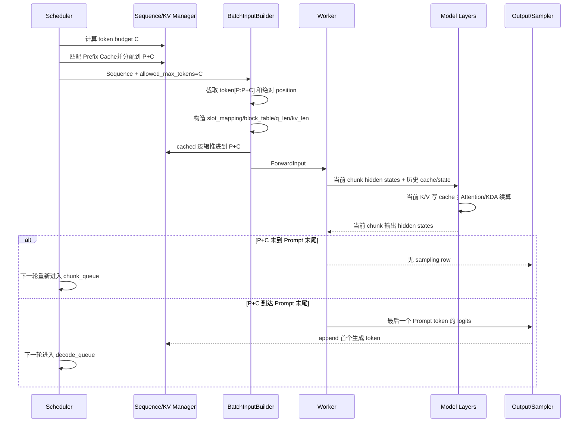

# xLLM Chunked Prefill 全量解读：从调度切块到模型续算

> 本文是 `code_wiki` 的第四篇核心文章。
>
> [第一篇](/export/home/weinan5/penghengduo/CODE/xllm-KIMI-K3/code_wiki/01-online-service-complete-chain.md:1)讲在线服务完整链路，[第二篇](/export/home/weinan5/penghengduo/CODE/xllm-KIMI-K3/code_wiki/02-scheduler-complete-chain.md:1)讲 Scheduler，[第三篇](/export/home/weinan5/penghengduo/CODE/xllm-KIMI-K3/code_wiki/03-graph-execution-complete-chain.md:1)讲组图机制。本文把其中反复出现、但值得单独彻底拆开的 Chunked Prefill 作为主角，回答一个长 Prompt 怎样被切成多个 step，又怎样在普通 Attention、MLA、KDA、Prefix Cache 和 PD 分离中保持数学等价与状态连续。
>
> 源码基线：`xllm` 提交 `9768548dd359460d46e7fab32d3cd905407fff6d` 及 2026-08-13 当前工作区。文中严格区分“当前源码设计支持”“单元测试覆盖”和“本仓库 Kimi K3 已完成请求级实测”三种结论。

---

## 1. 先建立最终认知

Chunked Prefill 不是把 Prompt 文本切成几次 HTTP 请求，也不是每个 chunk 独立推理后拼接答案。

它做的是：

> 一个请求仍然持有完整 Prompt；Scheduler 每个 step 只允许模型计算其中一段新 token；已经计算过的前缀保存在 KV cache 或线性注意力状态中；下一段从前一段留下的状态继续计算。

### 1.1 先补齐五个前置词

| 术语 | 白话含义 |
|---|---|
| Prompt | 用户输入经过 Chat Template 后得到的完整模型输入文本 |
| token | Tokenizer 切出的模型最小离散编号，不等于一个汉字或一个单词 |
| Prefill | 一次读入 Prompt token，建立上下文状态并产生首 token 所需 logits |
| Decode | Prompt 已处理后，基于已有状态逐步生成后续 token |
| KV/state | 模型为已经处理的历史 token 保存的可复用状态 |

例如“你好，介绍一下 xLLM”经过模板和 Tokenizer 后，可能变成几十个 token，而不是按肉眼看到的字数计算。Chunked Prefill 切的是这串 token ID 的计算区间，不是在 HTTP 层把字符串截成几段重新提交。

### 1.2 为什么切开以后答案还能等价

可以把读长文档想成边读边做笔记：

```text
第一段：从空笔记开始，读完留下状态 S1
第二段：带着 S1 继续读，留下状态 S2
第三段：带着 S2 继续读，留下状态 S3
```

只要每段都能访问此前正确保存的状态，并使用原文中的绝对位置，最终效果就应等价于连续读完整篇。

映射回模型：普通 Attention 的“笔记”是历史 K/V；KDA 的“笔记”是卷积与递归状态；position 仍然是完整 Prompt 的绝对位置。若第二块只看自己的 token，或者状态/position 接错，服务可能不崩溃，但模型理解会被截断。

假设 Prompt 长度为 9000，当前有效 chunk 大小为 2048，没有 Prefix Cache 命中：

```text
step 1: 计算 token [0, 2048)       历史长度 0     当前 q 长度 2048
step 2: 计算 token [2048, 4096)    历史长度 2048  当前 q 长度 2048
step 3: 计算 token [4096, 6144)    历史长度 4096  当前 q 长度 2048
step 4: 计算 token [6144, 8192)    历史长度 6144  当前 q 长度 2048
step 5: 计算 token [8192, 9000)    历史长度 8192  当前 q 长度 808
        使用 token 8999 的 logits 采样首 token
step 6: 进入 Decode
```

要真正实现它，框架必须同时满足六个条件：

1. Scheduler 能限制本轮只处理 Prompt 的一部分。
2. Sequence 能准确记录已经计算到哪里。
3. Batch 只抽取当前 chunk 的 token 和绝对 position。
4. 新 chunk 产生的 K/V 必须写入正确的 cache slot。
5. Attention 必须让当前 query 看到“历史 cache + 当前 chunk”，不能只看当前 chunk。
6. 最后一个 chunk 才能采样首 token，中间 chunk 不能产生用户输出。

对于 Kimi K3 这类混合模型，还要增加第七个条件：

7. MLA 层的分页 KV、KDA 层的卷积状态与递归状态必须在同一个 chunk 边界上同步推进。

一句话概括完整链路：

```text
Scheduler 给出 token budget
  -> BatchInputBuilder 截取当前 token 后缀
  -> 写入本 chunk 的 KV/线性状态
  -> 模型用历史状态续算当前 chunk
  -> Sequence 的 cached 位置前移
  -> 未到 Prompt 末尾则重新进入 chunk_queue
```

---

## 2. 为什么需要 Chunked Prefill

### 2.1 普通 Prefill 的问题

传统 Prefill 会在一个 step 内计算完整 Prompt。短 Prompt 没有问题，但一个超长 Prompt 可能独占设备很久：

```text
长请求 Prefill: [==============================]
短请求 Decode:                                  [x]
```

这会带来三个直接影响：

- 已经在流式输出的请求被长 Prefill 阻塞，TPOT 出现尖峰；
- 新来的短请求要等长 Prefill 完成，排队延迟变大；
- 单 step token 数和临时计算量过大，组批空间很难精细控制。

Chunked Prefill 把长工作切成可调度的小单元：

```text
长请求: [chunk 1] [chunk 2] [chunk 3] [chunk 4]
短 Decode:        [x]       [x]       [x]
```

Scheduler 可以在 chunk 之间重新决策，把 Decode 或其他 Prefill 插进来。它改善的是**调度粒度和延迟隔离**。

### 2.4 一个不用公式的延迟例子

假设一次 8192-token Prefill 需要 400 ms，而在线 Decode 请求期望约每 30 ms 返回一个 token。

不切块时：

```text
长 Prefill 连续占用 400 ms
正在流式输出的请求可能出现接近 400 ms 的停顿
```

若切为 8 个 1024-token chunk，假设每块约 50 ms：

```text
chunk 1 -> 插入 Decode -> chunk 2 -> 插入 Decode -> ...
```

总 Prefill 计算未必减少，甚至会增加一点调度和 kernel 边界成本；真正改善的是其他请求获得执行机会的最大等待窗口。实际数值取决于模型、设备、batch、Attention backend 和通信，不能用这个示意值替代 benchmark。

### 2.2 它不解决什么

Chunked Prefill 不会让完整请求最终占用的 KV cache 变少。9000 个 Prompt token 全部处理完成后，仍然需要保存 9000 个 token 对应的历史状态。

它也不会自动让总计算量下降。普通全注意力下，各 chunk 的 query 仍要读取历史 K/V，最终数学目标与完整 Prefill 相同。

因此要区分：

| 问题 | Chunked Prefill 是否直接解决 |
|---|---|
| 单次长 Prefill 长时间阻塞 Decode | 是 |
| 每轮 batch token 数可控 | 是 |
| 长 Prompt 的最终 KV 占用 | 否 |
| 模型总算力需求 | 通常不减少 |
| Prefix Cache 命中带来的重复计算 | 由 Prefix Cache 解决 |
| P/D 跨实例传输 | 由 PD 传输机制解决，但可按 chunk 增量推进 |

### 2.3 Chunked Prefill 与 Continuous Batching 的关系

Continuous Batching 解决“每个 step 都可以重新组批”；Chunked Prefill 解决“长 Prefill 可以跨多个 step”。

两者结合后，Scheduler 才能在长 Prompt 的处理中间插入其他请求：

```text
Continuous Batching 提供每轮重排能力
Chunked Prefill 提供 Prefill 内部的可抢占边界
Mix Batch 进一步允许 Decode 和 Prefill 同轮执行
```

它们是相互配合的三层能力，不是三个同义词。

---

## 3. 三种“chunk”必须分清

xLLM 源码中至少存在三种容易混淆的分块概念。

### 3.1 Scheduler chunk

由 `max_tokens_per_chunk_for_prefill` 和本轮预算决定，是本文主线。

它控制一次模型 forward 给某条 Prefill Sequence 处理多少个新 token，例如 2048。

### 3.2 KV block/page

KV cache 以固定 block/page 管理，例如每个 block 16 或 128 token。它解决物理内存分配、分页寻址、Prefix Cache 和 PD 传输。

一个 Scheduler chunk 通常跨越很多 KV block：

```text
Scheduler chunk = 2048 tokens
KV block_size   = 128 tokens
一个 chunk      = 16 个完整 KV block
```

### 3.3 Kernel 内部 chunk

某些算子为了计算效率，会在一次 forward 内再做内部 tiling。例如 Kimi K3 的 KDA 使用：

```python
KDA_CHUNK_SIZE = 64
```

定义见 [kda.py](/export/home/weinan5/penghengduo/CODE/xllm-KIMI-K3/xllm/xllm/python/layers/kda.py:62)。

这个 64 是 `chunk_kda_fwd` 算子的内部算法块，不决定 Scheduler 一次给请求处理多少 token。若 Scheduler chunk 为 2048，KDA kernel 可以在这一次 forward 内部再按 64 组织计算。

后文提到“chunk 边界”时，如果没有特别说明，均指 Scheduler chunk 边界。

---

## 4. Chunked Prefill 的数学要求

### 4.1 普通自注意力应该看到什么

设已经缓存的前缀长度为 `P`，当前 chunk 长度为 `C`：

```text
历史 token: [0, P)
当前 token: [P, P+C)
```

模型本轮只需要为当前 `C` 个 token 计算 query，但这些 query 的 key/value 上下文必须是：

```text
KV 总范围 = [0, P+C)
Q 范围    = [P, P+C)
```

当前 chunk 中第 `i` 个 query 的可见范围是：

```text
[0, P+i]
```

所以 Chunked Prefill 的核心不只是 `Q=C`，还必须有 `KV=P+C`，并使用带历史偏移的因果关系。

### 4.2 为什么不能把每个 chunk 当作独立 Prefill

如果第二个 chunk 只把自己的 K/V 传给普通 Prefill Attention：

```text
错误: Q=[P,P+C), KV=[P,P+C)
正确: Q=[P,P+C), KV=[0,P+C)
```

那么第二个 chunk 完全看不到第一个 chunk。服务可能仍能运行并输出 token，但语义已经不是对完整 Prompt 做推理。这类错误比直接崩溃更危险，因为它需要和不切块基线做 logits 或生成结果对比才能发现。

### 4.3 线性注意力应该看到什么

KDA 不保存所有历史 K/V，而是把历史压缩成递归状态：

```text
S_P = 前 P 个 token 计算后的 recurrent state
当前 chunk 输入 = token [P, P+C)
输出 = 当前 chunk hidden states + 新状态 S_(P+C)
```

第一块从零状态开始，后续块必须以之前的最终状态作为 `initial_state`。因此普通 Attention 的连续性载体是 paged KV，KDA 的连续性载体是 convolution state 和 recurrent state。

---

## 5. 源码地图

| 领域 | 关键文件 | 作用 |
|---|---|---|
| 配置定义 | [scheduler_config.cpp](/export/home/weinan5/penghengduo/CODE/xllm-KIMI-K3/xllm/xllm/core/framework/config/scheduler_config.cpp:21) | chunk、batch、mix、匹配频率默认值 |
| 默认值归一化 | [xllm.cpp](/export/home/weinan5/penghengduo/CODE/xllm-KIMI-K3/xllm/xllm/xllm.cpp:454) | `-1` 转成 `max_tokens_per_batch` |
| 阶段推导 | [sequence.h](/export/home/weinan5/penghengduo/CODE/xllm-KIMI-K3/xllm/xllm/core/framework/request/sequence.h:140) | PREFILL/CHUNKED_PREFILL/DECODE |
| Batch 类型 | [batch.cpp](/export/home/weinan5/penghengduo/CODE/xllm-KIMI-K3/xllm/xllm/core/framework/batch/batch.cpp:90) | 合并每条 Sequence 的阶段 |
| 策略路由 | [continuous_scheduler.cpp](/export/home/weinan5/penghengduo/CODE/xllm-KIMI-K3/xllm/xllm/core/scheduler/continuous_scheduler.cpp:63) | 是否混批、选择何种 Policy |
| 公共 Prefill 调度 | [scheduler_policy.cpp](/export/home/weinan5/penghengduo/CODE/xllm-KIMI-K3/xllm/xllm/core/scheduler/scheduler_policy.cpp:171) | 取队列、预算、cache 分配 |
| chunk 大小计算 | [scheduler_policy.cpp](/export/home/weinan5/penghengduo/CODE/xllm-KIMI-K3/xllm/xllm/core/scheduler/scheduler_policy.cpp:333) | token budget 与 CP 对齐 |
| DecodeFirst | [decode_first_policy.cpp](/export/home/weinan5/penghengduo/CODE/xllm-KIMI-K3/xllm/xllm/core/scheduler/decode_first_policy.cpp:30) | Decode 优先、Prefill 预算再分配 |
| PrefillFirst | [prefill_first_policy.cpp](/export/home/weinan5/penghengduo/CODE/xllm-KIMI-K3/xllm/xllm/core/scheduler/prefill_first_policy.cpp:31) | chunk continuation 优先的独占批次 |
| Batch 输入 | [batch_input_builder.cpp](/export/home/weinan5/penghengduo/CODE/xllm-KIMI-K3/xllm/xllm/core/framework/batch/batch_input_builder.cpp:671) | 截 token、position、长度和 cache 页表 |
| Attention metadata | [attention_metadata_builder.cpp](/export/home/weinan5/penghengduo/CODE/xllm-KIMI-K3/xllm/xllm/core/layers/common/attention_metadata_builder.cpp:46) | 将 Batch 契约转换为 Layer 契约 |
| C++ NPU Attention | [attention.cpp](/export/home/weinan5/penghengduo/CODE/xllm-KIMI-K3/xllm/xllm/core/layers/npu_torch/attention.cpp:39) | dense 首块与 paged 后续块 |
| C++ CUDA Attention | [flashinfer_attention.cpp](/export/home/weinan5/penghengduo/CODE/xllm-KIMI-K3/xllm/xllm/core/layers/cuda/flashinfer_attention.cpp:224) | FlashInfer paged chunked prefill |
| Python CUDA Attention | [flashinfer.py](/export/home/weinan5/penghengduo/CODE/xllm-KIMI-K3/xllm/xllm/python/attention/flashinfer.py:106) | ragged first prefill 与 paged continuation |
| Python NPU Attention/MLA | [npu_paged_attention.py](/export/home/weinan5/penghengduo/CODE/xllm-KIMI-K3/xllm/xllm/python/attention/npu_paged_attention.py:222) | Kimi MLA 的首块、续块、Decode |
| Kimi KDA | [kda.py](/export/home/weinan5/penghengduo/CODE/xllm-KIMI-K3/xllm/xllm/python/layers/kda.py:351) | 卷积状态、递归状态与 chunk kernel |
| KDA metadata 桥 | [py_executor_impl.cpp](/export/home/weinan5/penghengduo/CODE/xllm-KIMI-K3/xllm/xllm/core/runtime/py_executor_impl.cpp:101) | C++ 运行时状态传入 Python 模型 |
| 线性状态恢复 | [linear_state_restore.cpp](/export/home/weinan5/penghengduo/CODE/xllm-KIMI-K3/xllm/xllm/core/framework/kv_cache/linear_state_restore.cpp:82) | checkpoint slot 到 live slot 的恢复 |
| PD 增量窗口 | [batch_input_builder.cpp](/export/home/weinan5/penghengduo/CODE/xllm-KIMI-K3/xllm/xllm/core/framework/batch/batch_input_builder.cpp:238) | 每个 chunk 只 PUSH 新完成的 block |

---

## 6. 配置是怎样生效的

### 6.1 核心配置

[SchedulerConfig](/export/home/weinan5/penghengduo/CODE/xllm-KIMI-K3/xllm/xllm/core/framework/config/scheduler_config.h:62) 中最相关的字段是：

| 配置 | 源码默认值 | 含义 |
|---|---:|---|
| `enable_chunked_prefill` | `true` | 是否允许 Prefill 跨 step |
| `max_tokens_per_chunk_for_prefill` | `-1` | 初始 chunk 预算；启动时会归一化 |
| `max_tokens_per_batch` | `10240` | 整个 step 的 query token 总预算 |
| `max_seqs_per_batch` | `200` | 整个 step 的 Sequence 总预算 |
| `enable_mix_batch` | `true` | 是否允许 Prefill/Decode 混批 |
| `chunked_match_frequency` | `2` | 长 Prefill 过程中重新探测 Prefix Cache 的频率 |
| `prefill_scheduling_memory_usage_threshold` | `0.95` | 非 PD 模式下 Prefill 调度的 cache 利用率短路阈值 |

典型命令行配置是：

```bash
--enable_chunked_prefill=true \
--max_tokens_per_chunk_for_prefill=2048 \
--max_tokens_per_batch=10240 \
--enable_mix_batch=true
```

### 6.2 `-1` 的真实含义

配置定义中的 `-1` 不是传到 Scheduler 后仍然无限制。[xllm.cpp](/export/home/weinan5/penghengduo/CODE/xllm-KIMI-K3/xllm/xllm/xllm.cpp:454) 在创建 Master 前执行：

```text
if max_tokens_per_chunk_for_prefill < 0:
    max_tokens_per_chunk_for_prefill = max_tokens_per_batch
```

默认配置因此等效于：

```text
max_tokens_per_chunk_for_prefill = 10240
max_tokens_per_batch             = 10240
```

也就是说，默认虽然打开了 Chunked Prefill，但单请求在空 batch 中最多可拿到整个 batch 的 token 预算。要获得更细的切块粒度，应显式设置 chunk 大小。

### 6.3 flags 与 JSON 的覆盖顺序

`SchedulerConfig::initialize()` 先读取 flags，再读取 JSON；同名 JSON 字段可以覆盖命令行值。判断最终生效配置时不能只看启动命令，还要看模型目录或服务配置中的 JSON。

### 6.4 不是所有组合都允许 Mix Batch

[resolve_batch_mode()](/export/home/weinan5/penghengduo/CODE/xllm-KIMI-K3/xllm/xllm/core/scheduler/continuous_scheduler.cpp:63) 会对配置做二次解析：

- `multi_slo_and_prio` 强制启用 Chunked Prefill；
- CP `cp_size>1` 强制关闭 Mix Batch；
- MTP/推测解码强制关闭 Mix Batch；
- 关闭 Chunked Prefill时，Mix Batch 也被关闭；
- PD 的 PREFILL 实例固定使用独占 Prefill batch。

所以 `enable_mix_batch=true` 只是用户意图，不保证最终 BatchMode 一定开启混批。

---

## 7. Sequence 阶段如何自然推进

[Sequence::stage()](/export/home/weinan5/penghengduo/CODE/xllm-KIMI-K3/xllm/xllm/core/framework/request/sequence.h:140) 没有读取一个手工维护的 stage 字段，而是实时比较：

```text
kv_cache_tokens_num
prompt_end = max(volatile_num_prompt_tokens, num_prompt_tokens)
```

推导规则是：

```text
cached == 0 且 cached < prompt_end -> PREFILL
0 < cached < prompt_end           -> CHUNKED_PREFILL
cached >= prompt_end              -> DECODE
```

这使 Prefix Cache 和 Chunked Prefill 可以共用同一状态机：

- 没有命中 Prefix Cache：从 `cached=0` 的 PREFILL 开始；
- 命中部分前缀：分配共享 block 后 `cached>0`，本轮直接成为 CHUNKED_PREFILL；
- 每个 chunk 完成：`cached` 增加，下一轮自动保持 CHUNKED_PREFILL；
- 最后一块完成：`cached` 到达 Prompt 末尾，自动进入 DECODE。

### 7.1 为什么不手工设置 stage 更可靠

如果 stage 和 cached 位置分别维护，很容易出现：KV 已推进但 stage 仍是 PREFILL，或者 Prefix Cache 命中了前缀但模型仍走 dense 首块路径。

xLLM 把 cache 进度作为唯一事实来源。Batch 创建时，[Batch::update_forward_type()](/export/home/weinan5/penghengduo/CODE/xllm-KIMI-K3/xllm/xllm/core/framework/batch/batch.cpp:90) 再把多条 Sequence 的派生阶段汇总成：

```text
PREFILL
CHUNKED_PREFILL
DECODE
MIXED
```

---

## 8. Scheduler 如何把请求切成块

### 8.1 三个主队列

调度状态把请求分成：

```text
prefill_queue: 从未执行或尚未持有部分 KV 的新请求
chunk_queue:   已经有部分 Prompt 状态、需要继续 Prefill 的请求
decode_queue:  Prompt 已完成、正在生成的请求
```

一个 chunk 执行后，如果 Sequence 仍满足 `0 < cached < prompt_end`，下一轮会被放回 `chunk_queue`。

### 8.2 continuation 为什么通常优先

PrefillFirst 和 DecodeFirst 都在调度新 Prefill 前先处理 `chunk_queue`：

```text
已有半成品请求
  -> 已占用部分 KV/cache 状态
  -> 优先继续到下一个边界
  -> 避免大量长请求同时只做开头一小段
```

这不代表 continuation 永远高于 Decode：

- PrefillFirst：`chunk_queue -> prefill_queue`，只有没有 Prefill 时才 Decode；
- DecodeFirst：`decode_queue -> chunk_queue -> prefill_queue`；
- Unified：按统一优先级、SLO 和 token 预算决策。

### 8.3 初始 chunk 预算公式

[compute_prefill_tokens()](/export/home/weinan5/penghengduo/CODE/xllm-KIMI-K3/xllm/xllm/core/scheduler/scheduler_policy.cpp:333) 的初始逻辑可概括为：

```text
initial_chunk = min(
    max_tokens_per_chunk_for_prefill,
    remaining_token_budget,
    当前 Sequence 尚可处理的 token
)
```

实际分配时，[allocate_for_prefill()](/export/home/weinan5/penghengduo/CODE/xllm-KIMI-K3/xllm/xllm/core/scheduler/scheduler_policy.cpp:363) 再计算目标位置：

```text
target_cached = min(old_cached + token_budget, sequence.num_tokens)
actual_tokens = target_cached - old_cached
```

因此 Scheduler 传给 Batch 的 `allowed_max_tokens` 是“本轮允许新增的 query token 数”，不是总序列长度。

### 8.4 一个重要细节：chunk 配置不总是最终硬上限

在 DecodeFirstPolicy 中，所有请求先按 chunk 上限获得初始份额。若 batch 仍有剩余 token 预算，[redistribute_remaining_budget()](/export/home/weinan5/penghengduo/CODE/xllm-KIMI-K3/xllm/xllm/core/scheduler/decode_first_policy.cpp:101) 会把剩余预算重新分给已经选中的 Prefill Sequence。

所以：

```text
max_tokens_per_chunk_for_prefill = 初始公平份额/调度粒度
不一定是 DecodeFirst 最终 allowed_max_tokens 的绝对上限
```

例如：

```text
max_tokens_per_batch = 10000
max_tokens_per_chunk = 1024
5 条 Decode 各占 1 token
只有 1 条长 Prefill
```

长 Prefill 可能在预算再分配后拿到 `9995`，而不只是 `1024`。这一行为由 [scheduler_policy_test.cpp](/export/home/weinan5/penghengduo/CODE/xllm-KIMI-K3/xllm/tests/core/scheduler/scheduler_policy_test.cpp:286) 的 `NormalSchedule` 测试覆盖。

PrefillFirst 不执行这段 DecodeFirst 再分配，Unified 也有自己的显式 chunk 上限计算。因此调优时必须先确认最终采用哪种 Policy。

### 8.5 CP 下的 chunk 对齐

当 `kv_split_size_effective > 1` 时，[maybe_align_cp_chunk_tokens()](/export/home/weinan5/penghengduo/CODE/xllm-KIMI-K3/xllm/xllm/core/scheduler/scheduler_policy.cpp:39) 会把非最终 chunk 向下对齐到：

```text
kv_split_size * block_size
```

最终 chunk 可以不对齐，以便把 Prompt 完成。源码中的待办注释说明这是当前 KV-split block 映射带来的限制，不是 Chunked Prefill 的普遍数学要求。

---

## 9. 为什么切块了仍要检查完整 KV footprint

### 9.1 只按当前 chunk 分配会有什么问题

假设设备只剩 10 个 block，一个长请求最终需要 100 个 block，但第一个 chunk 只需要 8 个。如果只检查本 chunk，它可以被接纳；执行完后系统却没有能力让它完成。

大量请求都这样进入“半完成”状态后，会出现：

- 每个请求都占了一部分 block；
- 没有任何请求有足够空间继续；
- 频繁抢占或整体停滞。

### 9.2 xLLM 的新请求 admission gate

[schedule_prefill_from_queue()](/export/home/weinan5/penghengduo/CODE/xllm-KIMI-K3/xllm/xllm/core/scheduler/scheduler_policy.cpp:171) 对 `cached==0` 的新请求计算：

```text
full_footprint = ceil(prompt_tokens / block_size)
```

只有下面条件满足才接纳：

```text
reserved_full_footprint + full_footprint <= total_blocks
```

已经执行过的 in-flight chunk continuation 不再做这个新请求门禁，而是允许继续。对应测试见 [FullFootprintAdmissionGate](/export/home/weinan5/penghengduo/CODE/xllm-KIMI-K3/xllm/tests/core/scheduler/scheduler_policy_test.cpp:560)。

因此 Chunked Prefill 的内存语义是：

```text
物理上：每步只新增当前 chunk 所需 block
准入上：新请求仍按完整 Prompt footprint 预留完成能力
```

### 9.3 非 PD 的利用率短路

普通服务中，如果 KV cache 利用率达到 `prefill_scheduling_memory_usage_threshold`，Scheduler 会停止继续接入 Prefill。PD 模式跳过这条普通短路，由 PD 自己的资源与传输流程管理。

---

## 10. Prefix Cache 与 Chunked Prefill 怎样协作

### 10.1 首次分配先匹配共享前缀

`allocate_for_prefill()` 在分配新增 block 前调用 `allocate_shared_blocks_for()`：

```text
完整 Prompt
  -> 先查 Prefix Cache
  -> cached 跳到最深可复用位置
  -> 当前 chunk 从命中位置之后开始
```

这意味着一个逻辑上的“新请求”在真正构建 Batch 时，可能已经是 `CHUNKED_PREFILL`。

### 10.2 为什么长请求处理中还会重新匹配

请求在等待后续 chunk 时，其他请求或 in-batch publish 可能让更多前缀进入 Prefix Cache。xLLM 可以在 chunk 过程中重新探测共享前缀，以跳过重复计算。

[allocate_shared_blocks_for()](/export/home/weinan5/penghengduo/CODE/xllm-KIMI-K3/xllm/xllm/core/scheduler/scheduler_policy.cpp:416) 使用 `chunked_match_frequency` 控制普通 KV 模型的重新匹配频率，避免每个 chunk 都做哈希和 cache 查询。

### 10.3 为什么线性注意力必须每个边界重新匹配

普通 Attention 只要有对应 KV block 就能从任意可用前缀继续；KDA 还需要那个位置对应的递归状态。

因此“KV 命中 4096 token”只有在同时存在 4096 边界的 linear-state checkpoint 时才可恢复。源码对“线性注意力 + Prefix Cache”强制每个 chunk 边界重新匹配，并把 checkpoint stride 固定为 `max_tokens_per_chunk_for_prefill`。

---

## 11. Batch 只抽取当前 chunk

Scheduler 完成选择后，Batch 保存：

```text
sequences[i]
allowed_max_tokens[i]
batch_forward_type
```

[BatchInputBuilder::process_single_sequence()](/export/home/weinan5/penghengduo/CODE/xllm-KIMI-K3/xllm/xllm/core/framework/batch/batch_input_builder.cpp:671) 对每条 Sequence 计算四个核心量：

```text
n_tokens          = Sequence 当前 token 总数
n_kv_cache_tokens = 本 step 前已经计算并缓存的 token 数
q_seq_len         = min(n_tokens - n_kv_cache_tokens, allowed_max_tokens)
seq_len           = n_kv_cache_tokens + q_seq_len
```

例子：Prompt 长度 9000，当前 cached=4096，本轮 budget=2048：

```text
n_tokens          = 9000
n_kv_cache_tokens = 4096
q_seq_len         = 2048
seq_len           = 6144
```

这四个数是整个模型侧契约的起点。

### 11.1 token 和 position 如何截取

[extract_tokens_and_positions()](/export/home/weinan5/penghengduo/CODE/xllm-KIMI-K3/xllm/xllm/core/framework/batch/batch_input_builder.cpp:734) 只遍历：

```text
j = n_kv_cache_tokens ... seq_len-1
```

因此传给模型的是：

```text
token_ids = prompt[4096:6144]
positions = [4096, 4097, ..., 6143]
```

模型不会重新收到前 4096 个 token；历史信息只通过 cache/state 进入。

绝对 position 不能从 0 重新开始，否则 RoPE、位置编码和后续 Attention 都会错位。

### 11.2 中间 chunk 为什么不采样

只有循环抵达 `j + 1 >= n_tokens` 时，Builder 才登记采样参数。中间 chunk 还没走到 Prompt 末尾，因此没有 sampling row。

同时：

```text
中间 chunk: extra_token_id = prompt[seq_len]
最后 chunk: extra_token_id = -1
```

`extra_token_id` 让 MTP/重叠调度等路径知道下一枚已知 Prompt token；它不是用户生成结果。

[Batch::refresh_output_targets()](/export/home/weinan5/penghengduo/CODE/xllm-KIMI-K3/xllm/xllm/core/framework/batch/batch.cpp:375) 也只在本轮 `seq_len == n_tokens` 时为普通请求登记输出目标，形成第二道保护。

---

## 12. KV metadata 如何描述“当前 Q + 完整 KV”

### 12.1 cache 进度与 slot mapping

[setup_kv_cache_info()](/export/home/weinan5/penghengduo/CODE/xllm-KIMI-K3/xllm/xllm/core/framework/batch/batch_input_builder.cpp:961) 做三件关键事情：

1. 将 Sequence 的 `kv_cache_tokens_num` 增加 `q_seq_len`；
2. 为 `[old_cached, seq_len)` 生成 `new_cache_slots`；
3. 导出当前 Sequence 的完整 `block_table` 和 paged KV 描述。

注意，ForwardInput 中同时保留了 step 前的旧 cached 数：

```text
host.kv_cache_tokens_nums = old_cached
kv_seq_lens               = old_cached + q_seq_len
```

所以模型侧既知道“之前有没有历史”，也知道“写完本 chunk 后总 KV 有多长”。

### 12.2 四个最重要的 Attention 输入

| 字段 | Chunked Prefill 中的意义 |
|---|---|
| `q_seq_lens` | 每条 Sequence 本轮新增 token 数 `C` |
| `kv_seq_lens` | 历史加当前 chunk 的总长度 `P+C` |
| `new_cache_slots` / `slot_mapping` | 当前 chunk 的 K/V 应写到哪些物理位置 |
| `block_tables` | 每条 Sequence 的逻辑 KV block 到物理 block 映射 |

CUDA/FlashInfer 还使用：

```text
paged_kv_indptr
paged_kv_indices
paged_kv_last_page_len
qo_indptr
```

这些是同一个分页 cache 关系的 CSR/page 形式表达。

### 12.3 一个具体例子

设：

```text
block_size = 4
old_cached = 6
q_seq_len  = 3
kv_seq_len = 9
block_table = [12, 7, 21]
```

逻辑 token 到物理 cache 的关系可能是：

```text
token 0..3 -> block 12
token 4..7 -> block 7
token 8    -> block 21 的第 0 个 slot
```

本轮 `slot_mapping` 只列 token 6、7、8 的写入位置，但 Attention 通过 `block_table` 能读到 token 0..8 的完整历史。

### 12.4 NPU 与 CUDA 长度布局不同

BatchInputBuilder 在 NPU 上保存逐 Sequence 长度：

```text
q_seq_lens  = [q1, q2, ...]
kv_seq_lens = [kv1, kv2, ...]
```

CUDA/MLU/DCU 等部分路径保存 cumulative length。AttentionMetadataBuilder 会根据平台构造 host/device 视图。读代码时不能看到字段名相同就假设张量布局完全相同。

---

## 13. AttentionMetadata 是 Batch 与模型 Layer 的桥

[build_attention_metadata()](/export/home/weinan5/penghengduo/CODE/xllm-KIMI-K3/xllm/xllm/core/layers/common/attention_metadata_builder.cpp:46) 将 `ModelInputParams` 转成 Layer 可消费的 `AttentionMetadata`。

它对阶段的映射是：

```text
is_prefill = BatchForwardType::PREFILL

is_chunked_prefill =
    BatchForwardType::CHUNKED_PREFILL
    or BatchForwardType::MIXED
```

MIXED 也进入 paged chunked 语义，因为同批里至少存在需要历史 cache 的 Prefill 行，Decode 行同样天然使用 paged cache。

Chunked Prefill 下：

```text
is_causal = true
block_table 必须可用
q 长度描述当前 chunk
kv 长度描述总上下文
```

NPU 还会为非 Decode 构造 FIA causal mask，并准备 host 侧累计长度向量。

从这里开始，Scheduler 不再参与 Attention 数学。能否正确续算，取决于具体 backend 是否真正使用 paged cache、总 KV 长度和因果 mask。

---

## 14. 普通 Attention 的模型侧实现

### 14.1 统一的正确执行顺序

普通 MHA/GQA 的 Chunked Prefill 应遵循：

```text
1. 当前 hidden states 计算 Q/K/V
2. 用 slot_mapping 把当前 K/V 写入 paged KV cache
3. Q 只使用当前 chunk
4. K/V 从更新后的完整 paged cache 读取
5. 用 q_len=C、kv_len=P+C、causal=true 做 Attention
```

先写 cache 再 Attention 是必要的，因为当前 query 既要看到历史 token，也要看到当前 chunk 中自己之前的 token。

### 14.2 C++ NPU Torch Attention

[AttentionImpl::forward()](/export/home/weinan5/penghengduo/CODE/xllm-KIMI-K3/xllm/xllm/core/layers/npu_torch/attention.cpp:39) 先调用 `reshape_paged_cache` 写当前 K/V，再把 PREFILL 和 CHUNKED_PREFILL 都交给 `prefill_forward()`。

但 `prefill_forward()` 内部明确分成两条路：

```text
PREFILL:
  key/value = 当前 dense K/V
  不传 block_table
  q_len == kv_len

CHUNKED_PREFILL:
  key/value = 完整 paged k_cache/v_cache
  传 block_table
  q_len = 当前 chunk
  kv_len = 历史 + 当前 chunk
```

第二条调用 NPU Fused Infer Attention 时，把 `block_size=k_cache.size(1)` 和 `sparse_mode=3` 一起传入。这就是普通 NPU Attention 正确续算的核心实现。

### 14.3 C++ CUDA FlashInfer

[FlashInferAttentionImpl::forward()](/export/home/weinan5/penghengduo/CODE/xllm-KIMI-K3/xllm/xllm/core/layers/cuda/flashinfer_attention.cpp:112) 同样先写 paged cache，再按阶段分发。

Chunked Prefill 进入 [chunked_prefill_forward()](/export/home/weinan5/penghengduo/CODE/xllm-KIMI-K3/xllm/xllm/core/layers/cuda/flashinfer_attention.cpp:224)：

```text
更新 BatchPrefillWithPagedKVCache plan
  -> batch_chunked_prefill(
       query,
       k_cache,
       v_cache,
       paged_kv_indptr,
       paged_kv_indices,
       paged_kv_last_page_len,
       qo_indptr)
```

这里没有把当前 dense K/V 再传进 Attention，因为它们已经写进 paged cache。

### 14.4 Python CUDA FlashInfer

[FlashInferBackend.prepare()](/export/home/weinan5/penghengduo/CODE/xllm-KIMI-K3/xllm/xllm/python/attention/flashinfer.py:106) 对首块使用 ragged wrapper，对后续块使用 paged prefill wrapper。

[execute()](/export/home/weinan5/penghengduo/CODE/xllm-KIMI-K3/xllm/xllm/python/attention/flashinfer.py:235) 的分支也很清晰：

```text
PREFILL          -> run(q, current_k, current_v)
CHUNKED_PREFILL  -> run(q, (k_cache, v_cache))
DECODE           -> decode_wrapper.run(q, (k_cache, v_cache))
```

### 14.5 当前 Python NPU 通用 MHA 的边界

[NpuPagedAttentionBackend.execute()](/export/home/weinan5/penghengduo/CODE/xllm-KIMI-K3/xllm/xllm/python/attention/npu_paged_attention.py:222) 虽然先写了 paged cache，但当前代码把 `is_prefill or is_chunked_prefill` 都交给 `_prefill(q_3d, k_3d, v_3d)`。

而 [_prefill()](/export/home/weinan5/penghengduo/CODE/xllm-KIMI-K3/xllm/xllm/python/attention/npu_paged_attention.py:481) 使用的是当前 chunk 的 dense K/V，并令：

```text
actual_seq_lengths_kv = actual_seq_lengths_q
```

它没有传入 paged cache、block table 或总 KV 长度。按当前代码判断，**使用这条 Python NPU 通用 MHA 分支的模型，后续 chunk 不能看到历史前缀**。

这是当前实现边界，不应泛化成“xLLM 的 NPU Chunked Prefill 都错误”：

- C++ NPU 普通 Attention 有正确 paged continuation；
- Python Kimi MLA 有专门的 paged chunked 路径；
- 受影响的是 Python NPU backend 的通用 `execute()` MHA 分支。

为新的 Python NPU MHA 模型开启 Chunked Prefill 前，必须补齐或验证这条路径，并做多 chunk 等价性测试。

---

## 15. Kimi K3 为什么比普通模型更复杂

Kimi K3 的 Decoder 不是所有层都使用同一种 Attention。

[KimiK3DecoderLayer](/export/home/weinan5/penghengduo/CODE/xllm-KIMI-K3/xllm/xllm/python/models/kimi_k3_text.py:993) 根据 layer id 选择：

```text
KDA layer -> KimiK3DeltaAttention
MLA layer -> KimiK3MLAAttention
```

因此一个 Sequence 同时存在两类历史状态：

| 层类型 | 历史载体 | 当前 chunk 后如何推进 |
|---|---|---|
| MLA/Full Attention | latent/rope paged KV cache | 写入当前 latent K/PE，长度增加 C |
| KDA | causal-conv state + recurrent state | 以旧状态为 initial state，写回最终状态 |

Chunked Prefill 的同一个 token 边界必须同时适用于两类层：

```text
cached = 4096
  -> MLA cache 必须代表 token [0,4096)
  -> 每个 KDA 层的 recurrent/conv state 也必须代表 [0,4096)
```

只恢复其中一类状态，模型都会产生错误结果。

---

## 16. Kimi MLA 如何实现 Chunked Prefill

### 16.1 模型层先产生压缩 K/V 表达

[KimiK3MLAAttention.forward()](/export/home/weinan5/penghengduo/CODE/xllm-KIMI-K3/xllm/xllm/python/models/kimi_k3_text.py:785) 计算：

```text
q_latent
q_pe
k_latent
k_pe
```

然后调用 `attention_backend.execute_mla()`。MLA cache 保存的不是普通展开后的每头 K/V，而是压缩 latent 与位置部分。

### 16.2 `execute_mla()` 的三条路径

[NpuPagedAttentionBackend.execute_mla()](/export/home/weinan5/penghengduo/CODE/xllm-KIMI-K3/xllm/xllm/python/attention/npu_paged_attention.py:249) 先把当前 `k_latent/k_pe` 写入 `nope_cache/rope_cache`，然后分发：

```text
PREFILL         -> _mla_dense_prefill
CHUNKED_PREFILL -> _mla_dense_chunked_prefill
DECODE          -> _mla_dense_decode
```

### 16.3 首块为什么可以用 dense K/V

第一块没有历史前缀，所以 `_mla_dense_prefill()` 直接使用当前 chunk 的 `k_latent/k_pe`：

```text
actual_seq_lengths    = 当前 q 累计长度
actual_seq_lengths_kv = 同一个长度
causal mask           = 开启
```

这避免了首块额外通过分页表读取。

### 16.4 后续块怎样读取完整 paged cache

[_mla_dense_chunked_prefill()](/export/home/weinan5/penghengduo/CODE/xllm-KIMI-K3/xllm/xllm/python/attention/npu_paged_attention.py:363) 做的是：

```text
Q        = 当前 chunk 的 q_latent/q_pe
K/V      = 更新后的 nope_cache/rope_cache
q lengths  = 当前 chunk 的累计长度
kv lengths = 每条 Sequence 的总 KV 长度
page map    = block_table
causal      = true
```

调用 NPU FIA 时显式传入：

```text
block_table
block_size
actual_seq_lengths
actual_seq_lengths_kv
sparse_mode=3
```

这条路径满足“Q 是当前后缀、KV 是完整上下文”的数学要求。

### 16.5 dtype 与 head padding

当前 FIA packed TND 路径要求 BF16。实现会把 query 临时转成 BF16，并要求 paged MLA cache 本身也是 BF16；输出再转回调用方原 dtype。

同时 `_pad_mla_query_heads()` 会处理 NPU FIA 对 query head 数的约束，计算结束后裁回本 TP rank 的真实 head 数。这些是设备 kernel 契约，不是 Chunked Prefill 的调度语义，但后续 chunk 会实际经过它们。

### 16.6 测试证据

[test_dense_mla_chunked_prefill_uses_paged_caches_and_total_kv_lens](/export/home/weinan5/penghengduo/CODE/xllm-KIMI-K3/xllm/tests/python/test_npu_paged_attention.py:207) 明确检查：

- key/value 来自 paged cache；
- query 累计长度为当前 chunk；
- KV 长度为包含历史的总长度；
- block table、block size、causal mask 和 `sparse_mode=3` 正确传入。

这属于模型算子级覆盖，还不是完整在线请求级多 chunk 验收。

---

## 17. Kimi KDA 如何跨 chunk 续算

### 17.1 KDA 的两份状态

[KimiK3DeltaAttention.forward()](/export/home/weinan5/penghengduo/CODE/xllm-KIMI-K3/xllm/xllm/python/layers/kda.py:351) 接收：

```text
conv_state:      [num_slots, conv_size - 1, 3 * local_proj]
recurrent_state: [num_slots, H, V, K], float32
```

`conv_state` 保存因果卷积需要的短窗口历史；`recurrent_state` 保存 Delta Attention 的长期递归状态。

### 17.2 C++ Worker 怎样告诉 Python“有没有历史”

[prepare_input_params_for_linear_attention()](/export/home/weinan5/penghengduo/CODE/xllm-KIMI-K3/xllm/xllm/core/runtime/worker_impl.cpp:187) 根据每条 Sequence 的旧 cached 数构造：

```text
has_initial_state[i] = old_kv_cache_tokens_num > 0
```

并从 `q_seq_lens` 构造 `query_start_loc`，描述 packed batch 中每条 Sequence 当前 chunk 的起止位置。

[KimiK3KDAMetadataView](/export/home/weinan5/penghengduo/CODE/xllm-KIMI-K3/xllm/xllm/core/runtime/py_executor_impl.cpp:101) 再把这些 C++ 运行时信息暴露给 Python：

```text
query_start_loc
state_indices
has_initial_state
num_decode_seqs
num_prefill_seqs
```

所以 KDA 不需要自己猜当前是不是第一块。

### 17.3 causal conv 如何续接

有 Prefill 行时，KDA 调用自定义因果卷积：

```text
run_mode=0
initial_state_mode=has_initial_state
cache_indices=state_indices
```

第一块对应 `has_initial_state=false`，卷积从冷状态开始；后续块为 true，从同一 Sequence 的 slot 中继续。

纯 Decode 使用 `run_mode=1`，每条 Sequence 一次处理一个 token。

### 17.4 recurrent state 如何续接

[_prefill()](/export/home/weinan5/penghengduo/CODE/xllm-KIMI-K3/xllm/xllm/python/layers/kda.py:499) 对 Prefill 行执行：

```text
slots = state_indices[prefill rows]
initial_state = recurrent_state.index_select(slots)
initial_state *= has_initial_state
```

第一块的 state 因乘 0 变成零状态；后续块保留 slot 中已有状态。

之后调用：

```text
chunk_kda_fwd(
    current q/k/v,
    initial_state=历史状态,
    output_final_state=True)
```

算子返回当前 chunk 的输出和最终状态，最终状态通过：

```python
recurrent_state.index_copy_(0, slots, final_state)
```

写回 live slot，成为下一 chunk 的初始状态。

### 17.5 混批时 Decode 与 Prefill 如何排列

KDA metadata 约定 Decode Sequence 排在 batch 前部，Prefill Sequence 在后部：

```text
[decode rows][prefill/chunked-prefill rows]
```

Decode 行走 `_recurrent()` 单 token kernel，Prefill 行走 `_prefill()` chunk kernel。`query_start_loc` 保证每条 packed Sequence 仍有独立边界。

---

## 18. 线性状态 Prefix Cache 为什么绑定 chunk 边界

### 18.1 只有 KV hash 不够

对于 KDA/线性注意力模型，如果 Prefix Cache 只保存 token 对应的 KV/块命中信息，却没有保存相同位置的 recurrent state，从命中位置继续就会缺失历史。

xLLM 为每条线性注意力 Sequence 分配一个 live LINEAR slot，并在部分 chunk 末尾制作 checkpoint。

### 18.2 checkpoint stride

[append_linear_state_row()](/export/home/weinan5/penghengduo/CODE/xllm-KIMI-K3/xllm/xllm/core/framework/batch/batch_input_builder.cpp:825) 使用：

```text
chunk_stride = max_tokens_per_chunk_for_prefill
```

只有 `seq_len % chunk_stride == 0` 的 Prefill step 末尾才登记待保存 hash。最终 unaligned chunk 可以完成请求，但不会成为规则 checkpoint 边界。

### 18.3 为什么保存发生在下一 step

Batch 构造时，当前 forward 还没执行，live slot 里仍是上一个边界的状态。因此 Builder 只能记录：

```text
这个 step 完成后，应把新边界状态保存到哪个 hash
```

当前 forward 写完 live state 后，下一次进入 [LinearStateBlockManager::allocate_for_sequence()](/export/home/weinan5/penghengduo/CODE/xllm-KIMI-K3/xllm/xllm/core/framework/block/linear_state_block_manager.cpp:56) 才执行 save-rotation：

```text
旧 live slot -> checkpoint index
新 slot      -> Sequence 接下来继续写的 live slot
```

这是一种跨 step 的延迟提交。

### 18.4 Prefix 命中后如何恢复

Scheduler 匹配到 checkpoint 后，把 source block 挂到 Sequence。Builder 生成：

```text
restore_requested
restore_src_slot_id
linear_state_id       # 当前 live slot
```

[restore_linear_state_slots()](/export/home/weinan5/penghengduo/CODE/xllm-KIMI-K3/xllm/xllm/core/framework/kv_cache/linear_state_restore.cpp:82) 在 Worker 中把各线性层的 source slot 拷贝到 live slot，并把 `has_initial_state` 设为 1。

如果 source 无效，代码将 `has_initial_state` 降为 0，避免把一份未恢复的冷状态误当成历史状态使用。

### 18.5 对配置的硬约束

[llm_engine.cpp](/export/home/weinan5/penghengduo/CODE/xllm-KIMI-K3/xllm/xllm/core/distributed_runtime/llm_engine.cpp:519) 对“线性注意力 + Prefix Cache + 非 Decode 角色”检查：

```text
enable_chunked_prefill == true
max_tokens_per_chunk_for_prefill % block_size == 0
```

原因不是普通 Attention 必须如此，而是 linear-state checkpoint 必须和可复用的 KV block 边界同时成立。

对应 Batch 行为由 [LinearStateCheckpointSavesOnlyAtPrefillStepBoundary](/export/home/weinan5/penghengduo/CODE/xllm-KIMI-K3/xllm/tests/core/framework/batch/batch_test.cpp:1376) 覆盖。

---

## 19. PD 分离中的 Chunked Prefill

### 19.1 P 实例仍然可以切块

PD 分离只改变“在哪里 Prefill、在哪里 Decode”，不取消长 Prompt 的切块需求。P 实例可以执行多个 chunk，再把完成的 KV 和首 token 交给 D 实例。

`resolve_batch_mode()` 对 PD PREFILL 角色强制关闭 Mix Batch，因为 P 实例没有本地 Decode 请求；但 `enable_chunked_prefill` 可以保持开启。

### 19.2 为什么要按 chunk 增量 PUSH

如果等完整 Prompt 结束后再一次性传全部 KV：

- 最后会出现大传输突发；
- 前面已经稳定完成的 block 一直闲置在 P；
- 传输不能与后续 Prefill 计算形成流水。

BatchInputBuilder 为每条 Sequence 维护 `next_transfer_block_idx`，每个 step 只构建新窗口：

```text
win_begin = 上次已稳定传完的位置
win_end   = ceil(current_seq_len / block_size)
```

代码见 [build_step_transfer_info()](/export/home/weinan5/penghengduo/CODE/xllm-KIMI-K3/xllm/xllm/core/framework/batch/batch_input_builder.cpp:238)。

### 19.3 为什么最后一个部分 block 会重复传

只有完整 block 才能被视为稳定：

```text
stable_end = floor(seq_len / block_size)
```

如果本 chunk 停在 block 中间，该 block 当前内容还会被下一 chunk 继续写。因此 cursor 不越过它，下一 step 会再次传输更新后的完整内容。

这是有意的重传，不是 cursor bug。测试见 [PartialBoundaryRepeatsDirtyBlocks](/export/home/weinan5/penghengduo/CODE/xllm-KIMI-K3/xllm/tests/core/framework/batch/batch_test.cpp:263)。

### 19.4 KDA 状态也要传

对 Kimi K3 这类混合模型，D 端除了 MLA KV，还需要 P 端最终的 recurrent state。`TransferKVInfo` 因而可以携带：

```text
local_linear_state_ids
remote_linear_state_ids
```

即使最后一个 step 没有新 KV block，Builder 也会保留“只有 linear-state”的传输项，避免 D 收到完整 KV 却缺少 KDA 最终状态。

### 19.5 PD 完成边界

P 端必须完成最后一个 Prompt chunk，获得用于首 token 的最终 hidden/logits，并确保所需 KV/线性状态已传到 D，才能完成 P->D 请求交接。Chunked Prefill 只把这个过程拆成多步，不改变交接的一致性要求。

---

## 20. Mix Batch 中的 Chunked Prefill

### 20.1 BatchForwardType 为什么是 MIXED

同一 batch 如果同时有：

```text
Sequence A: DECODE，q_len=1
Sequence B: CHUNKED_PREFILL，q_len=512
```

BatchForwardType 为 MIXED。AttentionMetadata 会把它视为 `is_chunked_prefill=true`，让 Attention 统一走可读取 paged history 的路径。

### 20.2 packed token 排列

通常 Decode 行位于前部，Prefill 行位于后部：

```text
flatten_tokens = [A 的 1 token][B 的 512 tokens][C 的 ...]
q_seq_lens     = [1, 512, ...]
kv_seq_lens    = [A 总长度, B 总长度, ...]
```

每条 Sequence 依靠长度数组、slot mapping 和 block table 保持独立，Attention 不允许跨 Sequence 相互可见。

### 20.3 为什么 CP/MTP 禁止混批

CP 和 MTP 会改变输入扩展、通信或 speculative token 的批次契约。当前实现选择强制 Prefill/Decode 分开，减少形态组合，而不是宣称算法上永远不能混合。

[ChunkedPrefillWithSPDoesNotBuildMixedBatch](/export/home/weinan5/penghengduo/CODE/xllm-KIMI-K3/xllm/tests/core/scheduler/continuous_scheduler_test.cpp:347) 验证 CP 下后续 chunk 单独形成 CHUNKED_PREFILL batch。

---

## 21. Schedule Overlap 中怎样避免假 token 污染状态

Schedule Overlap 允许准备下一 step 与当前 step 计算重叠。Chunked Prefill 的特殊困难是：Scheduler 预调度下一块时，上一块可能还没真正完成。

中间 chunk 本来就没有采样输出，因此不能像 Decode 一样先附加 fake token 再替换。

[Batch::update_sequence_state()](/export/home/weinan5/penghengduo/CODE/xllm-KIMI-K3/xllm/xllm/core/framework/batch/batch.cpp:671) 使用 `pre_scheduled_step_prefill_queue` 记录预调度 step 是否仍处在 Prefill，避免中间 chunk 被错误 `append_token()`。

线性状态恢复还有额外的 stream 时序要求：上一 chunk 的 forward 可能正在 compute stream 写 live state。Worker 在 overlap 模式下把 restore 延迟到计算线程，使：

```text
chunk N 写状态
  -> 同一 compute stream 上 chunk N+1 restore/继续
```

按 stream 顺序成立，避免 prepare 线程过早拷贝旧状态。相关注释见 [worker_impl.cpp](/export/home/weinan5/penghengduo/CODE/xllm-KIMI-K3/xllm/xllm/core/runtime/worker_impl.cpp:871)。

---

## 22. Chunked Prefill 与 Graph

Chunked Prefill 的 shape 和历史长度高度动态，通常不走 Decode Graph。

当前 Python Graph Runner 的准入条件明确要求：

```text
not metadata.is_prefill
and not metadata.is_chunked_prefill
```

对应 [decode_acl_graph.py](/export/home/weinan5/penghengduo/CODE/xllm-KIMI-K3/xllm/xllm/python/model_executor/runners/decode_acl_graph.py:108) 和 [decode_cuda_graph.py](/export/home/weinan5/penghengduo/CODE/xllm-KIMI-K3/xllm/xllm/python/model_executor/runners/decode_cuda_graph.py:92)。

因此 Kimi K3 的 Python Chunked Prefill 会回退 eager 执行。Graph 是否开启不影响它必须遵守 paged KV/KDA 状态的正确性契约。

C++ 平台存在少数 piecewise prefill 或 Spec Verify 特殊路径，详见第三篇。不能把“Graph 开关打开”解释为普通 Chunked Prefill 已被捕获和 replay。

---

## 23. Chunked Prefill 的完整 step 时序

以一条已有 `P` 个 cached token、本轮处理 `C` 个 token 的 Sequence 为例：



### 23.1 为什么 Builder 先逻辑推进 cached

`setup_kv_cache_info()` 在 forward 前增加 `kv_cache_tokens_num`。这是调度/输入构建对本轮已承诺写入范围的逻辑提交，同时 ForwardInput 单独保留旧 cached 数供模型判断初始状态。

正常服务把设备 forward 失败视为 step 失败或进程级错误，不会尝试在同一 Sequence 上静默继续。因此这里没有模型失败后的细粒度事务回滚。

---

## 24. 一个双请求混批例子

配置：

```text
max_tokens_per_batch = 1024
max_tokens_per_chunk = 512
enable_mix_batch      = true
Policy                = DecodeFirst
block_size            = 128
```

当前状态：

```text
A: Decode，历史长度 3000，本轮 1 token
B: 长 Prompt，历史长度 2048，总长度 6000
```

Scheduler 初始预算：

```text
A 占 1
B 初始最多占 512
剩余 511
```

DecodeFirst 可能把剩余预算继续给 B，因此 B 最终可得 1023，而不是固定 512。

BatchInputBuilder 构造：

```text
flatten_tokens:
  [A_current_token]
  [B_prompt_2048 ... B_prompt_3070]

q_seq_lens:
  [1, 1023]

kv_seq_lens:
  [3001, 3071]
```

模型侧：

```text
A query 读取自己的 3001-token paged history
B 的 1023 个 query 读取自己的 3071-token paged history
两者 block_table 行完全独立
```

B 没到 Prompt 末尾，不登记 sampling row；A 正常采样下一个 Decode token。

---

## 25. 正确性不变量

实现或排查 Chunked Prefill 时，应逐条验证以下不变量。

### 25.1 调度层

```text
0 < allowed_max_tokens[i]
actual_new_tokens <= Sequence 尚未计算 token 数
所有 Sequence 的实际 query token 总数 <= 本轮 token budget
```

DecodeFirst 再分配后允许 `actual_new_tokens > max_tokens_per_chunk`，但不能超过 batch 剩余预算和 Sequence 末尾。

### 25.2 输入层

```text
flatten token 范围 = [old_cached, old_cached + q_len)
position 起点       = old_cached
kv_len              = old_cached + q_len
slot_mapping 数量   = 所有 q_len 之和
```

### 25.3 普通 Attention

```text
当前 K/V 已写入 cache
Q 长度 = q_len
KV 可见长度 = kv_len
block_table 属于对应 Sequence
Chunked Prefill causal = true
```

### 25.4 KDA

```text
第一 chunk has_initial_state = false
后续 chunk has_initial_state = true
state_indices 始终指向同一 Sequence 的 live slot
chunk 输出 final_state 写回该 slot
```

### 25.5 输出层

```text
中间 chunk sampling rows = 0
最后 chunk sampling rows = 每个应采样 Sequence 的目标数
首 token 只追加一次
```

### 25.6 PD

```text
完整 block 只需稳定推进一次
部分 block 下一 chunk 允许重传
最终 KV 与 linear state 都到达 D
```

---

## 26. 怎样选择 chunk 大小

没有对所有模型和设备都最优的固定值。chunk 大小影响的是延迟、吞吐和调度自由度的平衡。

### 26.1 chunk 较小

优点：

- 长 Prefill 更频繁地让出设备；
- Decode TPOT 更容易保持平稳；
- Scheduler 能更细粒度满足 SLO。

代价：

- step 次数增加；
- 每步组批、metadata、kernel launch 开销增加；
- Prefix Cache 探测与 PD 窗口管理更频繁；
- Attention 每块都需要 paged continuation setup；
- 线性状态 checkpoint 数量可能增加。

### 26.2 chunk 较大

优点：

- 更接近高效的大 Prefill；
- step 和 launch 开销少；
- 大矩阵计算更容易吃满设备。

代价：

- 单 step 更容易阻塞 Decode；
- TTFT/TPOT 隔离变差；
- token budget 留给其他请求的空间减少。

### 26.3 推荐的调优顺序

1. 先确认模型 backend 的多 chunk 数学正确性。
2. 确认 `max_tokens_per_batch`、block_size、CP 对齐和 linear checkpoint 约束。
3. 关闭 DecodeFirst 预算再分配或从日志确认实际 chunk，避免把配置值误当真实值。
4. 同时观测 TTFT、TPOT p99、吞吐、step 时间和设备利用率。
5. 用短/中/超长 Prompt 混合压测，而不是只测单个长请求。

对于线性注意力 Prefix Cache，chunk 大小还必须是 KV block_size 的整数倍。

---

## 27. 测试应怎样分层

### 27.1 Scheduler 单测

验证：

- 新请求和 continuation 的队列顺序；
- 每轮 allowed token budget；
- DecodeFirst 再分配；
- full-footprint admission；
- CP/MTP 不混批。

代表文件：[scheduler_policy_test.cpp](/export/home/weinan5/penghengduo/CODE/xllm-KIMI-K3/xllm/tests/core/scheduler/scheduler_policy_test.cpp:286)、[continuous_scheduler_test.cpp](/export/home/weinan5/penghengduo/CODE/xllm-KIMI-K3/xllm/tests/core/scheduler/continuous_scheduler_test.cpp:308)。

### 27.2 BatchInputBuilder 单测

验证：

- token 只抽当前后缀；
- position 使用绝对偏移；
- q/KV 长度正确；
- slot mapping 和 block table 正确；
- PD step window 与部分 block 重传；
- linear checkpoint 边界。

代表文件：[batch_test.cpp](/export/home/weinan5/penghengduo/CODE/xllm-KIMI-K3/xllm/tests/core/framework/batch/batch_test.cpp:619)。

### 27.3 Attention/KDA 算子测试

验证：

- 后续块使用 paged cache 而非当前 dense K/V；
- `q_len` 和总 `kv_len` 不混淆；
- causal mask 和 block table 传入；
- KDA initial/final state 连续。

Kimi MLA 已有 paged chunked 参数测试；KDA 还应把两块连续执行与一次完整 Prefill 的输出和最终 state 做对比。

### 27.4 请求级等价性测试

最关键的验收是同一模型、同一输入、确定性采样下比较：

```text
enable_chunked_prefill=false
vs
enable_chunked_prefill=true + 明确较小 chunk
```

至少覆盖：

- 2 个 chunk；
- 3 个以上 chunk；
- 最后 chunk 不对齐；
- Prefix Cache 部分命中后继续；
- 多请求 Mix Batch；
- PD 模式；
- 对 Kimi 同时覆盖 MLA 与 KDA 层状态。

比较层次从强到弱可以是：

```text
逐层/最终 hidden state
首 token logits
greedy 生成 token 序列
服务最终文本
```

仅验证 HTTP 200 或“能输出文字”远远不够。

---

## 28. 本仓库 Kimi K3 的当前结论

截至本文代码基线，可以确认：

### 28.1 已有源码链路

- Scheduler、BatchInputBuilder 和 AttentionMetadata 支持请求跨多个 Prefill step；
- Kimi MLA 有独立的 paged dense chunked prefill 路径；
- KDA metadata 已由 C++ Worker/PyExecutor 传入 Python；
- KDA Prefill kernel 接收 initial state 并写回 final state；
- 线性状态 Prefix Cache 有 chunk-boundary checkpoint/restore 机制；
- PD transfer 能增量发送 KV，并携带 linear-state slot。

### 28.2 已有测试证据

- Scheduler chunk、准入和混批规则有 C++ 单测；
- Batch token/position/cache metadata 和 PD 窗口有 C++ 单测；
- Kimi MLA paged chunked 参数有 Python 单测；
- linear-state checkpoint 边界有 C++ 单测。

### 28.3 尚未完成的请求级证明

当前 Kimi K3 在线五层 smoke 使用的是短 Prompt，不足以强制发生多个 chunk。因此它证明了在线服务和短 Prefill/Decode 主链可运行，但**不能证明真实多 chunk 下 Kimi MLA 与 KDA 的端到端数值等价性**。

后续应显式把 `max_tokens_per_chunk_for_prefill` 设得小于测试 Prompt 长度，完成：

```text
单实例多 chunk greedy 等价性
  -> Prefix Cache 命中续算
  -> Mix Batch 干扰测试
  -> PD 多 chunk 状态交接
```

Kimi K3 是否尚未完成这项验收，不影响本文作为 xLLM 通用机制解读；但在宣布该模型的 Chunked Prefill 功能可用前，这项验证不能省略。

---

## 29. 常见误解与排查方向

### 29.1 “打开开关就一定切成配置大小”

不一定。默认 `-1` 会变成 `max_tokens_per_batch`，DecodeFirst 还可能把剩余预算再分配给同一条 Prefill。

排查时记录实际 `allowed_max_tokens`、`q_seq_lens`，不要只打印配置。

### 29.2 “cached 增长了就说明历史被使用了”

不成立。cached 和 slot mapping 只证明状态被管理；具体 Attention backend 仍可能错误地只用当前 dense K/V。必须检查 kernel 实参或做等价性测试。

### 29.3 “中间 chunk 没输出是采样器丢了结果”

中间 chunk 本来就不应采样。只有 Prompt 最后一个 token 的 hidden state 对应首 token logits。

### 29.4 “chunk 越小显存越省”

它只降低单 step 新增量和计算峰值，不降低完整 Prompt 最终 KV footprint。xLLM 甚至会按完整 footprint 做新请求准入。

### 29.5 “KDA 的 `KDA_CHUNK_SIZE=64` 就是服务 chunk”

不是。前者是单次 KDA kernel 内部算法块，服务 chunk 由 Scheduler budget 决定。

### 29.6 “Prefix Cache 命中 KV 后 KDA 就能直接继续”

不一定。必须同时命中可恢复的 linear-state checkpoint，且边界要和 chunk stride 对齐。

### 29.7 “PD 每个 chunk 都只传一次最后 block”

部分写入的最后 block 会在下一 chunk 重传，只有完整稳定 block 才推进 transfer cursor。

### 29.8 “开启 Graph 会优化 Prefill chunk”

当前 Python Decode Graph 明确拒绝 Prefill/Chunked Prefill；普通 chunk 仍走 eager。是否存在平台特定 piecewise 路径要单独看 Executor。

---

## 30. 推荐的源码阅读顺序

第一轮只看控制流：

1. [Sequence::stage()](/export/home/weinan5/penghengduo/CODE/xllm-KIMI-K3/xllm/xllm/core/framework/request/sequence.h:140)
2. [DecodeFirstPolicy::schedule()](/export/home/weinan5/penghengduo/CODE/xllm-KIMI-K3/xllm/xllm/core/scheduler/decode_first_policy.cpp:30)
3. [schedule_prefill_from_queue()](/export/home/weinan5/penghengduo/CODE/xllm-KIMI-K3/xllm/xllm/core/scheduler/scheduler_policy.cpp:171)
4. [Batch::update_forward_type()](/export/home/weinan5/penghengduo/CODE/xllm-KIMI-K3/xllm/xllm/core/framework/batch/batch.cpp:90)

第二轮看输入契约：

1. [process_single_sequence()](/export/home/weinan5/penghengduo/CODE/xllm-KIMI-K3/xllm/xllm/core/framework/batch/batch_input_builder.cpp:671)
2. [extract_tokens_and_positions()](/export/home/weinan5/penghengduo/CODE/xllm-KIMI-K3/xllm/xllm/core/framework/batch/batch_input_builder.cpp:734)
3. [setup_kv_cache_info()](/export/home/weinan5/penghengduo/CODE/xllm-KIMI-K3/xllm/xllm/core/framework/batch/batch_input_builder.cpp:961)
4. [build_attention_metadata()](/export/home/weinan5/penghengduo/CODE/xllm-KIMI-K3/xllm/xllm/core/layers/common/attention_metadata_builder.cpp:46)

第三轮看模型正确性：

1. [C++ NPU Attention](/export/home/weinan5/penghengduo/CODE/xllm-KIMI-K3/xllm/xllm/core/layers/npu_torch/attention.cpp:80)
2. [Kimi MLA chunked prefill](/export/home/weinan5/penghengduo/CODE/xllm-KIMI-K3/xllm/xllm/python/attention/npu_paged_attention.py:363)
3. [Kimi KDA forward](/export/home/weinan5/penghengduo/CODE/xllm-KIMI-K3/xllm/xllm/python/layers/kda.py:351)
4. [Kimi KDA prefill state](/export/home/weinan5/penghengduo/CODE/xllm-KIMI-K3/xllm/xllm/python/layers/kda.py:499)

第四轮看高级特性交互：

1. [linear-state checkpoint 构造](/export/home/weinan5/penghengduo/CODE/xllm-KIMI-K3/xllm/xllm/core/framework/batch/batch_input_builder.cpp:825)
2. [linear-state save rotation](/export/home/weinan5/penghengduo/CODE/xllm-KIMI-K3/xllm/xllm/core/framework/block/linear_state_block_manager.cpp:56)
3. [PD step transfer window](/export/home/weinan5/penghengduo/CODE/xllm-KIMI-K3/xllm/xllm/core/framework/batch/batch_input_builder.cpp:238)
4. [schedule overlap 状态处理](/export/home/weinan5/penghengduo/CODE/xllm-KIMI-K3/xllm/xllm/core/framework/batch/batch.cpp:671)

---

## 31. 读完本文应该能回答的问题

1. Chunked Prefill 为什么能缓解长 Prompt 对 Decode 的阻塞？
2. 它为什么不降低完整 Prompt 的最终 KV 占用？
3. Scheduler chunk、KV block 和 KDA kernel chunk 有什么区别？
4. `Sequence::stage()` 为什么不需要手工维护状态？
5. `q_seq_len`、`kv_seq_len`、`slot_mapping` 和 `block_table` 分别描述什么？
6. 为什么后续 chunk 的 Q 只包含当前 token，而 KV 必须包含完整历史？
7. 为什么 `max_tokens_per_chunk_for_prefill` 在 DecodeFirst 下不一定是最终硬上限？
8. 新请求为什么仍要通过完整 KV footprint 准入？
9. C++ NPU、CUDA FlashInfer 和 Kimi MLA 如何读取历史 paged cache？
10. 当前 Python NPU 通用 MHA 分支存在哪个多 chunk 边界？
11. Kimi K3 的 MLA 与 KDA 各自用什么保存历史？
12. KDA 的 `has_initial_state`、`state_indices` 和 `query_start_loc` 从哪里来？
13. linear-state checkpoint 为什么只能落在规则 chunk 边界？
14. PD 为什么会重传最后一个部分 block？
15. 中间 chunk 为什么绝不能采样首 token？
16. 为什么短 Prompt 在线 smoke 不能证明 Chunked Prefill 正确？

如果这些问题都能结合源码回答，就已经掌握了 xLLM Chunked Prefill 从 Scheduler 到模型状态的完整主链。

---

## 32. 最终总结

Chunked Prefill 的本质是把一个长 Prompt 的 Prefill 变成多个可重新调度、但状态连续的模型 step。

Scheduler 负责决定本轮新增多少 token；Sequence 的 cached 位置派生 PREFILL、CHUNKED_PREFILL 和 DECODE；BatchInputBuilder 只抽取当前后缀，却同时构造完整历史所需的页表和长度；普通 Attention 通过 paged KV 续算，Kimi MLA 通过 latent paged cache 续算，KDA 通过 convolution/recurrent state 续算；Prefix Cache、PD 和 Schedule Overlap 再围绕同一 chunk 边界保存、传输和同步这些状态。

判断一条 Chunked Prefill 路径是否真的正确，最重要的不是看配置开关，也不是看服务能否返回文本，而是检查下面这个等式是否始终成立：

```text
当前 chunk 的计算
+ 前面所有 chunk 留下的正确状态
= 一次完整 Prefill 在同一位置得到的结果
```

这既是理解源码的主线，也是后续模型接入和端到端验收的最终标准。
