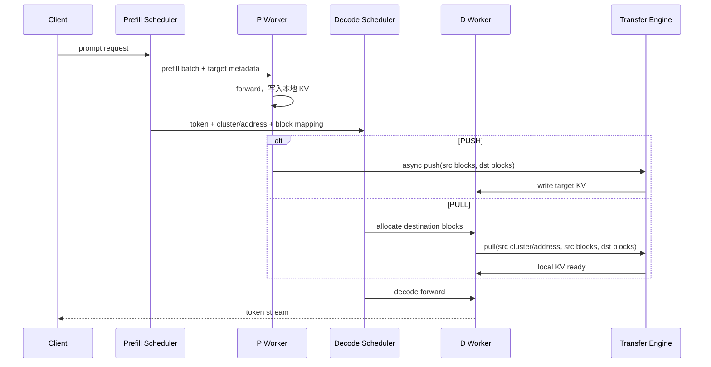

# xLLM 状态与缓存通信全解：从 KV Cache 到 PD、多机与远端缓存数据面

> 本文是 xLLM 推理加速专题的“缓存通信”篇。它不重复介绍分页 KV 的地址翻译细节（见 [07-paged-kv-and-paged-attention-complete-chain.md](/export/home/weinan5/penghengduo/CODE/xllm-KIMI-K3/code_wiki/07-paged-kv-and-paged-attention-complete-chain.md)），而是回答一个更容易混淆的问题：**当 KV Cache、线性注意力状态、前缀缓存或 Host Cache 不在当前设备上时，xLLM 如何找到它、如何把它搬过来、谁负责等待，以及为什么它通常不是 AllGather。**

---

## 1. 先给结论：缓存通信不是“把一次 forward 再广播一遍”

### 1.1 最重要的判断

在 xLLM 里，通信对象至少有三类：

| 对象 | 生命周期 | 典型消费者 | 常见通信方式 | 是否通常使用 AllGather |
|---|---|---|---|---|
| 权重 | 进程启动到进程退出 | 每个本地 forward | 文件加载、权重切分、初始化同步 | 否，初始化阶段也不等于每层 AllGather |
| 激活/中间张量 | 一层或一个 step 内 | 同一个 batch 的其他 rank | TP AllReduce/AllGather、EP AllToAll、CP collective | 是，取决于并行维度 |
| 持久状态/缓存 | 多个 step，甚至跨实例 | 后续 decode、另一个实例或下一次请求 | 本地块拷贝、P2P/RDMA、RPC 控制面、远端 KV Store、Host H2D/D2H | 通常不是 |

一句话记忆：

> **collective 解决“这一轮大家一起算”的同步问题；cache transfer 解决“这份历史状态现在归谁、从哪块内存搬到哪块内存”的所有权问题。**

### 1.2 为什么不能直接 AllGather KV

AllGather 的语义是：每个参与者都给出一份同形数据，调用结束后每个参与者都拿到所有参与者的数据。它适合“每个 rank 都必须拥有完整结果”的场景。

一个 8 卡 decode 请求可能只需要：

```text
源 P-worker 2 的 block 37  -> 目标 D-worker 5 的 block 11
源 P-worker 3 的 block 38  -> 目标 D-worker 6 的 block 11
```

如果对 8 个 worker 做 AllGather，结果会把与当前请求无关的 block 也复制给所有人，通信量、临时显存和同步等待都变成请求真正需要的数据的数倍。缓存传输因此优先使用：

- **点对点（P2P）**：明确源地址、目标地址和块列表；
- **RDMA/设备传输引擎**：远端内存注册后直接读写；
- **RPC + 数据面**：RPC 只传控制信息，真实 bytes 由数据传输引擎搬运；
- **Host H2D/D2H**：设备缓存和 CPU pinned/page-aligned 缓存之间做异步拷贝；
- **远端 KV Store**：用内容 hash 查找缓存，再批量 put/get；
- **共享物理页映射**：通过全局虚拟地址和页偏移避免重复复制，仍需要 RPC 交换元数据。

AllGather 并非永远错误。Context Parallel（CP）为了让每个 query 看到跨 rank 的上下文，可能需要 AllGather Prefix KV 或等价的分片交换；那是**当前 attention 计算的输入激活/上下文依赖**，不是请求迁移意义上的“缓存归属转移”。

---

## 2. 读者需要先建立的四个坐标系

缓存通信难懂，通常不是因为某个 API 难，而是把四件不同的事混在了一起。阅读源码时始终区分以下四个坐标系。

### 2.1 “活数据”与“持久数据”

**活数据**（live data）只服务当前计算，例如某层的 hidden states、Q、局部 attention 输出。它的有效期通常只有一个 kernel 或一个 step。

**持久数据**（persistent state）会在 forward 结束后继续存在，例如：

- self-attention 的 K/V；
- GDN、SSM、Mamba 类线性注意力的 recurrent state；
- prefix cache 中按 token 前缀命中的块；
- speculative decoding 的 draft KV；
- Host offload 后驻留在 CPU 的块；
- 远端 Store 中按 hash 保存的缓存。

活数据通常由并行组同步；持久数据通常按请求、块和生命周期管理。

### 2.2 “逻辑位置”与“物理位置”

请求的第 0 到第 4095 个 token 是**逻辑位置**。它可能被分散在多个物理 block 中，物理 block 还可能因为分页、DP、CP 或迁移而改变 ID。

因此传输不能只传“token 范围”，而必须传一张映射：

```text
source block id  ->  destination block id
source linear-state slot -> destination linear-state slot
source cache group -> destination cache group
```

xLLM 的 `KVCacheInfo` 正是这张“搬运清单”，其字段包括目标 cluster/address、源/目标 block、线性状态 ID、XTensor layer offsets 和按 group 划分的映射，见 [kv_cache_transfer.h:52](/export/home/weinan5/penghengduo/CODE/xllm-KIMI-K3/xllm/xllm/core/framework/kv_cache_transfer/kv_cache_transfer.h:52)。

### 2.3 “控制面”与“数据面”

- **控制面**：告诉对方“谁是源、谁是目标、哪几个块、属于哪个 DP、是否有线性状态、是否异构 TP”。协议消息、RPC、cluster link 都属于控制面。
- **数据面**：真的复制 K/V bytes、CONV/SSM bytes、index cache 或 scale。Mooncake、LlmDataDist、BatchMemcpy、RDMA Store 属于数据面。

把控制面和数据面拆开，是理解 PD 的关键。brpc 可以发送一个很小的 `PullKVCacheRequest`，但真正的大 tensor 通常不会塞进 protobuf，而是交给后端按已注册的内存地址搬运。

### 2.4 “共享”与“复制”

- **复制**：目标有自己的物理存储，传输完成后源和目标各有一份 bytes。PUSH/PULL、Host offload、Store get 都属于复制。
- **共享/映射**：多个逻辑视图指向同一组物理页，减少复制。XTensor 的全局虚拟地址和物理页映射接近这种模型，但它仍有本地设备可访问性、页生命周期和元数据同步约束。

---

## 3. 基础通信术语：AllReduce、AllGather、AllToAll、P2P、RPC 到 RDMA

### 3.1 Collective 是什么

Collective（集合通信）是一组 rank 共同参与的操作。常见语义如下：

| 原语 | 白话 | 典型 xLLM 用途 |
|---|---|---|
| AllReduce | 每个 rank 提供一份张量，大家得到求和/最大值后的同形张量 | TP Row Parallel 输出合并、部分 MoE 统计 |
| AllGather | 每个 rank 提供一片，大家拼出完整张量 | TP 列拼接、CP 让每个 rank 得到完整上下文 |
| ReduceScatter | 先规约，再把不同结果片段分给不同 rank | TP/优化通信，避免每人保存完整结果 |
| AllToAll | 每个 rank 向每个其他 rank 发送不同切片，同时接收自己的切片 | EP token dispatch、专家路由 |
| Broadcast | 一个 rank 发给所有 rank | 小型配置或控制信息 |

xLLM 的 Python collective 封装可以直接看到 `all_reduce_`、`all_gather`、`all_to_all_single`，见 [collectives.py:125](/export/home/weinan5/penghengduo/CODE/xllm-KIMI-K3/xllm/xllm/python/ops/collectives.py:125)、[collectives.py:139](/export/home/weinan5/penghengduo/CODE/xllm-KIMI-K3/xllm/xllm/python/ops/collectives.py:139) 和 [collectives.py:208](/export/home/weinan5/penghengduo/CODE/xllm-KIMI-K3/xllm/xllm/python/ops/collectives.py:208)。

> 注意：collective 的“大家”是一个预先建立好的并行组，不是所有在线请求，也不是所有机器。

### 3.2 P2P 是什么

P2P（point-to-point）是明确的发送方和接收方。它可以是：

1. 同一设备内的 tensor copy；
2. 同一节点 GPU/NPU 之间的 peer copy；
3. 同一机器进程间的共享内存；
4. 跨节点通过 TCP、RoCE、InfiniBand 或设备传输引擎的远端内存读写。

缓存传输天然适合 P2P，因为调度器已经知道源和目标块。

### 3.3 RPC 不等于大 tensor 数据通道

RPC（Remote Procedure Call，远程过程调用）把远程操作包装成函数调用。它非常适合：

- 建立/解除 cluster link；
- 交换 cluster ID、地址、DP/TP 拓扑；
- 发送 block 映射和请求 token；
- 报告完成、失败和超时。

但 protobuf/RPC 消息本身不一定承载 KV bytes。xLLM 的 `PullKVCache` 服务接收 block ID、线性状态 ID 等字段，之后调用 worker 的异步传输接口，见 [worker_service.cpp:497](/export/home/weinan5/penghengduo/CODE/xllm-KIMI-K3/xllm/xllm/core/distributed_runtime/worker_service.cpp:497)。

### 3.4 RDMA 和设备传输引擎

RDMA（Remote Direct Memory Access）允许一台机器直接读写另一台机器已经注册的内存，减少远端 CPU 拷贝。它仍然需要：

- 可访问的地址和长度；
- 内存注册与生命周期管理；
- 会话/连接建立；
- 完成通知和错误处理。

所以 RDMA 不是“无协议传输”，而是把数据面做得更直接，控制面依然存在。

---

## 4. xLLM 的缓存与状态分类

### 4.1 权重不是 KV Cache

权重通常在启动阶段按 TP/EP 切片，每个 rank 持有自己的 shard。forward 过程中它们是只读的。把权重从一个实例发送到另一个实例，是模型加载或权重服务问题；把 KV 从 P 发送到 D，是请求状态转移问题。

二者区别：

| 维度 | 权重 | KV/状态 |
|---|---|---|
| 内容 | 模型参数 | 某个请求的历史结果 |
| 是否请求相关 | 否 | 是 |
| 是否只读 | 通常是 | 会追加、回收、复制 |
| 分片约束 | 模型 TP/EP 固定 | 请求 DP、CP、KV split、目标拓扑共同决定 |
| 生命周期 | 进程级 | 请求级、prefix 级或 Store 级 |
| 错误处理 | 启动失败 | 可重试、回退到重算、拒绝迁移 |

### 4.2 标准 K/V Cache

对 decoder-only Transformer，历史 token 的 K/V 会被后续 query 读取。xLLM 以 block/page 管理它们，block ID 是调度和传输的基本粒度。

### 4.3 线性注意力状态

GDN、SSM 等模型不一定保存传统 K/V，而是保存 recurrent state。它的特点是：

- 通常按 sequence slot 保存，而不是按 token block 保存；
- 不能简单把一个 K block 当作一个 state block；
- 迁移时必须同时传 `src_linear_state_ids` 和 `dst_linear_state_ids`。

源码中的 `KVCacheInfo` 明确把两类 ID 分开，见 [kv_cache_transfer.h:57](/export/home/weinan5/penghengduo/CODE/xllm-KIMI-K3/xllm/xllm/core/framework/kv_cache_transfer/kv_cache_transfer.h:57)。

### 4.4 Prefix Cache

Prefix Cache 是“内容相同的前缀可以复用”。它通常通过 token hash 找到物理块，并增加引用计数。跨机器复用时，传输的是命中的块内容和映射，不是把整个 worker 的 prefix cache AllGather 给所有机器。

Prefix Cache 的命中、引用计数和调度影响请结合 [08-prefix-cache-complete-chain.md](/export/home/weinan5/penghengduo/CODE/xllm-KIMI-K3/code_wiki/08-prefix-cache-complete-chain.md) 阅读。

### 4.5 其他可能需要迁移的状态

- speculative decoding 的 draft KV；
- MLA/index cache 以及 INT8 index scale；
- 多模态 embedding 或视觉 token 的中间缓存；
- graph replay 的静态 buffer、shape metadata（通常不是跨请求搬运的数据）；
- beam search 的共享 block（更多是本地引用/Copy-on-Write）；
- 请求迁移所需的 token 序列、采样状态、logprob 和线性状态。

缓存通信设计的第一步永远是问：**这个对象按 token、按 block、按 sequence slot，还是按模型 layer 组织？**

---

## 5. 从配置到对象：传输后端如何被选出来

### 5.1 PD 配置入口

`DisaggPDConfig` 定义了 PD 开关、实例角色、传输类型、PUSH/PULL 模式、监听端口、异构 TP 和并行 shard pull，见 [disagg_pd_config.h:46](/export/home/weinan5/penghengduo/CODE/xllm-KIMI-K3/xllm/xllm/core/framework/config/disagg_pd_config.h:46) 和 [disagg_pd_config.h:61](/export/home/weinan5/penghengduo/CODE/xllm-KIMI-K3/xllm/xllm/core/framework/config/disagg_pd_config.h:61)。当前默认值是：PD 关闭、传输类型 `LlmDataDist`、模式 `PUSH`、监听端口 `26000`、并行 shard pull 开启。

这些默认值只是配置默认值，不代表所有编译平台都能直接运行；配置归一化还会按 MLU/DCU 等平台改写传输类型和 overlap 行为，见 [disagg_pd_config.cpp:103](/export/home/weinan5/penghengduo/CODE/xllm-KIMI-K3/xllm/xllm/core/framework/config/disagg_pd_config.cpp:103) 和 [disagg_pd_config.cpp:132](/export/home/weinan5/penghengduo/CODE/xllm-KIMI-K3/xllm/xllm/core/framework/config/disagg_pd_config.cpp:132)。

### 5.2 Factory 的分支

`KVCacheTransferFactory::create` 根据传输类型构造：

- NPU 上的 `LlmDataDistTransfer`；
- `MooncakeKVCacheTransferDefault`；
- 打开 XTensor 时的 `MooncakeKVCacheTransferXTensor`。

对应分支见 [kv_cache_transfer.cpp:361](/export/home/weinan5/penghengduo/CODE/xllm-KIMI-K3/xllm/xllm/core/framework/kv_cache_transfer/kv_cache_transfer.cpp:361) 到 [kv_cache_transfer.cpp:430](/export/home/weinan5/penghengduo/CODE/xllm-KIMI-K3/xllm/xllm/core/framework/kv_cache_transfer/kv_cache_transfer.cpp:430)。这告诉我们一个重要事实：**上层 scheduler 不直接依赖某个网卡 API，而依赖 `KVCacheTransfer` 接口。**

### 5.3 统一接口的最小协议

抽象接口包含：

```text
initialize / finalize
allocate_kv_cache / register_kv_cache / free_kv_cache
get_cache_info / link_cluster / unlink_cluster
pull_kv_blocks / pull_kv_blocks_async
push_kv_blocks_async / push_kv_blocks
pull_hetero_kv_blocks
```

见 [kv_cache_transfer.h:77](/export/home/weinan5/penghengduo/CODE/xllm-KIMI-K3/xllm/xllm/core/framework/kv_cache_transfer/kv_cache_transfer.h:77) 到 [kv_cache_transfer.h:163](/export/home/weinan5/penghengduo/CODE/xllm-KIMI-K3/xllm/xllm/core/framework/kv_cache_transfer/kv_cache_transfer.h:163)。

这组接口已经表达了三种不同的能力：

1. **缓存生命周期**：分配并注册可远端访问的内存；
2. **同构传输**：源和目标拓扑相同，按 block 一一搬运；
3. **异构恢复**：源 TP shard 数多于目标 TP，需要临时 staging 和 merge。

---

## 6. TP：为什么它通信的是激活，不是完整 KV

### 6.1 Column Parallel 和 Row Parallel 的直觉

以一个线性层为例，权重可以按列或按行切分：

```text
X [B, H] × W [H, 4H]
```

如果 W 按输出列切成 TP=4 片，每个 rank 得到 `[B, H] × [H, H]` 的局部输出；如果下一层需要合并，可能使用 AllGather 或直接进入 Row Parallel。Row Parallel 的局部结果通常通过 AllReduce 合并。

xLLM 的模型并行实现可从 `ColumnParallelLinear` 和 `RowParallelLinear` 看见，见 [linear.py:250](/export/home/weinan5/penghengduo/CODE/xllm-KIMI-K3/xllm/xllm/python/layers/linear.py:250) 和 [linear.py:290](/export/home/weinan5/penghengduo/CODE/xllm-KIMI-K3/xllm/xllm/python/layers/linear.py:290)。

### 6.2 为什么每个 TP rank 只保留自己的 KV shard

假设 attention 的 KV head 也按 TP 切分。每个 rank 计算自己拥有的 K/V head，下一轮 query 通常只需要读这个局部 head；把所有 KV head 复制到每个 rank 会浪费显存。

因此常见结构是：

```text
TP rank 0: K/V head 0..3 + 局部 attention
TP rank 1: K/V head 4..7 + 局部 attention
TP rank 2: K/V head 8..11 + 局部 attention
TP rank 3: K/V head 12..15 + 局部 attention
```

TP 需要交换的是本层计算所需的 activation 或局部结果，而不是把从第 0 个 token 到当前 token 的所有 K/V 在每一层重新 AllGather。

### 6.3 多机 TP 的网络流量

如果 TP=8 跨两台机器，网络上会出现每层的 AllReduce/AllGather。它们可能是推理的主要网络开销，但不要把这部分称为“KV Cache 通信”。更准确的描述是：

```text
多机 TP = 每个 forward 都发生的 activation collective
PD KV transfer = 请求边界发生的 persistent-state P2P transfer
```

两者可能同时存在。例如 D 节点收到 P 节点传来的 KV 后，D 内部继续进行跨节点 TP AllReduce。前者是一次性的请求迁移，后者是每个 decode step 的模型并行。

---

## 7. DP：请求分片，不等于 KV AllGather

### 7.1 DP 的职责

Data Parallel（DP）通常复制模型，每个 DP rank 独立处理一部分请求。调度器需要保证同一请求的 block 和 sequence state 归属于一个稳定的 DP rank，避免每个 token 都在 DP rank 之间搬运。

因此 DP 的常见通信内容是：

- 请求/sequence 的归属和负载信息；
- batch size、token count、padding 或路由统计；
- EP 需要的全局 token count；
- PD 建立映射时的 `dp_rank` 和 cluster 列表。

### 7.2 xLLM 如何把源 DP 映射到目标 DP

`merge_kv_blocks` 会读取源 world size、源 DP、源 KV split 和目标 DP/TP 拓扑，计算当前 worker 应该把哪些 block 发给目标 DP group，而不是对所有目标 worker 广播。源码见 [kv_cache_transfer.cpp:176](/export/home/weinan5/penghengduo/CODE/xllm-KIMI-K3/xllm/xllm/core/framework/kv_cache_transfer/kv_cache_transfer.cpp:176) 到 [kv_cache_transfer.cpp:243](/export/home/weinan5/penghengduo/CODE/xllm-KIMI-K3/xllm/xllm/core/framework/kv_cache_transfer/kv_cache_transfer.cpp:243)。

其核心思想是：

```text
源 rank -> 计算自己连接的目标 DP ranks -> 对每个目标 worker 合并 block 列表
```

这样既避免全量 AllGather，也避免源 worker 为不相关 DP 请求发送数据。

### 7.3 DP 下 prefix cache 的边界

如果 prefix cache 只在本地 block manager 中维护，DP rank 之间不会自动共享命中结果。若请求被重新路由到另一个 DP rank，系统要么重新计算前缀，要么显式迁移 block。不能因为模型权重复制了，就推断 KV 也复制了。

---

## 8. CP：缓存通信中最容易与 PD 混淆的特例

### 8.1 Context Parallel 的问题

Context Parallel（CP）把长上下文分散到多个 rank。每个 rank 可能只拥有部分历史 token，但本地 query 的 attention 仍然需要访问全局上下文。

这时有两种实现思路：

1. 每个 rank 交换/AllGather 必要的 Prefix KV；
2. 采用 Ring/分块 attention，在通信过程中逐段消费远端 KV。

这类通信发生在 forward 的 attention 路径内，数据由当前 step 的 query 消费，因而更像 activation communication。

### 8.2 CP 的 KV split 元数据

PD 场景中，P 侧 CP/KV split 可能只持有全局 block 列表的一部分。`filter_kv_split_infos` 会按 `kv_split_rank + k * kv_split_size` 选择自己负责的目标块，并在最后一个不完整逻辑 block 时截断多余尾部，见 [kv_cache_transfer.cpp:68](/export/home/weinan5/penghengduo/CODE/xllm-KIMI-K3/xllm/xllm/core/framework/kv_cache_transfer/kv_cache_transfer.cpp:68) 到 [kv_cache_transfer.cpp:115](/export/home/weinan5/penghengduo/CODE/xllm-KIMI-K3/xllm/xllm/core/framework/kv_cache_transfer/kv_cache_transfer.cpp:115)。

这是**块映射重排**，不是 CP attention 的 AllGather。二者都出现“split”，但发生的时间和目的不同：

| 名称 | 发生时间 | 目的 |
|---|---|---|
| CP attention exchange | 每个相关 forward | 让 query 看到远端上下文 |
| PD KV split remap | P/D 交接一次 | 让源局部 block 对上目标物理 block |

### 8.3 一个小例子

`kv_split_size=4`、P 的 rank=2 只保存本地 block `[p0,p1,p2]`，D 给出的全局目标 block 是 `[d0,d1,...,d11]`。映射下标为 `2,6,10`，所以传输清单是：

```text
p0 -> d2
p1 -> d6
p2 -> d10
```

如果目标列表只有 10 个元素，`d10` 不存在，代码会截断最后一个本地 block，避免源/目标长度不相等导致整批传输失败。这个边界处理对长 prompt 的最后一个不满 block 很重要。

---

## 9. EP：AllToAll 传 token，通常不传 KV

Expert Parallel（EP）把 MoE 专家分布在不同 rank。一个 token 的 router 结果可能指向远端专家，所以需要：

```text
本地 token -> AllGather/统计 token counts -> AllToAll 发往专家 -> 专家计算 -> AllToAll 返回 -> 合并
```

xLLM 的 token dispatcher 里可以看到 `FusedAllGatherTokenDispatcher` 和 `AllToAllTokenDispatcher`，见 [token_dispatcher.py:165](/export/home/weinan5/penghengduo/CODE/xllm-KIMI-K3/xllm/xllm/python/layers/moe/token_dispatcher.py:165) 和 [token_dispatcher.py:239](/export/home/weinan5/penghengduo/CODE/xllm-KIMI-K3/xllm/xllm/python/layers/moe/token_dispatcher.py:239)。

EP 传的是当前 token 的 activation，KV 仍由 attention 所属的 block manager 管理。除非模型明确要求跨专家共享某种状态，否则不能把 EP 的 AllToAll 误认为 KV transfer。

---

## 10. PD 分离：为什么必须有独立的缓存数据面

### 10.1 P 和 D 的职责

PD（Prefill-Decode Disaggregation）把：

- **P 实例**：长 prompt 的 prefill 计算；
- **D 实例**：后续逐 token decode；

拆到不同的进程、设备池或机器。P 计算出来的 KV 不在 D 的本地显存里，D 想继续生成就必须拿到它。

所以一次 PD 交接至少包括：

1. token 序列或迁移请求元数据；
2. P/D 的 DP、TP、CP、KV split 拓扑；
3. 源 cluster ID 和地址；
4. 源 block IDs 与目标 block IDs；
5. 可选的线性状态 ID；
6. 可选的 XTensor layer offsets 或 cache group mapping；
7. 传输完成/失败状态。

### 10.2 PUSH 与 PULL 的定义

- **PUSH**：P 侧在本轮 forward 后主动把已完成的 KV 写入 D 的目标块。D 只等待或接收完成通知。
- **PULL**：D 侧收到请求和源地址后，主动从 P 读取源块并写入自己的目标块。

两者传输的 bytes 可以相同，区别在于谁发起数据面操作、谁更容易安排重试和背压。

### 10.3 xLLM 的请求级时序



PD 的控制面和数据面代码分别散落在 scheduler、RPC service 和 transfer backend 中。不要只看 `pd_ooc_scheduler.cpp` 就认为它已经搬完 KV；scheduler 只是生成迁移信息，真实搬运发生在 worker/transfer 层。

### 10.4 P 侧的异步 PUSH

`LLMWorkerImpl::step_internal` 在检测到 PUSH 模式和 `transfer_kv_infos` 后，创建每层 synchronizer，并调用 `push_kv_blocks_async`，见 [llm_worker_impl.cpp:242](/export/home/weinan5/penghengduo/CODE/xllm-KIMI-K3/xllm/xllm/core/runtime/llm_worker_impl.cpp:242) 到 [llm_worker_impl.cpp:277](/export/home/weinan5/penghengduo/CODE/xllm-KIMI-K3/xllm/xllm/core/runtime/llm_worker_impl.cpp:277)。

这带来一个非常重要的时序：

```text
第 0 层 KV 写完 -> synchronizer 放行第 0 层 push
第 1 层 KV 写完 -> synchronizer 放行第 1 层 push
...
模型 forward 结束 -> 等待整个 push future
```

它不是“等所有层都算完再一次性 memcpy”，而是允许层级 overlap，具体后端是否真正异步还要看平台实现。

### 10.5 D 侧的 PULL

在离线迁移或 PULL 模式下，scheduler 会收集目标块和目标 linear state slot，再调用 engine 的 pull 接口。`PDOOCScheduler` 会把 `src_linear_state_id` 映射到 decode 侧实际读取的 slot，见 [pd_ooc_scheduler.cpp:1787](/export/home/weinan5/penghengduo/CODE/xllm-KIMI-K3/xllm/xllm/core/scheduler/pd_ooc_scheduler.cpp:1787) 到 [pd_ooc_scheduler.cpp:1819](/export/home/weinan5/penghengduo/CODE/xllm-KIMI-K3/xllm/xllm/core/scheduler/pd_ooc_scheduler.cpp:1819)。

这里不能只传 token 数量：如果 recurrent state 没有放到 decode forward 会读取的 slot，模型虽然能运行，状态却是错的，后续 token 会逐步偏离。

---

## 11. 传输清单如何从请求变成后端调用

### 11.1 `TransferKVInfo` 到 `KVCacheInfo`

上层调度通常为每个请求产生 `TransferKVInfo`，其中含本地/远端 block、请求所属 DP 和远端实例信息。`merge_kv_blocks` 做三件事：

1. 根据源/目标拓扑确定当前 worker 需要联系哪些 D worker；
2. 将同一目标地址的多条请求合并成一个 `KVCacheInfo`；
3. 合并 block、linear state、XTensor offset 和 group mapping。

同一目标合并逻辑见 [kv_cache_transfer.cpp:215](/export/home/weinan5/penghengduo/CODE/xllm-KIMI-K3/xllm/xllm/core/framework/kv_cache_transfer/kv_cache_transfer.cpp:215) 到 [kv_cache_transfer.cpp:317](/export/home/weinan5/penghengduo/CODE/xllm-KIMI-K3/xllm/xllm/core/framework/kv_cache_transfer/kv_cache_transfer.cpp:317)。

### 11.2 为什么要按 cache group 传输

普通 Transformer 可能只有 K/V；复杂模型还可能有：

- index cache；
- index scale；
- CONV/SSM；
- SWA/C4/C128 等不同 block type；
- speculative draft cache。

如果把所有对象都假设为同一个 block layout，传输完成后可能只恢复了 K/V，遗漏了 index scale 或线性状态。`KVCacheInfo.block_transfer_groups` 用 group ID 把这些布局分开。

LlmDataDist 在 push 时会根据 `sequence_scoped` 选择 linear-state ID，否则按 group 查找 block ID；找不到非 KV group 会报错，见 [llm_data_dist_transfer.cpp:273](/export/home/weinan5/penghengduo/CODE/xllm-KIMI-K3/xllm/xllm/core/framework/kv_cache_transfer/llm_data_dist_transfer.cpp:273) 到 [llm_data_dist_transfer.cpp:351](/export/home/weinan5/penghengduo/CODE/xllm-KIMI-K3/xllm/xllm/core/framework/kv_cache_transfer/llm_data_dist_transfer.cpp:351)。

### 11.3 源/目标数量必须一致

传输接口不是“尽量复制”。对于一个 group，源 ID 和目标 ID 数量不相等时，LlmDataDist 会报错并将结果标为失败，见 [llm_data_dist_transfer.cpp:343](/export/home/weinan5/penghengduo/CODE/xllm-KIMI-K3/xllm/xllm/core/framework/kv_cache_transfer/llm_data_dist_transfer.cpp:343)。这也是前面 KV split 尾块截断逻辑存在的原因。

---

## 12. 同构 TP 的 PD 传输：P 的一片到 D 的对应一片

### 12.1 拓扑约束

同构 PD 通常要求 P 与 D 的 TP、KV head 切分兼容。源 TP=4、目标 TP=4 时，每个源 shard 可以直接写入对应的目标 shard；源 DP=2、目标 DP=4 时，则还要按 DP group 复制到对应目标 worker。

### 12.2 LlmDataDist 的注册与传输

LlmDataDist 的初始化会根据 P/Decode/Mix 角色设置不同 role；P 需要公布监听 endpoint，见 [llm_data_dist_transfer.cpp:44](/export/home/weinan5/penghengduo/CODE/xllm-KIMI-K3/xllm/xllm/core/framework/kv_cache_transfer/llm_data_dist_transfer.cpp:44) 到 [llm_data_dist_transfer.cpp:79](/export/home/weinan5/penghengduo/CODE/xllm-KIMI-K3/xllm/xllm/core/framework/kv_cache_transfer/llm_data_dist_transfer.cpp:79)。

每层每个 cache tensor 会注册地址、dtype、shape 并获得 cache ID，见 [llm_data_dist_transfer.cpp:214](/export/home/weinan5/penghengduo/CODE/xllm-KIMI-K3/xllm/xllm/core/framework/kv_cache_transfer/llm_data_dist_transfer.cpp:214) 到 [llm_data_dist_transfer.cpp:271](/export/home/weinan5/penghengduo/CODE/xllm-KIMI-K3/xllm/xllm/core/framework/kv_cache_transfer/llm_data_dist_transfer.cpp:271)。真正的 PUSH/PULL 调用分别落到 `PushKvBlocks` 和 `PullKvBlocks`，见 [llm_data_dist_transfer.cpp:153](/export/home/weinan5/penghengduo/CODE/xllm-KIMI-K3/xllm/xllm/core/framework/kv_cache_transfer/llm_data_dist_transfer.cpp:153) 和 [llm_data_dist_transfer.cpp:353](/export/home/weinan5/penghengduo/CODE/xllm-KIMI-K3/xllm/xllm/core/framework/kv_cache_transfer/llm_data_dist_transfer.cpp:353)。

### 12.3 Mooncake 的内存注册

Mooncake 默认实现要求 cache tensor 非空、维度合法、连续（contiguous），并检查 storage offset、逻辑 bytes、每 block bytes 和底层 storage 容量，见 [mooncake_kv_cache_transfer.cpp:414](/export/home/weinan5/penghengduo/CODE/xllm-KIMI-K3/xllm/xllm/core/framework/kv_cache_transfer/mooncake_kv_cache_transfer.cpp:414) 到 [mooncake_kv_cache_transfer.cpp:477](/export/home/weinan5/penghengduo/CODE/xllm-KIMI-K3/xllm/xllm/core/framework/kv_cache_transfer/mooncake_kv_cache_transfer.cpp:477)。

注册完成后，后端为每个 buffer 保存地址、长度和 block byte size，见 [mooncake_kv_cache_transfer.cpp:543](/export/home/weinan5/penghengduo/CODE/xllm-KIMI-K3/xllm/xllm/core/framework/kv_cache_transfer/mooncake_kv_cache_transfer.cpp:543) 到 [mooncake_kv_cache_transfer.cpp:578](/export/home/weinan5/penghengduo/CODE/xllm-KIMI-K3/xllm/xllm/core/framework/kv_cache_transfer/mooncake_kv_cache_transfer.cpp:578)。这解释了为什么传输前必须先完成 cache allocation/register：远端传输引擎需要稳定的可访问内存。

### 12.4 逐层 push 与 overlap

Mooncake default 的 push 循环按 layer 获取 buffer IDs，在该层 synchronizer 放行后调用 `push_memory_blocks`，见 [mooncake_kv_cache_transfer.cpp:648](/export/home/weinan5/penghengduo/CODE/xllm-KIMI-K3/xllm/xllm/core/framework/kv_cache_transfer/mooncake_kv_cache_transfer.cpp:648) 到 [mooncake_kv_cache_transfer.cpp:688](/export/home/weinan5/penghengduo/CODE/xllm-KIMI-K3/xllm/xllm/core/framework/kv_cache_transfer/mooncake_kv_cache_transfer.cpp:688)。

因此一个合理的时间线是：

```text
Layer 0 compute ──┬── Layer 0 push
Layer 1 compute   ├───────┬── Layer 1 push
Layer 2 compute   │       ├───────┬── Layer 2 push
                   ...     ...     ...
```

但“调用 async”不等于“网络完全与计算重叠”。是否重叠还取决于设备 stream、事件、后端是否阻塞、目标写入是否与 D forward 冲突，以及 scheduler 是否在正确时刻等待 future。

---

## 13. 异构 TP 的 PD：为什么需要 staging 和 merge

### 13.1 问题定义

P 使用 TP=8，D 使用 TP=4。P 的每个目标 head shard 只有 D 所需的一半，不能把 P rank 0 的 block 直接当成 D rank 0 的完整 block。

如果 D 直接读取其中一片，结果不是“略慢”，而是 attention 数学输入不完整。

### 13.2 xLLM 的接口与约束

统一接口提供 `pull_hetero_kv_blocks`，注释明确说明：先把每个源 TP shard 拉到本地临时 buffer，再合并到 decode-side cache，见 [kv_cache_transfer.h:132](/export/home/weinan5/penghengduo/CODE/xllm-KIMI-K3/xllm/xllm/core/framework/kv_cache_transfer/kv_cache_transfer.h:132)。

LLMEngine 会检查源 TP 至少不小于目标 TP，且源 TP 是目标 TP 的整数倍，见 [llm_engine.cpp:703](/export/home/weinan5/penghengduo/CODE/xllm-KIMI-K3/xllm/xllm/core/distributed_runtime/llm_engine.cpp:703) 到 [llm_engine.cpp:727](/export/home/weinan5/penghengduo/CODE/xllm-KIMI-K3/xllm/xllm/core/distributed_runtime/llm_engine.cpp:727)。

### 13.3 两阶段恢复

当前 speculative transfer 的异构路径体现了一个清晰的两阶段模型：

1. 从所有源 shard 拉取线性状态，或使用已预推送到 staging 的 target KV；
2. 把 staging 中的多个 shard 合并到 D 的 TP1/目标布局；
3. draft cache 可能仍走同步 pull。

相关代码见 [spec_kv_cache_transfer.cpp:847](/export/home/weinan5/penghengduo/CODE/xllm-KIMI-K3/xllm/xllm/core/framework/kv_cache_transfer/spec_kv_cache_transfer.cpp:847) 到 [spec_kv_cache_transfer.cpp:918](/export/home/weinan5/penghengduo/CODE/xllm-KIMI-K3/xllm/xllm/core/framework/kv_cache_transfer/spec_kv_cache_transfer.cpp:918)。

### 13.4 异构 TP 的代价

与同构传输相比，异构 TP 会增加：

- staging cache 的额外显存或 Host/device 内存；
- 多源连接和多次 PULL；
- merge kernel 或 memcpy；
- 传输完成后的同步点；
- 更复杂的失败回滚。

它不是“把 AllGather 换成一个函数名”，而是一次真正的数据布局变换。

---

## 14. 线性状态、Speculative KV 和复杂 cache group

### 14.1 线性状态为什么必须单独传

传统 KV 的 key 是 block ID；线性注意力 state 的 key 是 sequence-scoped slot。LlmDataDist 的 pull 逻辑会根据 `registered_cache.sequence_scoped` 在 `src_linear_state_ids/dst_linear_state_ids` 与 `src_blocks/dst_blocks` 之间选择，见 [llm_data_dist_transfer.cpp:164](/export/home/weinan5/penghengduo/CODE/xllm-KIMI-K3/xllm/xllm/core/framework/kv_cache_transfer/llm_data_dist_transfer.cpp:164) 到 [llm_data_dist_transfer.cpp:188](/export/home/weinan5/penghengduo/CODE/xllm-KIMI-K3/xllm/xllm/core/framework/kv_cache_transfer/llm_data_dist_transfer.cpp:164)。

### 14.2 Speculative decoding

投机解码可能同时存在 target KV 和 draft KV。Mooncake default 会把主 layout 和 spec layout 分开记录，避免两套 buffer ID 混淆，见 [mooncake_kv_cache_transfer.cpp:246](/export/home/weinan5/penghengduo/CODE/xllm-KIMI-K3/xllm/xllm/core/framework/kv_cache_transfer/mooncake_kv_cache_transfer.cpp:246) 到 [mooncake_kv_cache_transfer.cpp:305](/export/home/weinan5/penghengduo/CODE/xllm-KIMI-K3/xllm/xllm/core/framework/kv_cache_transfer/mooncake_kv_cache_transfer.cpp:305)。

### 14.3 Index cache 和 scale 不能遗漏

MLA 或 lighting indexer 可能使用 index cache，INT8 index 还需要 per-token fp32 scale。Host hierarchy 的 block type map 和 Mooncake registration 都把 `INDEX_SCALE` 作为独立角色处理，见 [hierarchy_kv_cache_transfer.cpp:58](/export/home/weinan5/penghengduo/CODE/xllm-KIMI-K3/xllm/xllm/core/framework/kv_cache_transfer/hierarchy_kv_cache_transfer.cpp:58) 和 [mooncake_kv_cache_transfer.cpp:552](/export/home/weinan5/penghengduo/CODE/xllm-KIMI-K3/xllm/xllm/core/framework/kv_cache_transfer/mooncake_kv_cache_transfer.cpp:552)。

### 14.4 迁移时 token 也要同步

KV 只描述历史 attention 状态，不包含完整的请求控制状态。PD scheduler 还会传递已生成 token、logprob、TTFT 等迁移信息，见 [pd_ooc_scheduler.cpp:2115](/export/home/weinan5/penghengduo/CODE/xllm-KIMI-K3/xllm/xllm/core/scheduler/pd_ooc_scheduler.cpp:2115) 到 [pd_ooc_scheduler.cpp:2155](/export/home/weinan5/penghengduo/CODE/xllm-KIMI-K3/xllm/xllm/core/scheduler/pd_ooc_scheduler.cpp:2155)。

只有 KV 没有 token 序列，D 仍然不知道下一轮 position、采样历史和停止条件；只有 token 没有 KV，则 D 必须重算整个 prompt。

---

## 15. Host Offload：这是 H2D/D2H，不是跨机 collective

### 15.1 Host cache 的作用

当 HBM 不够时，可以把不活跃的 prefix block 放到 CPU pinned/page-aligned 内存。xLLM 通过 `host_blocks_factor` 控制 Host block 数量，初始化时 host block 数约为 HBM block 数乘以该因子，见 [llm_engine.cpp:540](/export/home/weinan5/penghengduo/CODE/xllm-KIMI-K3/xllm/xllm/core/distributed_runtime/llm_engine.cpp:540) 到 [llm_engine.cpp:563](/export/home/weinan5/penghengduo/CODE/xllm-KIMI-K3/xllm/xllm/core/distributed_runtime/llm_engine.cpp:563)。

当 `host_blocks_factor > 1.0` 时，engine 创建 `HierarchyBlockManagerPool`，见 [llm_engine.cpp:618](/export/home/weinan5/penghengduo/CODE/xllm-KIMI-K3/xllm/xllm/core/distributed_runtime/llm_engine.cpp:618) 到 [llm_engine.cpp:633](/export/home/weinan5/penghengduo/CODE/xllm-KIMI-K3/xllm/xllm/core/distributed_runtime/llm_engine.cpp:633)。

### 15.2 D2H offload

请求释放或 prefix cache 形成后，满足引用计数条件的设备 block 会进入 offload 队列。`HierarchyBlockManagerPool::transfer_blocks` 把它们标成 `D2H2G`，异步调用 engine，完成后才把 host block 发布到 prefix cache，见 [hierarchy_block_manager_pool.cpp:449](/export/home/weinan5/penghengduo/CODE/xllm-KIMI-K3/xllm/xllm/core/framework/block/hierarchy_block_manager_pool.cpp:449) 到 [hierarchy_block_manager_pool.cpp:505](/export/home/weinan5/penghengduo/CODE/xllm-KIMI-K3/xllm/xllm/core/framework/block/hierarchy_block_manager_pool.cpp:505)。

这里的 `G` 可以理解为“完成后再加入全局/Host cache 可见集合”。如果复制失败，代码会释放预留 ID，并跳过 cache publish，避免下次 H2D 读到未完成数据。

### 15.3 H2D prefetch

调度器命中 Host prefix cache 后，先为序列分配设备 block，再生成 `H2D` transfer info。Host cache 的形状是 `[host_blocks, layer_count, per_block_dims]`，设备 cache 通常是 `[device_blocks, per_block_dims]`，copy plan 会按 layer 把两者配对，见 [hierarchy_kv_cache_transfer.cpp:224](/export/home/weinan5/penghengduo/CODE/xllm-KIMI-K3/xllm/xllm/core/framework/kv_cache_transfer/hierarchy_kv_cache_transfer.cpp:224) 到 [hierarchy_kv_cache_transfer.cpp:306](/export/home/weinan5/penghengduo/CODE/xllm-KIMI-K3/xllm/xllm/core/framework/kv_cache_transfer/hierarchy_kv_cache_transfer.cpp:306)。

H2D 不是一次性阻塞 memcpy：实现按 layer range 分批复制，记录 synchronizer event，forward 在消费对应层之前等待该层完成，见 [hierarchy_kv_cache_transfer.cpp:421](/export/home/weinan5/penghengduo/CODE/xllm-KIMI-K3/xllm/xllm/core/framework/kv_cache_transfer/hierarchy_kv_cache_transfer.cpp:421) 到 [hierarchy_kv_cache_transfer.cpp:465](/export/home/weinan5/penghengduo/CODE/xllm-KIMI-K3/xllm/xllm/core/framework/kv_cache_transfer/hierarchy_kv_cache_transfer.cpp:465)。

### 15.4 Host offload 的内存代价

Host offload 节省 HBM，但会增加：

- pinned/page-aligned CPU 内存；
- H2D/D2H 临时 stream 和 event；
- scheduler 的 prefetch bookkeeping；
- PCIe/NVLink/设备总线带宽占用。

它不消耗跨机网络带宽，除非 Host cache 进一步接入远端 Store。

---

## 16. 远端 KV Store：按 hash 取缓存的另一条路径

### 16.1 Store 和 PD transfer 的区别

PD transfer 知道“这次请求来自哪个 P cluster”；Store 更像一个共享缓存：

```text
hash(token prefix) -> Store key -> bytes
```

请求可以在不同时间、不同 worker、甚至不同实例上命中同一个 key。它不需要源 P 实例一直在线，但需要处理 TTL、淘汰、复制和一致性。

### 16.2 xLLM 的 Store 配置

`KVCacheStoreConfig` 暴露 prefetch timeout、prefetch batch size、Host block factor、TCP/RDMA 协议和 server 地址，见 [kv_cache_store_config.h:41](/export/home/weinan5/penghengduo/CODE/xllm-KIMI-K3/xllm/xllm/core/framework/config/kv_cache_store_config.h:41) 到 [kv_cache_store_config.h:75](/export/home/weinan5/penghengduo/CODE/xllm-KIMI-K3/xllm/xllm/core/framework/config/kv_cache_store_config.h:75)。

### 16.3 Store 的 key 和 batch put/get

`KVCacheStore` 将 block hash 拼接 TP rank 形成 key，通过 Mooncake Client 执行 `BatchPut`/`BatchGet`，见 [kv_cache_store.cpp:98](/export/home/weinan5/penghengduo/CODE/xllm-KIMI-K3/xllm/xllm/core/framework/kv_cache_transfer/kv_cache_store.cpp:98) 到 [kv_cache_store.cpp:176](/export/home/weinan5/penghengduo/CODE/xllm-KIMI-K3/xllm/xllm/core/framework/kv_cache_transfer/kv_cache_store.cpp:176)。

一个 block 的 slice 可能同时包含 K、V、index 和 index scale，见 [kv_cache_store.cpp:194](/export/home/weinan5/penghengduo/CODE/xllm-KIMI-K3/xllm/xllm/core/framework/kv_cache_transfer/kv_cache_store.cpp:194) 到 [kv_cache_store.cpp:223](/export/home/weinan5/penghengduo/CODE/xllm-KIMI-K3/xllm/xllm/core/framework/kv_cache_transfer/kv_cache_store.cpp:194)。

### 16.4 TCP 与 RDMA

Store `protocol=tcp` 时通常走网络栈和 CPU；`protocol=rdma` 时必须先注册本地内存，否则初始化失败或回退 TCP，见 [kv_cache_store.cpp:14](/export/home/weinan5/penghengduo/CODE/xllm-KIMI-K3/xllm/xllm/core/framework/kv_cache_transfer/kv_cache_store.cpp:14) 到 [kv_cache_store.cpp:88](/export/home/weinan5/penghengduo/CODE/xllm-KIMI-K3/xllm/xllm/core/framework/kv_cache_transfer/kv_cache_store.cpp:88)。

这仍然不是 AllGather：Store 是按 key 的单块查询，可能有副本，但不会把所有缓存广播给所有 worker。

### 16.5 当前实现边界

当前源码中 Store API、配置和协议路径存在，但具体部署是否连通取决于外部 Mooncake 服务、metadata/master 地址、RDMA 环境和构建宏。不能仅凭 `enable_kvcache_store` 默认存在，就宣称远端 Store 在每个模型和平台上已经可用。

---

## 17. XTensor：用页映射减少复制，但元数据通信仍不可少

### 17.1 全局虚拟地址的直觉

XTensor 把物理页映射到一个大的虚拟地址空间。`GlobalXTensor::init` 先从 `PhyPagePool` 获取总页数和页粒度，创建虚拟地址，再把每个物理页映射进去，见 [global_xtensor.cpp:28](/export/home/weinan5/penghengduo/CODE/xllm-KIMI-K3/xllm/xllm/core/framework/xtensor/global_xtensor.cpp:28) 到 [global_xtensor.cpp:89](/export/home/weinan5/penghengduo/CODE/xllm-KIMI-K3/xllm/xllm/core/framework/xtensor/global_xtensor.cpp:89)。

这解决的是本地物理页碎片和连续地址问题，不等于“跨机器 GPU 自动共享内存”。跨实例仍需：

- 交换模型 ID、页/块 offset；
- 确认目标页已被分配和映射；
- 让 Mooncake/XTensor transfer 知道目标 layer offsets；
- 在生命周期结束时解除映射或释放页。

### 17.2 XTensor 控制面

XTensorDistClient 通过 brpc 调用 `GetXTensorOffsets`、`MapToKvTensors` 等服务，见 [xtensor_dist_client.cpp:115](/export/home/weinan5/penghengduo/CODE/xllm-KIMI-K3/xllm/xllm/core/framework/xtensor/xtensor_dist_client.cpp:115) 到 [xtensor_dist_client.cpp:166](/export/home/weinan5/penghengduo/CODE/xllm-KIMI-K3/xllm/xllm/core/framework/xtensor/xtensor_dist_client.cpp:213)。这些是元数据 RPC，不是每个 token 的 AllGather。

`KVCacheInfo.dst_xtensor_layer_offsets` 用于在 PD 传输时把 D 侧每层 offset 传给后端，见 [kv_cache_transfer.h:62](/export/home/weinan5/penghengduo/CODE/xllm-KIMI-K3/xllm/xllm/core/framework/kv_cache_transfer/kv_cache_transfer.h:62)。

### 17.3 XTensor 适合什么场景

- 共享权重页或全局物理页池；
- 减少频繁页复制和地址碎片；
- PD 中目标已经拥有可映射的全局页；
- 需要按 layer offset 精确写入的布局。

它不自动解决：

- P/D 的请求路由；
- DP/TP 拓扑不一致；
- cache hash 一致性；
- 远端机器的物理内存可达性；
- 源数据仍在计算中的可见性。

---

## 18. 完整请求例子：2 台 P、4 台 D、TP=2、带线性状态

下面用一个具体但简化的配置把整条链路串起来。

### 18.1 拓扑

```text
P 实例：DP=1, TP=2, 2 个 worker
D 实例：DP=2, TP=2, 4 个 worker
prompt：1000 token，block_size=16，共 63 个逻辑 block（最后一个不满）
模型：普通 K/V + 每序列一个 GDN linear state
模式：PUSH
```

### 18.2 初始化

1. P/D 各自创建本地 KV block pool；
2. 每个 worker 通过 `KVCacheTransferFactory` 创建后端；
3. 每层 K/V tensor 和 linear state tensor 注册到 LlmDataDist 或 Mooncake；
4. 交换 cluster ID、地址和 cache ID；
5. D scheduler 为请求分配 63 个目标 KV blocks，并分配一个 linear state slot。

### 18.3 P forward

P 的两个 TP worker 各自计算自己的 head shard。第 0 层完成后，layer synchronizer 允许第 0 层 push；第 1 层完成后允许第 1 层 push。因为最后一个逻辑 block 不完整，P 的本地 block 列表和 D 的全局目标列表必须先经过 `filter_kv_split_infos`，不能盲目按向量长度复制。

### 18.4 DP 映射

D 有两个 DP group，每组 TP=2。源 P worker 的 TP rank 0 可能连接 D 的 TP rank 0；根据 `merge_kv_blocks` 的拓扑计算，P worker 只向相关 DP group 的两个 worker 发送，不向所有四个 worker 广播。

### 18.5 linear state

P 的 `src_linear_state_id=17`，D 为该请求分配 `dst_linear_state_id=4`。这个映射和 KV block 映射一起发送；D 侧恢复后，decode forward 从 slot 4 读取，而不是错误地读取 slot 17。

### 18.6 D decode

D 只有在对应 layer 的 KV 已经可见后才能执行 attention。对于不使用 schedule overlap 的路径，worker 最终等待 `kv_transfers`；对于 layer-wise overlap，D 也可以在足够的前置层 ready 后推进，但必须满足 attention 的数据依赖。

### 18.7 这次通信与 AllGather 的对比

真实传输量近似为：

```text
63 blocks × (K bytes + V bytes + 可选 index/scale) × 目标 shard 数
```

而对 4 个 D worker 做 AllGather，会使每个 worker 收到所有源 shard，且还需要 collective group 同步。PD 的目标是“把这 63 个 block 写到四个确定的目标位置”，不是“让四个 worker 都得到所有源数据”。

---

## 19. 通信量、延迟和内存：如何做数量级估算

### 19.1 KV block 大小

对普通 K/V cache，可用如下近似：

```text
bytes_per_block
  = 2(K/V)
  × num_layers
  × block_size
  × num_kv_heads_per_rank
  × head_dim
  × bytes_per_element
```

例如：

```text
layers=32, block=16, kv_heads=8, head_dim=128, BF16=2 bytes
每 block ≈ 2 × 32 × 16 × 8 × 128 × 2
         = 2,097,152 bytes ≈ 2 MiB
```

如果 P TP=4、D TP=4，同构传输每个目标 shard 约 2 MiB；如果 D 需要两个 DP 副本，总网络发送量约为 4 MiB（还未计协议和对齐开销）。

### 19.2 线性状态大小

线性状态通常不按 block_size 线性增长，可能是：

```text
num_layers × state_heads × state_dim × state_dim × bytes
```

因此一个短请求也可能携带很大的 recurrent state。估算通信时必须把 linear state 单独列出来，不能只用“token 数 × KV bytes/token”。

### 19.3 延迟模型

粗略可写成：

```text
T_transfer = T_control_RTT
           + T_registration_or_lookup
           + bytes / effective_bandwidth
           + T_destination_visibility
```

PUSH 还要加源侧“等本层计算完成”的时间；PULL 还要加 D 侧收到请求并分配目标 block 的时间。

### 19.4 内存峰值

一次异构 TP 或 Host restore 的峰值可能是：

```text
目标 KV cache
+ staging KV cache
+ source/destination transfer buffers
+ layer event/synchronizer
+ scheduler metadata
```

如果启用 Host offload，CPU 内存峰值还包括 pinned host cache；如果使用 RDMA，注册范围不能超过底层 storage capacity，Mooncake 会显式检查这一点。

### 19.5 为什么按 layer overlap 能降低峰值

一次性搬完整个模型的 KV 需要大块临时 buffer；按 layer 搬运可以把临时 buffer 限制在一个或几个 layer。代价是：

- RPC/transfer 调用次数增加；
- event 数量增加；
- 需要更精细的 producer-consumer 同步。

这也是 `layers_wise_copy_batchs`、layer synchronizer 和 backend buffer layout 存在的原因。

---

## 20. Overlap：四条流水线不要混为一谈

### 20.1 TP communication overlap

这是当前 layer 的 activation collective 与 GEMM/attention 的重叠，通常由模型执行器和 device stream 管理。

### 20.2 PD KV overlap

这是 P 的第 i 层 KV 计算与第 i-1 层或第 i 层 transfer 的重叠，依赖 `LayerSynchronizer`。LlmDataDist 的 push 会在每层 synchronizer 放行后执行，见 [llm_data_dist_transfer.cpp:288](/export/home/weinan5/penghengduo/CODE/xllm-KIMI-K3/xllm/xllm/core/framework/kv_cache_transfer/llm_data_dist_transfer.cpp:288) 到 [llm_data_dist_transfer.cpp:371](/export/home/weinan5/penghengduo/CODE/xllm-KIMI-K3/xllm/xllm/core/framework/kv_cache_transfer/llm_data_dist_transfer.cpp:288)。

### 20.3 Host prefetch overlap

这是下一轮 scheduler 批次与当前 H2D copy 的重叠。H2D copy 在 load threadpool 执行，forward 通过 event 等待所需 layer。

### 20.4 Store prefetch overlap

这是从远端 Store 批量 get 与 scheduler 等待/排队的重叠。brpc stream 会按 `prefetch_batch_size` 分片接收完成数量，见 [worker_service.cpp:551](/export/home/weinan5/penghengduo/CODE/xllm-KIMI-K3/xllm/xllm/core/distributed_runtime/worker_service.cpp:551) 到 [worker_service.cpp:614](/export/home/weinan5/penghengduo/CODE/xllm-KIMI-K3/xllm/xllm/core/distributed_runtime/worker_service.cpp:614)。

### 20.5 overlap 的正确性原则

所有 overlap 都必须满足：

```text
producer 写完某 layer 的状态
  -> record event / completion
  -> transfer 或 consumer 等待
  -> consumer 读取
```

没有 event 的“异步 memcpy”只是潜在数据竞争。文章或性能报告中应该报告实际 wait 点，而不是只报告函数名里带有 `_async`。

---

## 21. 精度与正确性：缓存通信的错误通常是“静默错误”

### 21.1 block 映射错位

最危险的错误之一是源/目标 block 数量相等，但顺序错了。程序不会崩溃，模型会读取别的请求的历史 K/V，输出可能只在长上下文或高并发时异常。

应检查：

- token hash 与 block 内容是否对应；
- source/destination block list 是否同长度；
- DP/TP/CP rank 映射是否稳定；
- 最后不满 block 是否被截断/填充正确。

### 21.2 dtype 和 layout

源是 BF16、目标是 FP16，或者 index 是 INT8 但 scale 未传，都会改变 attention 结果。Mooncake 注册阶段只验证 tensor 元信息和存储边界，不代表跨模型/跨 dtype 的数学转换自动存在。

### 21.3 linear state slot 错误

线性状态恢复到错误 slot 会让第一轮 decode 可能看起来正常，后续状态递推逐步偏离。测试必须覆盖连续多 token，而不是只比较首 token。

### 21.4 传输完成但 cache 未发布

Host offload 代码只有在异步 D2H 完成且成功时才把 host block 放入 cache；失败时释放 ID 并不发布，见 [hierarchy_block_manager_pool.cpp:492](/export/home/weinan5/penghengduo/CODE/xllm-KIMI-K3/xllm/xllm/core/framework/block/hierarchy_block_manager_pool.cpp:492)。这是一种“宁可重算，也不使用不完整缓存”的正确性策略。

### 21.5 精度影响的来源分类

| 来源 | 是否由通信本身引入 | 典型处理 |
|---|---|---|
| BF16/FP16 原样复制 | 否，理论上只改变位置 | 校验 dtype/layout |
| INT8 index + scale | 若 scale 丢失则是 | 把 scale 作为独立 group 传输 |
| 传输中的 cast/量化 | 是 | 明确校准和误差预算 |
| KV 重算替代迁移 | 可能不同 | 与同一精度 baseline 对比 |
| 异构 TP merge | 数值顺序可能改变 | 对比完整 reference，容忍微小浮点误差 |

---

## 22. 与 TP/DP/CP/EP 通信的总对比

| 维度 | TP | DP | CP | EP | PD/远端 cache |
|---|---|---|---|---|---|
| 主要对象 | activation/partial output | 请求、计数、路由 metadata | 跨上下文 KV/attention 输入 | token activation | KV、linear state、index、cache block |
| 时间粒度 | 每层/每 step | 请求/step | 每个 attention step | 每个 MoE layer | 请求迁移、prefetch、evict |
| 参与者 | 固定 TP group | DP group 或控制面 | CP group | expert group | 明确源/目标 worker |
| 常见原语 | AllReduce/AllGather | 小型 collective/RPC | AllGather/Ring/分片交换 | AllToAll/AllGather | P2P/RDMA/RPC/Host copy/Store |
| 是否需要全员结果 | 常常需要 | 通常不需要完整 KV | query 需要全局上下文 | 专家需要对应 token | 只有目标需要对应块 |
| 失败语义 | collective 失败影响整个 step | 可重新路由 | attention step 失败 | 路由/容量失败 | 可重试、回退重算、拒绝迁移 |
| 内存模型 | 局部 shard + 临时 activation | 权重复制、KV 本地 | 分片上下文/临时 KV | 专家局部权重 | 源、目标、staging 或 Host 多份 |

### 22.1 直接回答用户最初的问题

> “KV Cache 等不是实时计算而是缓存下来的东西，也是依靠 AllGather 通信吗？”

通常不是。xLLM 当前的缓存传输抽象明确提供 PULL/PUSH、目标地址、block mapping、linear state mapping 和异构 merge；这些语义更接近点对点数据搬运。AllGather 只在 CP attention 或某些需要每个 rank 拥有完整上下文的实现中适用。即便同一个底层通信库同时提供 AllGather 和 RDMA，也不能因为库相同就把两种语义混为一谈。

---

## 23. 请求迁移、抢占和重算：什么时候根本不需要通信

### 23.1 本地 batch 内重排

Continuous batching 每轮可能重新排序 sequence，但只要 block manager 保持 block ID 和 sequence 的映射，模型输入只需更新索引，不需要复制 KV bytes。

### 23.2 Beam search

Beam 分叉时可以共享前缀 block，通过引用计数和 Copy-on-Write 管理。它不是网络通信，也不一定需要设备内 full copy。只有 beam 修改共享 block 时，才复制最后一个可写 block。

### 23.3 Preemption

抢占一个请求可以：

- 保留 KV 在本地 block pool，稍后继续；
- 把 KV offload 到 Host；
- 写入远端 Store；
- 释放 KV，稍后重算。

选择哪条路径取决于显存压力、恢复延迟、缓存大小和请求优先级。重算是“零通信但增加计算”，不是功能失败。

### 23.4 真正的跨 worker migration

跨 worker 时必须至少传 block mapping、token 序列和采样状态；如果目标拓扑不兼容，还要 staging/merge。不能把“请求在另一个 HTTP worker 继续”误解为“KV 自动可见”。

---

## 24. 配置如何改变通信量和行为

| 配置 | 影响 |
|---|---|
| `enable_disagg_pd` | 是否创建 PD 相关 block/runtime 路径 |
| `instance_role` | P、D、Mix，影响 endpoint 和 scheduler 角色 |
| `kv_cache_transfer_type` | `LlmDataDist`、`Mooncake` 等后端选择 |
| `kv_cache_transfer_mode` | PUSH 或 PULL，改变数据面发起者 |
| `transfer_listen_port` | 后端服务/连接端口 |
| `enable_heterogeneous_pd` | 是否进入异构 TP staging/merge 路径 |
| `enable_pd_parallel_shard_pull` | 异构 shard 是否用线程池并行拉取 |
| `kv_push_dst_rotate` | 目标 rank 顺序旋转，帮助分散传输压力 |
| `host_blocks_factor` | Host cache 容量及 H2D/D2H 机会 |
| `layers_wise_copy_batchs` | Host copy 的 layer 分批粒度 |
| `enable_kvcache_store` | 是否使用远端 Store 路径 |
| `store_protocol` | TCP 或 RDMA 数据面 |
| `prefetch_batch_size` | Store prefetch 的批次与 stream 空闲超时 |
| `block_size` | block 数量、hash 粒度和每次传输粒度 |
| `enable_prefix_cache` | 是否能通过 hash 复用历史 block |
| `enable_xtensor` | 是否采用全局页/offset 相关路径 |

配置之间有约束。例如 `host_blocks_factor > 1` 会触发 Host offload manager；`enable_heterogeneous_pd` 不是只在 D 侧打开就够，P/D 拓扑和 cache layout 也必须兼容。具体平台归一化可能关闭 schedule overlap，必须以当前 `normalize_*` 代码为准。

---

## 25. 缓存所有权状态机：一块 KV 什么时候可以被读、被搬、被释放

### 25.1 仅有地址还不够

缓存系统至少要区分以下状态：

```text
FREE
  -> ALLOCATED（目标物理块已预留，但内容无效）
  -> COMPUTING / COPYING（producer 正在写）
  -> READY（消费者可以读）
  -> CACHED（由 prefix/Host/Store 持有）
  -> EVICTING / MIGRATING
  -> FREE
```

block ID 只回答“在哪”，状态机回答“现在能不能读”。如果 D 在目标块还处于 `COPYING` 时开始 decode，即使地址和 shape 都正确，也会读到部分新数据、部分旧数据。

### 25.2 引用计数与唯一所有权

一个 block 可能同时被 sequence、prefix cache node 和 beam fork 引用。Host offload 只选择引用计数满足安全条件的 block；当前实现中 `ref_count == 2` 表示仅由 sequence 和 prefix node 持有，可以安全移出，见 [hierarchy_block_manager_pool.cpp:148](/export/home/weinan5/penghengduo/CODE/xllm-KIMI-K3/xllm/xllm/core/framework/block/hierarchy_block_manager_pool.cpp:148) 到 [hierarchy_block_manager_pool.cpp:164](/export/home/weinan5/penghengduo/CODE/xllm-KIMI-K3/xllm/xllm/core/framework/block/hierarchy_block_manager_pool.cpp:164)。

这说明缓存“搬走”不是简单的 memcpy：先要证明没有别的活跃消费者仍依赖原物理块。

### 25.3 目标先分配，还是源先发送

对于 PUSH，D 通常要先分配目标 block，把 `dst_blocks` 发给 P；否则 P 不知道写到哪里。对于 PULL，D 也必须先有目标空间，才能将远端源块读入本地。

因此两种模式都包含：

```text
D reserve destination
  -> exchange mapping
  -> transfer
  -> publish ready
```

区别只是第三步由 P 发起还是 D 发起。

### 25.4 释放顺序

安全释放顺序是：

```text
停止新消费者
  -> 等待 in-flight transfer/forward
  -> 删除 prefix/Store 可见性或减少引用
  -> 解除 memory registration / mapping
  -> 释放物理块
```

如果先释放物理块再关闭 Mooncake/LlmDataDist session，远端可能仍持有可访问地址，造成 use-after-free 风险。`KVCacheTransfer` 因此把 `unlink_cluster`、`free_kv_cache` 和 `finalize` 分成独立生命周期接口，而不是只有一个 `memcpy` 函数。

---

## 26. 网络拓扑：同一套 API 为什么在不同部署上表现完全不同

### 26.1 单机多卡

单机时，TP collective 可能走 NVLink、PCIe P2P 或设备厂商互联；Host offload 走 PCIe/NPU Host 通道；PD 即使是两个进程，也可能共享同一网卡或设备 runtime。

此时主要风险是：

- TP collective 和 KV transfer 争用同一 device fabric；
- H2D prefetch 和模型权重/activation copy 争用 PCIe；
- 多个 transfer thread 在同一 copy engine 上排队。

### 26.2 同机架多节点

同机架 RoCE/InfiniBand 往往具有较高带宽和较低 RTT，适合 P/D 直接 RDMA。此时应把 P worker 到 D worker 的映射尽量保持局部，减少跨交换机 hop，并避免所有 P rank 同时向同一 D rank push。

`rotate_dst_rank` 会按 KV split rank 旋转排序后的目标 key，见 [kv_cache_transfer.cpp:118](/export/home/weinan5/penghengduo/CODE/xllm-KIMI-K3/xllm/xllm/core/framework/kv_cache_transfer/kv_cache_transfer.cpp:118)。它不是负载均衡的全部，但体现了分散目标发送顺序的意图。

### 26.3 跨机架或普通 TCP

带宽降低、RTT 增加后，小 block 的固定开销更明显。可考虑：

- 合并同一目标的 block list；
- 增大 transfer batch；
- 预取而不是 decode 临界路径同步拉取；
- 使用 Store 副本靠近 D；
- 对低优先级请求选择重算而不是远程拉取。

但增大 batch 会延迟第一个 layer/block 的可用时间，降低流式 overlap。吞吐与 TTFT 之间需要测量，而不是凭经验固定一个值。

### 26.4 通信隔离

理想部署会区分：

```text
模型 collective traffic
PD/cache transfer traffic
HTTP/RPC control traffic
Store metadata traffic
```

它们可以共享物理网卡，但监控上必须分开。否则看到“网卡 90%”无法判断是 TP AllReduce、KV PUSH，还是远端 Store prefetch 导致。

---

## 27. 背压、失败与重试：缓存通信不是一个永远成功的 memcpy

### 27.1 背压来自哪里

P 侧可能比 D 侧更快地产生 KV；D 可能没有空闲 block；网络队列可能拥塞；Host cache 或 Store 也可能已满。系统必须限制：

- 同时 in-flight 的迁移请求数；
- 单请求/单目标的 block 数；
- transfer threadpool 和 stream 数；
- staging cache 占用；
- Store prefetch batch 和 timeout。

当前 `KVCacheTransfer` 的通用异步包装只有一个工作线程，见 [kv_cache_transfer.h:174](/export/home/weinan5/penghengduo/CODE/xllm-KIMI-K3/xllm/xllm/core/framework/kv_cache_transfer/kv_cache_transfer.h:174)。这会避免无界并发直接冲击后端，但也可能成为高并发瓶颈，需要以实际 backend 行为测量。

### 27.2 PUSH 失败

PUSH 失败时不能让 D 继续读目标 block。可选策略包括：

1. 重试同一 source/destination mapping；
2. 释放 D 预留块，重新调度到另一个 D；
3. 让 D 重新 prefill；
4. 返回请求失败。

xLLM 的 worker 在关键路径上通过 `CHECK(kv_transfers.wait())` 阻止失败后静默继续，见 [llm_worker_impl.cpp:279](/export/home/weinan5/penghengduo/CODE/xllm-KIMI-K3/xllm/xllm/core/runtime/llm_worker_impl.cpp:279)。这保证了失败可见，但生产系统仍需上层请求级恢复策略。

### 27.3 PULL 失败

PULL 失败可能来自 source 释放过早、cluster link 断开、目标无空间或超时。PD scheduler 当前在离线迁移 pull 失败时释放请求的 KV 分配并返回失败，见 [pd_ooc_scheduler.cpp:1810](/export/home/weinan5/penghengduo/CODE/xllm-KIMI-K3/xllm/xllm/core/scheduler/pd_ooc_scheduler.cpp:1810) 到 [pd_ooc_scheduler.cpp:1823](/export/home/weinan5/penghengduo/CODE/xllm-KIMI-K3/xllm/xllm/core/scheduler/pd_ooc_scheduler.cpp:1823)。

### 27.4 幂等与重复写

重试要求回答：同一个 block 再写一次是否安全？若目标 block 仍归同一请求且没有被 decode 修改，原样覆盖通常幂等；若目标 ID 已被回收到另一请求，则重复写会破坏隔离。

因此重试键不能只有 `dst_block_id`，还应绑定请求/迁移 epoch、目标 owner 和 cache generation。当前源码接口更多依赖 block manager 生命周期保证这一点，生产部署应在监控和协议测试中验证超时重试不会跨请求串写。

### 27.5 Store 失败与 cache miss

Store 是优化，不应成为模型正确性的唯一来源。`BatchGet` 遇到 key 不存在时返回较少成功数，调度器应把未命中的尾部视为需要重算，而不是把未初始化目标 block 当作命中。Store 不可达时最保守的策略是降级到本地 prefill。

---

## 28. 模型侧不变量：传输完成后 forward 到底读什么

### 28.1 模型不会理解“远端”

模型 forward 最终看到的仍然是本地 `kv_caches_` tensor、block table、sequence lengths 和可选 linear state metadata。PD、Store 或 Host 的任务，是在 forward 之前让这些本地对象呈现出与“本地完整 prefill”相同的内容。

这是一条非常实用的抽象边界：

```text
模型层：按 block table 读本地 tensor
运行时层：确保目标 block 在读取前正确填充
传输层：负责 bytes 和可见性
调度层：负责 ownership、长度和映射
```

### 28.2 block table 与 bytes 必须同时正确

只复制 bytes、不更新 sequence 的 block table，模型仍会读旧物理块；只更新 block table、不复制 bytes，模型会读未初始化数据。PD 正确性因此必须同时验证控制面和数据面。

### 28.3 position 与 cache length

目标 sequence 的 `kv_cache_tokens_num` 决定下一轮 query 从哪个 position 开始。如果传输 1024 token 的 KV，却把 cache length 标为 1008，模型会重复计算一部分；如果标成 1040，模型会跳过 16 个不存在的 token。

Host restore 代码专门把恢复后的 token count 限制在 scheduler 本轮已经提交的 `num_tokens` 和设备容量内，见 [hierarchy_block_manager_pool.cpp:217](/export/home/weinan5/penghengduo/CODE/xllm-KIMI-K3/xllm/xllm/core/framework/block/hierarchy_block_manager_pool.cpp:217) 到 [hierarchy_block_manager_pool.cpp:252](/export/home/weinan5/penghengduo/CODE/xllm-KIMI-K3/xllm/xllm/core/framework/block/hierarchy_block_manager_pool.cpp:252)。

### 28.4 attention mask 与 CP metadata

CP 或 chunked prefill 下，本轮 query length、全局 context length、local KV length 和 causal mask 必须互相一致。缓存已经传到本地并不意味着 mask 自动正确；模型 input builder 仍需表达哪些历史 token 可见。

### 28.5 Graph replay 的关系

Graph replay 固定的是 kernel、buffer 地址和部分 shape bucket。只要 cache tensor 的基础地址稳定、block table 指向正确物理块，Graph 可以读取新请求的 KV；它不需要把 KV 固化在图里。

但 PD/Host copy 必须在 replay 读取对应 buffer 前完成。如果 transfer 改变了 tensor 基础地址、dtype 或 layout，而 graph 仍捕获旧地址，结果会错误。因此 Graph 与 cache transfer 的组合测试必须覆盖“先迁移/恢复，再 replay decode”。

---

## 29. 当前仓库的支持状态：不要把接口存在当成验证完成

### 25.1 可以从源码确认的能力

- 统一的 `KVCacheTransfer` 接口包含同构 PULL/PUSH、异构 pull fallback、linear state 和 XTensor offset；
- P/D 配置支持 LlmDataDist、Mooncake、PUSH/PULL 和异构 TP 开关；
- Mooncake default 支持 cache tensor 注册、逐层 push、pull 和 spec layout；
- NPU 的 LlmDataDist 支持每层 cache 注册、PULL、按 group PUSH；
- Host hierarchy 支持 D2H2G offload、H2D prefetch 和 layer-wise synchronizer；
- KVCacheStore 支持按 hash 的 batch put/get，协议可配置 TCP/RDMA；
- XTensor 有全局物理页池、offset RPC 和 Mooncake XTensor 分支。

### 25.2 仍需平台/部署验证的能力

以下结论不能仅凭静态代码宣称“已经验证”：

- 目标硬件上 LlmDataDist/Mooncake 的真实 RDMA 吞吐和可靠性；
- 跨机 TP + PD 同时开启时的端到端数值一致性；
- 异构 TP 对普通 K/V、linear state、draft KV 的完整组合；
- 远端 Store 的 metadata/master 服务、故障恢复和淘汰策略；
- XTensor 在目标模型上的跨实例 page mapping 是否完整接通；
- 高并发下 transfer threadpool、event 和 block manager 是否长期稳定。

当前研究状态中，Kimi K3 已验证的重点是 Graph、batch 和模型侧路径；PD、远端 Store、CP/异构 TP 的完整端到端验证不能默认继承这些结论。应把它们标记为“代码可达，实验待补”。

---

## 30. 如何设计验证：从单块复制到多机 SLO

### 26.1 单元级

1. 给定 `src_blocks/dst_blocks`，确认复制后 tensor bytes 完全一致；
2. 给定最后不满 block，确认 split filter 不多传、不少传；
3. 给定 linear state source/destination slot，确认目标 slot 内容正确；
4. 给定多个 cache group，确认 K、V、index、scale、CONV/SSM 都被处理；
5. 给定非 contiguous tensor，确认 Mooncake 注册按预期拒绝；
6. 给定源 TP=8、目标 TP=4，确认异构 pull 的 shard 数、staging 和 merge 结果正确。

### 26.2 集成级

- P/D 同构 TP：PUSH 和 PULL 各跑一次；
- P/D 异构 TP：比较与“D 直接完整 prefill”基线的 logits；
- CP：区分 attention exchange 与 PD transfer 的网络计数；
- Host offload：D2H 后释放设备块，再 H2D 命中 prefix；
- Store：首次 put、第二次 get、key miss、服务不可达；
- speculative：target/draft 两套 cache 同时迁移；
- 高并发：多个请求向不同 D DP group 迁移，验证没有 block 串线。

### 26.3 指标级

至少记录：

```text
控制面 RTT
每请求 block 数与 bytes
每层 push/pull 延迟
effective bandwidth
source/destination 等待时间
H2D/D2H bytes
staging peak memory
KV transfer failure/retry count
TTFT、TPOT、吞吐、P99
```

不要只记录总吞吐。PD 可能提高 D 的 batch 利用率，却把 TTFT 变差；Host prefetch 可能提高 cache hit，却在 PCIe 繁忙时增加 TPOT。

### 26.4 正确性基线

使用同一模型、同一 tokenizer、同一 dtype、同一采样种子，比较：

```text
基线：单实例连续 prefill + decode
实验：PD/Host/Store/异构 TP 恢复后 decode
```

至少比较首 token、连续 16/64 个 token、长上下文末端 token 和停止条件。对于浮点非确定性，比较 token 级一致率、logit 误差和任务级结果，而不是只看 HTTP 200。

---

## 31. 源码阅读顺序：按数据流而不是目录顺序

建议按以下顺序读：

1. `DisaggPDConfig`：知道有哪些模式和边界；
2. `KVCacheTransfer`：建立统一接口和 `KVCacheInfo` 心智模型；
3. `KVCacheTransferFactory`：确认平台 backend；
4. `LLMEngine::pull_kv_blocks` / `pull_hetero_kv_blocks`：看拓扑如何展开成 worker 调用；
5. `LLMWorkerImpl::step_internal`：看 PUSH 如何与 forward 和 synchronizer 交错；
6. `PDOOCScheduler` / `DisaggPDScheduler`：看请求、token 和 block metadata 从哪里来；
7. `LlmDataDistTransfer`：看每层 cache 注册和 group 选择；
8. `MooncakeKVCacheTransferDefault`：看 memory registration 和逐层数据面；
9. `HierarchyKVCacheTransfer`：看 Host H2D/D2H 和 event；
10. `KVCacheStore`：看 hash key、batch put/get 和 TCP/RDMA；
11. `SpecKVCacheTransfer`：看 draft/linear/异构 staging；
12. `GlobalXTensor`、`XTensorDistClient`：看页映射和 offset 控制面；
13. 最后回到 07、08、13、17、18，分别对照分页、prefix、PD、显存和 batch 语义。

这个顺序能避免一开始陷入某个传输库 API，却不知道上层为什么要传这些 ID。

---

## 32. 常见误区

### 误区一：所有多机通信都是 AllGather

错。TP/CP/EP 会使用不同 collective；PD/cache 更常是 P2P、RPC、RDMA 或 H2D/D2H。

### 误区二：P/D 两边模型权重相同，所以 KV 可以直接读

错。权重相同只说明计算函数相同，KV 的物理地址、TP shard、DP owner 和 block ID 仍然不同。

### 误区三：传了 token 数就等于传了 KV

错。token 数只描述逻辑长度；还需要 block mapping、dtype/layout、linear state 和 cache group。

### 误区四：RPC 返回成功就说明 decode 可以立即读

错。RPC 成功可能只代表请求已受理；必须等待后端数据面完成，并在正确 stream/event 上建立可见性。

### 误区五：启用 `_async` 就必然 overlap

错。要看 threadpool、device stream、layer synchronizer、future wait 和平台实现。

### 误区六：Host cache 是远端缓存

错。Host cache 通常是当前节点 CPU 内存；远端 Store 才跨节点。两者都可能使用 Mooncake，但内存层级和失败语义不同。

### 误区七：异构 TP 只是复制次数不同

错。异构 TP 改变 tensor layout，需要 staging 和 merge，可能增加显存、带宽和同步。

### 误区八：prefix cache 命中意味着所有 DP worker 都命中

错。命中由 block ownership、hash、DP 路由和 cache scope 决定；跨 worker 需要显式复制或共享机制。

---

## 33. 最后形成一张“通信决策图”

```text
我要传的是什么？
|
|-- 当前 layer 的 activation？
|      |-- TP -> AllReduce/AllGather/ReduceScatter
|      |-- EP -> AllToAll/AllGather
|      |-- CP -> Prefix KV exchange/Ring/分片 attention
|
|-- 请求历史状态？
|      |-- 同一设备、同一请求 -> block id/index，无网络复制
|      |-- P -> D -> KVCacheTransfer PUSH/PULL
|      |                 -> LlmDataDist/Mooncake/RDMA/P2P
|      |-- HBM -> Host -> Hierarchy H2D/D2H + event
|      |-- hash cache -> KVCacheStore BatchPut/BatchGet TCP/RDMA
|      |-- TP 拓扑不一致 -> staging + shard merge
|
|-- 全局页或共享布局？
       |-- XTensor page mapping + offset RPC
       |-- 仍需 ownership、lifetime 和完成通知
```

这张图的关键不是记住某个库名，而是先根据**数据生命周期、所有权和消费者范围**选择通信语义。

---

## 34. 自测题

1. 为什么 TP=8 的多机 decode 每层可能有 AllReduce，但不代表每层都在 AllGather 完整 KV？
2. P/D 同构 TP 时，为什么仍然需要 `src_blocks -> dst_blocks` 映射？
3. `src_linear_state_id` 和 `dst_linear_state_id` 为什么不能复用同一个整数？
4. `filter_kv_split_infos` 为什么要处理最后一个不满 block？
5. Host offload 的 D2H2G 何时才可以把 host block 发布到 prefix cache？
6. Mooncake 为什么要求 tensor contiguous，并检查 storage capacity？
7. 异构 TP 为什么需要 staging，而不是让 D 直接 pull 一个源 shard？
8. Store 的 hash key 为什么还要拼接 TP rank？
9. XTensor 减少了什么复制，又没有解决什么跨机问题？
10. 一个 transfer future 完成前，decode forward 读取 KV 可能造成什么类型的错误？

如果能用“源/目标、控制面/数据面、block/slot、复制/映射、collective/P2P”五组词回答这些问题，就已经掌握了本专题的核心。

---

## 35. 总结

xLLM 的缓存通信可以归纳为一条完整链路：

```text
请求被调度到某个 owner
  -> block manager 产生逻辑到物理的映射
  -> scheduler 生成 cluster/DP/TP/CP/linear-state metadata
  -> RPC 或控制协议交换清单
  -> transfer backend 注册或查找可访问内存
  -> P2P/RDMA/Store/H2D/D2H 搬运具体 cache bytes
  -> layer synchronizer / future 建立可见性
  -> 目标模型 forward 读取恢复后的状态
  -> 请求完成后决定保留、offload、Store 或释放
```

TP、DP、CP、EP 的 collective 仍然重要，但它们解决的是“当前并行计算如何协同”；KV、线性状态、prefix cache 和远端 Store 解决的是“历史状态在哪里、由谁拥有、如何在正确时间到达消费者”。

真正阅读 xLLM 时，最值得反复追问的不是“这里是不是用了 AllGather”，而是：

1. 这份数据的生命周期是什么？
2. 谁是 owner，谁是 consumer？
3. 目标需要完整副本，还是只需要一个 shard/一组 block？
4. 控制面如何描述映射，数据面如何搬 bytes？
5. 传输完成后，哪个 event/future 保证模型不会读到旧数据？
6. 如果拓扑、dtype 或 cache layout 不一致，代码是拒绝、转换、staging，还是回退重算？

把这六个问题串起来，才能真正理解 xLLM 在多机部署、PD 分离、Host offload、远端缓存和并行推理之间是如何协同的。
